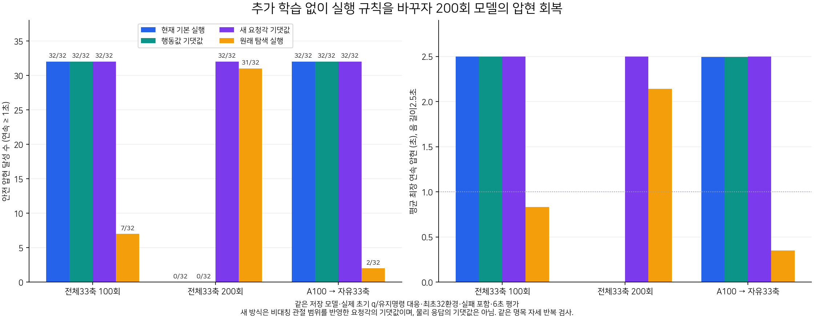
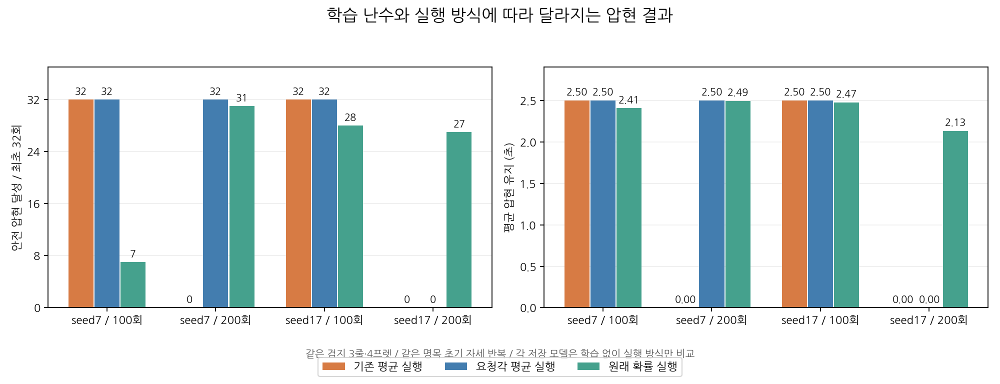
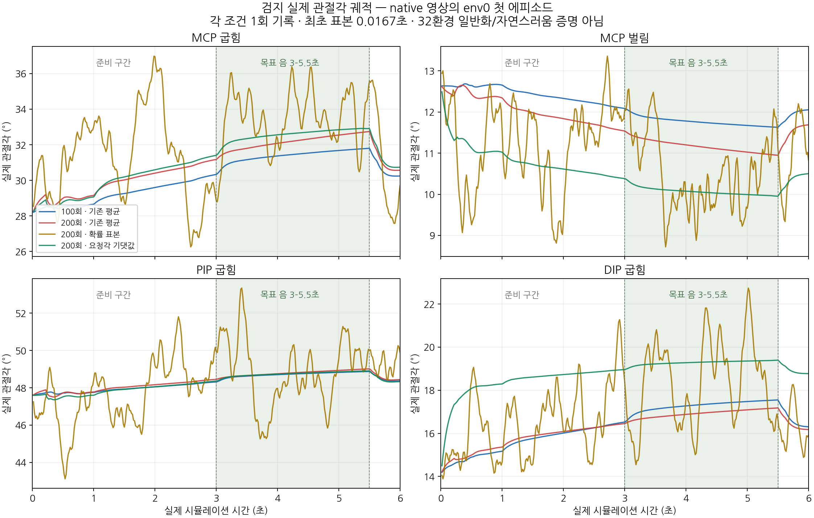

# 7시간 추가 압현 연구 보고서

상태: 실험·분석·개선 도구 구현·최종 독립 검수 완료. 최종 갱신: 2026-10-31T10:17:16.104335+09:00. 실제 시작·종료 시각과 예산은 [실행 시간 기록](budget.json)에 남겼다.

## 현재 결론

검지·중지·약지·소지의 대표 목표에서 손가락을 굽혀 압현할 수 있음을 확인했다. 추가로, 전체 제어200회 모델이 기본 영상 실행에서는 실패해도 같은 저장 정책의 원래 Gaussian 확률 재생에서는 성공한다는 차이를 찾았다. 같은 가중치를 유지하고 **관절 요청각의 기댓값으로 실행하자0/32에서32/32로 회복**했다. 독립 seed17의200회 모델에서는 기존 실행·요청각 평균 모두0/32여서 이 개선이 모든 모델을 회복시키지는 않았다. 다른 손가락과 독립 난수·탐색 그룹의 후속 검증도 완료했으며 아래에 반례를 함께 기록했다.

이 결과는 별도 구조v2 연구 사본의 단일음 검사다. 원래557열 전곡 학습 전체를 재현한 결과나 전곡 성공률이 아니다. 생산 학습 기본값은 유지한다.

이번 연구 디렉토리 안에서 실제로 학습에 반영한 양은 총2,408업데이트·4,931,584전이다. 사전 검지A100의 학습량은 여기에 포함하지 않는다. 완료된100회 블록24개와2회 소규모 검사4개를 포함하며, 학습 없는 평가·배포 진단·영상은 별도다. [학습량 원장](training_budget_summary.json).

## 실행 규칙을 바꾼 핵심 대조

모두 같은 저장 모델, 같은 실제 초기105관절 q·유지명령, 같은 보상·물리에서 최초32에피소드를 비교했다. 실패를 분모에 포함한다. 기본 실행은 Gaussian latent 평균에 tanh를 적용한다. 행동값 기댓값은 E[tanh Z], 새 방식은 reference 기준 비대칭 관절 범위를 반영한 E[요청각]을 원래 행동값으로 역변환한다.

| 저장 모델 | 기본 실행 | 행동값 기댓값 | 요청각 기댓값 | 원래 Gaussian 표본 |
|---|---:|---:|---:|---:|
| 전체33축100회 | 32/32 | 32/32 | 32/32 | 7/32 |
| 전체33축200회 | 0/32 | 0/32 | **32/32** | 31/32 |
| 검지A100→자유33축 | 32/32 | 32/32 | 32/32 | 2/32 |

전체33축은 왼팔12축과 왼손21축이다. 전신의 모든 관절을 정책이 자유 제어한다는 뜻이 아니다. A100은 목표 손가락4축을 학습한 뒤 팔과 다른 손가락의 평균 명령을 유지한 채 자유33축으로 내보낸 모델이다. Gaussian 열에서는 내보낸33축 전체에 잡음이 들어가므로 A학습 당시 비활성 축의 잡음은 학습되지 않았다는 한계가 있다.

200회 모델의 새 실행은 총/최장 연속 압현2.5초, 오압현·누락·물리/손목 실패0이었다. 기존 기본 실행의 보상9항과 시점별8개 trace 배열은 새 도구의 기본 실행 모드에서도 정확히 재현됐다. 전체 검증과 원시 자료는 [실행 규칙 분석](EXPECTED_ANGLE_ANALYSIS.md)에 있다.

### 독립 학습 재현과 반례

같은 검지 목표에서 학습 난수만17로 바꿔 처음부터100+100회를 학습했다.100회는 기존 평균·요청각 평균 모두32/32, 원래 확률 실행28/32였다.200회는 기존 평균·요청각 평균 모두0/32, 확률 실행27/32였다. 두 학습 난수에서 기본 평균 실행이 나빠지는 현상은 반복됐지만, 요청각 평균이 회복시키는 효과는 seed7에서만 확인됐다. 따라서 이 도구를 모든 모델의 공통 해결책이나 전곡 기본값으로 채택하지 않는다. [독립 재현과 strict 재개 증거](SEED17_FULL33_ANALYSIS.md), [실제 관절 움직임](SEED17_MOVEMENT_ANALYSIS.md).

중지·약지·소지의 기존 A200 모델에서는 새로 대응한 기존 평균/요청각 평균의 여섯 평가가 모두32/32, 유지2.5초였다. 성공 모델의 성능을 유지한 제한된 회귀 검사이며 새 목표 일반화나 모든 모델의 무손상 보장은 아니다.

### 어느 관절의 탐색이 성공을 만드는가

추가 학습 없이 같은 full200 모델에서 선택한 관절 그룹만 원래 Gaussian으로 실행하고, 나머지 활성 관절은 기존 latent 평균으로 실행했다. 원래 활성33축의 난수 추출은 매번 동일하게 유지했다. 모든 관절을 탐색하는 기준 실행은 두 난수에서 원래 기록8개 배열과 초기q/hold를 정확히 재현했다.

| 탐색 그룹 | seed7 달성 | seed17 달성 |
|---|---:|---:|
| 원래 전체33축 | 31/32 | 27/32 |
| 목표 손가락4축만 | 32/32 | 16/32 |
| 왼팔12축만 | 24/32 | 10/32 |
| 나머지 손가락17축만 | 0/32 | 0/32 |

목표 손가락과 팔의 탐색이 각각 성공을 회복시키는 경로가 있었다. 하지만 목표 손가락만 탐색하면 항상 더 좋다는 결과는 아니며, seed17에서는 전체 탐색보다 낮았다. 나머지 손가락만으로는 회복되지 않았지만 다른 그룹과의 상호작용까지 불필요하다고 증명한 것은 아니다. 각기 다른 상태 궤적을 만드는 진단 개입이므로 기여 비율을 더하거나 단일 원인으로 분해하지 않는다. 새 학습·결정적 정책 개선의 성과로 세지 않는다. [그룹별 원시32·보상9항·실제 초기값·원본 재현 검증](GROUP_SAMPLING_ANALYSIS.md).

### 왜 평균 실행이 달라졌나

관절 명령은 준비 기준각에서 굽힘/펴짐 방향별로 남은 관절 범위를 사용한다. 손가락 시작 관절은 MCP, 중간은 PIP, 끝은 DIP로 표시한다. 예를 들어 초기 검지DIP 기준각은14.15도지만 허용 범위는−5~90도로 양방향 길이가 다르다. 대칭인 Gaussian 잡음도 물리 요청각에서는 같은 크기의 굽힘/펴짐이 아니다. 현재 초기 탐색 폭에서 이 관절의 요청각 평균은 기준보다약3.34도 더 굽는다.

학습은 이 분포와 평활화·속도 제한·물리를 경험하지만 기본 영상은 잡음을 제거한 latent 평균을 실행한다. 따라서 ‘학습 중 성공’과 ‘기본 영상에서 성공’이 달라질 수 있다. 같은 모델에서 단순 행동값 평균은 실패하고 요청각 평균은 성공했다는 개입 결과가 이번 조건의 실행 차이를 뒷받침한다. 새 방식은 물리 운동의 기댓값을 계산한 것이 아니며 모든 환경에 보편적으로 더 낫다는 뜻도 아니다.

실제 env0 로그에서200회 모델의 DIP는 기본 실행16.92도, 확률 실행19.08도, 요청각 평균 실행19.27도였다. 새 실행은 실제DIP 시간 표준편차도약0.088도로 확률 실행의2.084도보다 작았다. 이는 한 환경의 구간 분석이며33축·관측·접촉 이력이 함께 달라지므로 DIP 하나의 효과로 환원할 수 없다. [관절 움직임과 요청/적용/실제각 분석](FULL33_MOVEMENT_ANALYSIS.md), [각도 변환의 CPU 감사](FINGER_NOISE_CODEC_AUDIT.md).

## 손가락별 압현 학습

| 손가락 | 물리 줄/프렛 | 학습 | A평가100/200회 | 자유33축 평균 평가 |
|---|---|---|---|---|
| 검지 | 3/4 | 이전A100 재현, 새seed17 A100/200 | 기존32/32, 새seed17 각32/32 | 기존A100 32/32 |
| 중지 | 3/6 | A100+100 | 각32/32 | 32/32 |
| 약지 | 2/7 | A100+100 | 각32/32 | 32/32 |
| 소지 | 3/9 | A100+100 | 각32/32 | 32/32 |

A는 팔을 계산된 정렬 자세에 유지하며 목표 손가락4축을 학습한다. 자유 실행에서도 평균 팔 명령은 학습 전 계산한 고정 IK bias였다. 따라서 현행 기하·접촉하중 기준의 손가락 압현 능력은 확인했지만 손목 정렬을 학습했다고 설명하지 않는다. C50→C75→C100 학습·승급 검사는 이번 연구에서 실행하지 않고 지원 제거 진단과 원인 대조로 대체했다. 네 모델은 별도 학습 모델이며 한 모델이 네 목표를 모두 수행한 결과가 아니다. A는 정렬된 시작 자세에서4축을 학습하고 full33은 원래v9 자세에서33축을 학습하므로, 두 절차의 차이를 순서 학습 하나의 단독 효과로 해석하지 않는다. 손가락마다 목표도 달라 난이도 차이를 손가락 자체의 차이로 해석하지 않는다.

네 손가락 실제 정책 영상（대표 영상 정리로 삭제）. 원본 손·전신 영상과 모델/SHA는 [선택 모델 목록](SELECTED_MODELS.md)에 있다.

### 성공 회복과 손가락 협응은 구분한다

최초32개 에피소드에서 검지MCP/PIP 실제 이동폭은 A100free 약25.99/21.47도, 원래full100 약3.61/1.27도, 새 요청각full200 약4.70/1.53도였다. 새 실행도 시작·중간 관절의 움직임은 작다. 따라서 압현 성공 회복을 자연스러운 손가락 협응의 완성으로 표현하지 않는다. 큰 진폭 자체가 자연스러움의 기준도 아니며 A 준비 구간의 펴짐도 범위에 포함된다. 세 조건에서 왼손21축의 관측된 관절 한계 점유는0이었지만 충돌·해부학적 자연스러움을 인증하는 지표는 아니다.

위 그림은 native 영상 env0의 각1회이며32환경 평균이 아니다. 요청각 평균도 중간 관절 움직임이 작고, 확률 실행의 큰 진폭 자체를 자연스러움으로 해석하지 않는다.

## 그 밖의 단일 요인 비교와 채택 판단

| 실험 | 확인한 결과 | 판단 |
|---|---|---|
| 검지 B 목표4축 탐색0.1배 | B100 유지1.889→2.373초, 학습전B0는2.434초 | 학습 손상 감소. B0 대체 보류 |
| 소지 B 목표4축 탐색0.1배 | B100 21/32→30/32, B0도30/32 | 학습 손상 감소. B0 대체 보류 |
| full33 fresh 목표4축 탐색0.1배·seed7 | 최종200회0/32→14/32, 원래 최고100회32/32; 축소조건100회는0/32 | 마지막 개선과 초기 학습 지연이 함께 있어 보류 |
| 같은 탐색 축소·독립seed17 | 100회는두조건32/32,200회는두조건0/32 | 탐색 축소만으로 실패 해결 불가 |
| 손가락 정책 함수 동결+팔 학습 | 유지2.313초로 단순0.1배의2.373초보다 낮음 | 보류 |
| B 압현 단계 팔 제한만 제거 | 소지B0/B100 성공·유지 동일, 검지 유지 약0.002/0.008초 증가 | 공통 원인·개선으로 채택 보류 |
| B 지원 유지+요청각 평균 | 검지 성공32/32 동일·유지 차이+0.0047/−0.0010초, 소지30/21 성공 동일 | B 실패 해결 근거 없음 |
| 초기 팔 IK 출력 bias만 제거 | 100/200회 평균0/32, 학습 물리실패314/706·303/706 | 정렬 시작·초기 제어 도움 필요. 제거안 보류 |

탐색0.1배 비교는 같은 초기 전체 가중치와 난수 상태, 같은 전이수와 학습률 조절 규칙을 확인했다. 탐색량이 KL재시도에 영향을 주므로 실제 학습률 경로까지 같은 것은 아니다. no-IK 비교는 초기 팔 bias만 제거했고 목표 관측·초기 자세 자체를 제거한 것이 아니다.

학습 중 변화하는 확률 정책과 마지막 고정 정책을 구분했다. 소지 B의 학습 중 안전 성공은96/513→490/512, full33 fresh0.1은100/200블록164/512→373/512였다. 이를 고정 평균 정책의 성공률로 대체하지 않는다.

세부: [검지 탐색 비교](VARIANCE_COMPARISON.md), [소지 탐색 비교](PINKY_VARIANCE_ANALYSIS.md), [fresh 전축 비교](FRESH_VARIANCE_ANALYSIS.md), [탐색 축소 독립 재현](FRESH_VARIANCE_SEED17_ANALYSIS.md), [함수 보존](ARM_REFINEMENT_ANALYSIS.md), [초기 팔 bias 제거](NO_ALIGNMENT_PRIOR_ANALYSIS.md), [B 팔 제한 제거](UNCLAMPED_B_ANALYSIS.md), [B 요청각 실행](EXPECTED_B_ANALYSIS.md).

## 보상과 최적화 점검

보상9항과 성공 조건은 완화하지 않았다. 접근 보상은gamma×다음potential−이전potential이므로 비할인 단순 합만으로 ‘머무르면 손해’라고 판단할 수 없다. 실제 gamma0.99 할인합에서 성공 정책은약0.180, 무압현 정책은0.036이었다. 이번 결과만으로 보상 회피가 주원인이라는 증거는 없다. [시점별 할인 보상 감사](DISCOUNTED_REWARD_ANALYSIS.md).

낮은 학습률이나 시간에 따른 탐색 붕괴도 이번601열 연구의 공통 실패 원인은 아니었다. 원래full33의100/200블록은 학습률 하한에 머무르지 않았고 entropy변화도 작았다. 기울기clipping은 빈번했으나 수행이 좋은0.1조건에서도 더 큰 norm이 관측돼 단독 원인으로 단정하지 않았다. [최적화 감사](OPTIMIZER_AUDIT.md). 이는 과거557열 장시간 학습의 모든 원인을 부정하는 결과가 아니다.

## 구현한 개선과 사용 범위

- 기대 요청각 계산·기존 실행/행동 평균 대조: expected_angle_probe.py. 저장 Gaussian과 가중치는 유지하고 실행 명령 규칙을 명시한다. GH64적분과 절댓값 kink 보정, 포화 경계 action/latent/logp 일치, 비활성 축 보존을 CPU검사8개와 별도 검수 후 native실행했다.
- 실행 방식별 실제 손·전신 영상: render_deployment.py. 기존 네이티브 renderer를 재사용하고 원래Gaussian/요청각평균 등의 방식을 결과에 정확히 표시한다. CPU4검사·별도 검수 후 네 조건의 실제 손/전신 영상8개를 생성했고, native/public SHA·각6초180프레임을 확인했다.
- 탐색 비교는 새로운 정책 schema와 봉인 사본에 격리했다. 초기모델/RNG, 엄격 재개 model·두Adam·전체RNG, 원시 에피소드·보상9항·실제 초기q/hold와 입력SHA를 확인했다.

검사 기록: 추가 도구의 CPU 회귀52개를 파일별 새 Python 프로세스에서 통과했다. 이후 B 요청각4개·seed17 실제 경로 핀3개·그룹 표본 진단4개를 추가로 통과해 관련 회귀는 총63개다. 처음 합동 실행은 서로 다른 봉인 runtime의 Python 모듈 캐시가 섞여1개가 실패했고, 원래 실패 로그를 보존한 뒤 해당runtime별 분리 실행으로 확인했다. 원시 로그는 cpu_regression_final.log와 cpu_regression_isolated.log, 파일별검사수/종료코드/소스SHA는 cpu_regression_isolated.json에 있다. 최초 격리 실행의 검사수 요약 정규식 오류도 원시검사를 반복하지 않고 로그에서 재집계해 별도 기록했다. 봉인 실행코드와 테스트 소스의 SHA를 그대로 유지했다.

추가 seed17 실행기의 첫 시도는 저장 경로의 입력 핀 준비에서 실패했고 학습 전이는0이었다. 원본 실패 자료를 보존하고, 기존 허용 경로 안에 새v2 실행기·출력을 둔 뒤 실제 settings/계보 경로 검사를 추가해 정상 학습을 완료했다. 기존 봉인·실패 기준은 완화하지 않았다.

원본 runtime3148파일과 기존 체크포인트는 보존했다. 이 보고서의 개선은 검증된 연구 실행 도구에 구현했으며, 제한된 단일음 검증만으로 생산의 전곡 기본값을 일괄 교체하지 않았다.

### 전곡 코드 통합 조건

현재 메인557열에서도 같은39축 요청각 수학을 공유할 수 있다. 기존 공통 평가 wrapper와 평가·렌더 진입점의3파일에 선택 옵션을 추가하는 최소안을 확인했다. 다만 기존 활성 소스를 바꾸면 과거 체크포인트의 엄격한 입력SHA 검증이 실패한다. 이번601열 모델을557열 모델로 직접 불러올 수도 없다.

이번 연구에서 관측된 작은 탐색 폭은 추가 GH64/128/256 수렴 점검을 통과했다. 메인 코드가 허용하는 큰 표준편차까지 같은 정확도를 검증한 것은 아니다. 따라서 생산 기본값은 유지하고, 해당557모델의 실제 분포·새 버전 체크포인트·전곡 목표·실행 비용 검증을 다음 통합 조건으로 정했다. [메인 통합 계획](MAIN_INTEGRATION_PLAN.md), [수치 수렴 점검](expected_angle_quadrature_range.json).

## 실제 영상

아래 네 조건은 각 환경0의 한 번 재생이다. 위32환경 평가와 분모가 다르다. 200회 세 조건은 같은 체크포인트를 사용했다. 영상은 native camera에서30fps로 기록한 실제6초이며 정책은60Hz, 물리는240Hz다.

| 조건 | 영상 한 회 압현 유지 비율 | 손 | 전신 |
|---|---:|---|---|
| full100 기존 평균 | 100% | [손](renders/full100_latent_mean/hand.mp4) | [전신](renders/full100_latent_mean/fullbody.mp4) |
| full200 기존 평균 | 0% | [손](../../../../../압현실험/동영상/08_전체33축_검지200회_평균동작실패_seed7_손확대.mp4) | [전신](../../../../../압현실험/동영상/08_전체33축_검지200회_평균동작실패_seed7_전신.mp4) |
| full200 원래 확률 실행 | 99.67% | [손](../../../../../압현실험/동영상/09_전체33축_검지200회_탐색포함대표실행_seed7_손확대.mp4) | [전신](../../../../../압현실험/동영상/09_전체33축_검지200회_탐색포함대표실행_seed7_전신.mp4) |
| full200 요청각 평균 | 100% | [손](../../../../video/seven_hour_v1/full200_requested_angle_mean_hand.mp4) | [전신](../../../../video/seven_hour_v1/full200_requested_angle_mean_fullbody.mp4) |

원래 네 손가락의 손/전신8개와 모음1개를 포함해 공개 MP4는17개다. 원본 capture_metadata에 남은 고정 평균 실행 템플릿 문구는 확률·요청각 모드에서 오래된 설명이다. 실제 소스 분기와 완료 보고서/공개목록의 실행 방식을 기준으로 구분했으며 원본은 보존했다. [영상·모델·출처 목록](SELECTED_MODELS.md), [영상 QA](NATIVE_VIDEO_QA.md).

## 다음 개선 순서

1. 실제 사용할 실행 방식의 평가로 최고 체크포인트를 고른다. 마지막 모델·학습 보상·확률 성공을 기본 평균 재생의 성공으로 대신하지 않는다. 이번에는 체크포인트와 실행 방식을 함께 보존한 선택 목록을 구현했다.
2. 탐색 폭은 한 번의 성공으로 정하지 않고 독립 난수에서 확인한다. 요청각 평균은 비교 도구로 남기고 공통 해결책으로 자동 적용하지 않는다. 탐색0.1배도 seed17 마지막 모델의 실패를 해결하지 못했으므로 일괄 채택하지 않는다. 팔 탐색 제거도 공통 해결이 아니었다.
3. 자연스러움은 별도로 확인한다. 성공 A모델의 실제 손가락 굽힘 궤적을 출발점으로 사용하고, 줄/프렛과 초기 손목 오차를 한 요인씩 확장한다. 관절별 실제각·요청각·적용각·접촉 전후를 비교하며, 사용자가 제거한 손가락 움직임 비용을 다시 넣지 않는다.
4. 엄지 넥 뒤 지지와 전곡 전환은 단일음 압현과 분리해 검증한다. 현재 성공 proxy만으로 엄지 지지·실제 줄 하중·음향 품질까지 해결됐다고 판단하지 않는다.

## 완료 범위와 남은 한계

독립seed17의 전체33축100+100학습, 다른3손가락 실행 회귀, B 팔 제한·요청각 비교, 실제 추가 영상, 탐색 축소의 독립seed17 재현을 모두 완료했다. 고정 모델의 탐색을 손가락·팔·다른 손가락으로 나눈 마지막8조건 진단도 완료했고 두 난수 모두 검증을 통과했다. 실제 완료 여부는 [진행 상태](progress.json)와 각 분석 문서의gate를 따른다.

평가32환경의 free-v9 초기 q/유지명령은 동일 명목 자세 반복이다. 서로 다른32자세·새 줄/프렛 일반화가 아니다. body/root 전체 초기 상태의 bitwise대응도 q/hold만으로 주장하지 않는다. 성공은 GPU 패드 표면 기하와 distal body접촉하중proxy이며 줄별 실제 힘이나 음향 품질을 직접 검증한 결과가 아니다.

엄지의 넥 뒤 지지와 전곡 전환은 해결됐다고 볼 수 없다. 이번 A영상의 엄지 rear접촉은 달성되지 않았고, 사용하지 않는 손가락의 자유로운 전곡 전환이나 시작시각을 바꾼 반응성도 미검증이다. 자연스러움은 성공률과 별도로 실제 관절 분담·영상으로 판단해야 한다. [시간 일반화 후속 검증 계획](TEMPORAL_GENERALIZATION_PLAN.md).
