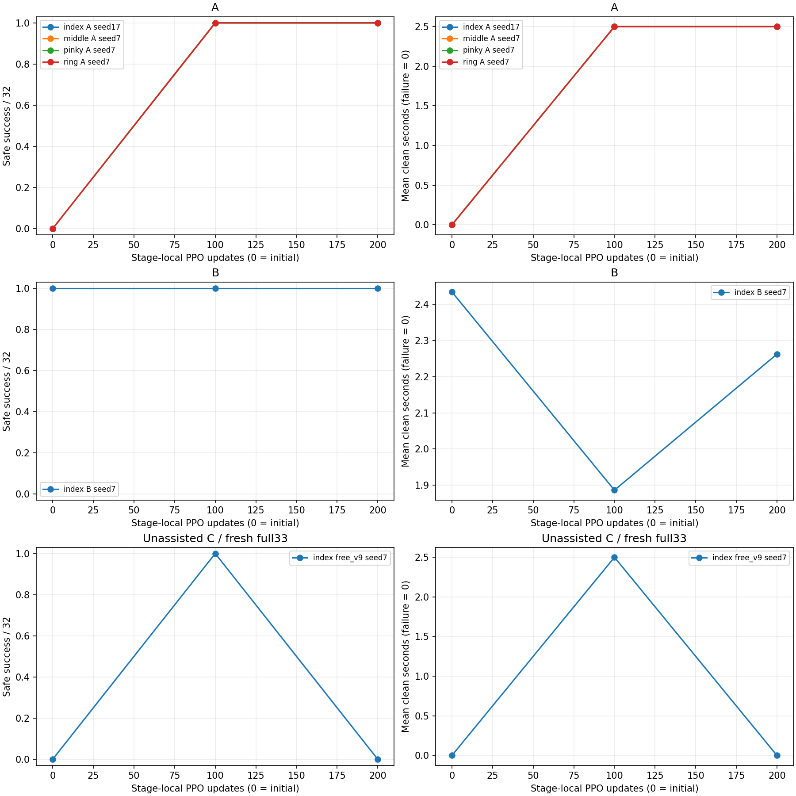
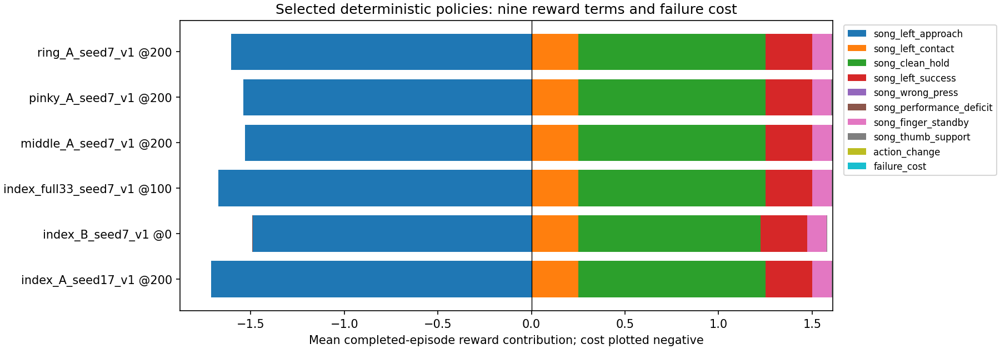

# 7시간 압현 연구 집계

갱신 UTC: 2026-10-30T22:00:33.637393+00:00

연구 상태: 진행 중. 아래 수치는 완료된 블록만 포함한다.

손가락마다 목표 줄·프렛이 다르므로 손가락 자체의 난이도 차이로 해석하면 안 된다. A/B는 정렬·지원 조건 평가이고 C는 도움 없는 원래 v9 평가다. 두 분포의 성공률을 합산하지 않는다.

large·64환경·H32·정책60Hz·물리240Hz. 블록당100회는204,800개 제어 전이이다. 초기 평가(0회), 이전 단계 source, 갱신 모델 평가를 구분한다. seed는 아래 표에 표시한다. 고정 정책 평가는 환경별 첫 에피소드32개이며 실패도 분모에 포함한다.

|실험|목표(줄/프렛)|조건|seed|역할/갱신|안전 달성|실패|clean 평균, 실패0점(s)|상태|
|---|---|---|--:|---|--:|--:|--:|---|
|index_A_seed17_v1|3/4|supported A|17|initial / 0|0/32|0|0.0000|passed|
|index_A_seed17_v1|3/4|supported A|17|block / 100|32/32|0|2.5000|passed|
|index_A_seed17_v1|3/4|supported A|17|block / 200|32/32|0|2.5000|passed|
|index_B_seed7_v1|3/4|supported B|7|initial / 0|32/32|0|2.4345|passed|
|index_B_seed7_v1|3/4|supported B|7|block / 100|32/32|0|1.8861|passed|
|index_B_seed7_v1|3/4|supported B|7|block / 200|32/32|0|2.2625|passed|

이전 단계 source (`index_B_seed7_v1`): `/home/ajou/yigyu/3/docs/2026-11-02/압현성공/experiments/structured_press_v2/runs/index_s3_f4_A_v1/train_100/J/final.pt` (SHA 유지: True). source의 과거 점수는 이번 초기 평가와 동일시하지 않는다.

|index_full33_seed7_v1|3/4|free v9, unassisted|7|initial / 0|0/32|0|0.0000|completed_comparison_not_stage_promotion|
|index_full33_seed7_v1|3/4|free v9, unassisted|7|block / 100|32/32|0|2.5000|completed_comparison_not_stage_promotion|
|index_full33_seed7_v1|3/4|free v9, unassisted|7|block / 200|0/32|0|0.0000|completed_comparison_not_stage_promotion|
|middle_A_seed7_v1|3/6|supported A|7|initial / 0|0/32|0|0.0000|passed|
|middle_A_seed7_v1|3/6|supported A|7|block / 100|32/32|0|2.5000|passed|
|middle_A_seed7_v1|3/6|supported A|7|block / 200|32/32|0|2.5000|passed|
|pinky_A_seed7_v1|3/9|supported A|7|initial / 0|0/32|0|0.0000|passed|
|pinky_A_seed7_v1|3/9|supported A|7|block / 100|32/32|0|2.5000|passed|
|pinky_A_seed7_v1|3/9|supported A|7|block / 200|32/32|0|2.5000|passed|
|ring_A_seed7_v1|2/7|supported A|7|initial / 0|0/32|0|0.0000|passed|
|ring_A_seed7_v1|2/7|supported A|7|block / 100|32/32|0|2.5000|passed|
|ring_A_seed7_v1|2/7|supported A|7|block / 200|32/32|0|2.5000|passed|

기존 검지 A100 재현 확인: 안전 달성 32/32, 실패 0, clean 평균(실패0점) 2.4401초. 이번 신규 단계 학습과 별도 기록이다.

## 선택 모델의 보상과 제어

선택 순서는 안전 달성 → 실패를0점 처리한 clean 평균 → 실패가 적음 → 최신이다. 아래 보상은 선택 모델의 결정적 평가 에피소드 평균이다. 실패 비용은 보상9항과 별도이며 비용 가중치는1이다.

### index_A_seed17_v1

선택: `/home/ajou/yigyu/3/docs/2026-11-02/압현성공/experiments/structured_press_v2/runs/seven_hour_v1/index_A_seed17_v1/200/train/J/final.pt` (block, 200회)

|보상항|에피소드 평균|
|---|--:|
|목표 패드 접근|-1.710780|
|최초 접촉|0.250000|
|압현 유지|0.999999|
|압현 달성|0.250000|
|오압현|0.000000|
|음 수행 부족|0.000000|
|대기 자세|0.102581|
|엄지 안내|0.004577|
|행동 변화|0.000000|
|실패 비용(별도)|0.000000|
|보상 합계|-0.103623|
|보상−비용|-0.103623|

비용 세부: `{"termination_base": 0.0, "termination_remaining_time": 0.0, "termination_remaining_negative_note_budget": 0.0, "running_physics": 0.0}`.

단계 체류 평균(손목 이동 / 정렬 / 압현): [0.0786, 0.0, 5.9214]초. 진입 차단 평균(손목 / 접선 / 높이 / 법선): [0.0, 0.0, 5.95, 0.0]초. 차단 항목은 서로 겹칠 수 있으며 압현 단계 유지 이후에도 readiness 위반 시간이 기록될 수 있다.

|목표 손가락 관절|실제 범위 평균(°)|제어 목표 범위 평균(°)|실제 한계 체류(%)|목표 한계 체류(%)|추종 RMS 평균(°)|
|---|--:|--:|--:|--:|--:|
|LH:index1_x|5.892|5.705|0.000|0.000|0.557|
|LH:index1_z|19.183|21.288|0.000|0.000|2.759|
|LH:index2|5.305|5.424|0.000|0.000|0.524|
|LH:index3|1.740|1.694|0.000|0.000|0.149|

위 범위·한계·추종은60Hz 에피소드 요약의 동일 가중 평균이다. 제어 목표 범위는 속도 제한을 거친 target이며 원요청 범위와 동일시하지 않는다. 240Hz 원요청/적용 추종 및 속도 제한 gap RMS의 손가락 평균: `{"requested_tracking_error_rad_rms": 0.020198446195936002, "applied_tracking_error_rad_rms": 0.017919873987241156, "rate_limit_gap_rad_rms": 0.005629613241956732}` (rad). RMS는 관절별 RMS의 산술 평균을 다시 에피소드 평균한 값이다. native position-drive의 제출 토크0을 힘 부족으로 해석하지 않는다.

해당 학습 블록의 확률적 정책 완료 에피소드: 512회, 안전 달성 10회, 실패 0회. 완료 에피소드에 속한 제어 전이 184320개 / 계획 블록 전이 204800개. 미종료 rollout은 에피소드 평균에서 제외하며, 학습 중 변하는 정책이므로 고정 모델 평가 성공률과 직접 혼합하지 않는다.

### index_B_seed7_v1

선택: `/home/ajou/yigyu/3/docs/2026-11-02/압현성공/experiments/structured_press_v2/runs/seven_hour_v1/index_B_seed7_v1/100/train/J/initial.pt` (initial, 0회)

|보상항|에피소드 평균|
|---|--:|
|목표 패드 접근|-1.488099|
|최초 접촉|0.250000|
|압현 유지|0.973801|
|압현 달성|0.250000|
|오압현|0.000000|
|음 수행 부족|-0.002536|
|대기 자세|0.102676|
|엄지 안내|0.003987|
|행동 변화|-0.000001|
|실패 비용(별도)|0.000000|
|보상 합계|0.089830|
|보상−비용|0.089830|

비용 세부: `{"termination_base": 0.0, "termination_remaining_time": 0.0, "termination_remaining_negative_note_budget": 0.0, "running_physics": 0.0}`.

단계 체류 평균(손목 이동 / 정렬 / 압현): [0.0833, 0.475, 5.4417]초. 진입 차단 평균(손목 / 접선 / 높이 / 법선): [0.0, 0.0818, 2.5849, 0.0]초. 차단 항목은 서로 겹칠 수 있으며 압현 단계 유지 이후에도 readiness 위반 시간이 기록될 수 있다.

|목표 손가락 관절|실제 범위 평균(°)|제어 목표 범위 평균(°)|실제 한계 체류(%)|목표 한계 체류(%)|추종 RMS 평균(°)|
|---|--:|--:|--:|--:|--:|
|LH:index1_x|26.153|28.096|0.000|0.000|2.149|
|LH:index1_z|1.771|2.465|0.000|0.000|0.377|
|LH:index2|21.485|22.306|0.000|0.000|1.642|
|LH:index3|5.641|5.583|0.000|0.000|0.576|

위 범위·한계·추종은60Hz 에피소드 요약의 동일 가중 평균이다. 제어 목표 범위는 속도 제한을 거친 target이며 원요청 범위와 동일시하지 않는다. 240Hz 원요청/적용 추종 및 속도 제한 gap RMS의 손가락 평균: `{"requested_tracking_error_rad_rms": 0.023731738372928513, "applied_tracking_error_rad_rms": 0.02164022312288863, "rate_limit_gap_rad_rms": 0.005343705734291034}` (rad). RMS는 관절별 RMS의 산술 평균을 다시 에피소드 평균한 값이다. native position-drive의 제출 토크0을 힘 부족으로 해석하지 않는다.

### index_full33_seed7_v1

선택: `/home/ajou/yigyu/3/docs/2026-11-02/압현성공/experiments/structured_press_v2/runs/seven_hour_v1/index_full33_seed7_v1/100/train/J/final.pt` (block, 100회)

|보상항|에피소드 평균|
|---|--:|
|목표 패드 접근|-1.673309|
|최초 접촉|0.250000|
|압현 유지|0.999999|
|압현 달성|0.250000|
|오압현|0.000000|
|음 수행 부족|0.000000|
|대기 자세|0.102556|
|엄지 안내|0.003994|
|행동 변화|-0.000005|
|실패 비용(별도)|0.000000|
|보상 합계|-0.066764|
|보상−비용|-0.066764|

비용 세부: `{"termination_base": 0.0, "termination_remaining_time": 0.0, "termination_remaining_negative_note_budget": 0.0, "running_physics": 0.0}`.

단계 체류 평균(손목 이동 / 정렬 / 압현): [0.2, 0.15, 5.65]초. 진입 차단 평균(손목 / 접선 / 높이 / 법선): [0.1833, 0.15, 5.9334, 0.0]초. 차단 항목은 서로 겹칠 수 있으며 압현 단계 유지 이후에도 readiness 위반 시간이 기록될 수 있다.

|목표 손가락 관절|실제 범위 평균(°)|제어 목표 범위 평균(°)|실제 한계 체류(%)|목표 한계 체류(%)|추종 RMS 평균(°)|
|---|--:|--:|--:|--:|--:|
|LH:index1_x|3.605|4.999|0.000|0.000|1.016|
|LH:index1_z|1.057|1.122|0.000|0.000|0.123|
|LH:index2|1.272|1.915|0.000|0.000|0.478|
|LH:index3|3.398|3.623|0.000|0.000|0.232|

위 범위·한계·추종은60Hz 에피소드 요약의 동일 가중 평균이다. 제어 목표 범위는 속도 제한을 거친 target이며 원요청 범위와 동일시하지 않는다. 240Hz 원요청/적용 추종 및 속도 제한 gap RMS의 손가락 평균: `{"requested_tracking_error_rad_rms": 0.008118633573913495, "applied_tracking_error_rad_rms": 0.008118633573913495, "rate_limit_gap_rad_rms": 0.0}` (rad). RMS는 관절별 RMS의 산술 평균을 다시 에피소드 평균한 값이다. native position-drive의 제출 토크0을 힘 부족으로 해석하지 않는다.

해당 학습 블록의 확률적 정책 완료 에피소드: 512회, 안전 달성 4회, 실패 0회. 완료 에피소드에 속한 제어 전이 184320개 / 계획 블록 전이 204800개. 미종료 rollout은 에피소드 평균에서 제외하며, 학습 중 변하는 정책이므로 고정 모델 평가 성공률과 직접 혼합하지 않는다.

### middle_A_seed7_v1

선택: `/home/ajou/yigyu/3/docs/2026-11-02/압현성공/experiments/structured_press_v2/runs/seven_hour_v1/middle_A_seed7_v1/200/train/J/final.pt` (block, 200회)

|보상항|에피소드 평균|
|---|--:|
|목표 패드 접근|-1.528838|
|최초 접촉|0.250000|
|압현 유지|0.999999|
|압현 달성|0.250000|
|오압현|0.000000|
|음 수행 부족|0.000000|
|대기 자세|0.103305|
|엄지 안내|0.006813|
|행동 변화|0.000000|
|실패 비용(별도)|0.000000|
|보상 합계|0.081280|
|보상−비용|0.081280|

비용 세부: `{"termination_base": 0.0, "termination_remaining_time": 0.0, "termination_remaining_negative_note_budget": 0.0, "running_physics": 0.0}`.

단계 체류 평균(손목 이동 / 정렬 / 압현): [0.0833, 2.6167, 3.3]초. 진입 차단 평균(손목 / 접선 / 높이 / 법선): [0.0, 2.3635, 5.788, 0.0]초. 차단 항목은 서로 겹칠 수 있으며 압현 단계 유지 이후에도 readiness 위반 시간이 기록될 수 있다.

|목표 손가락 관절|실제 범위 평균(°)|제어 목표 범위 평균(°)|실제 한계 체류(%)|목표 한계 체류(%)|추종 RMS 평균(°)|
|---|--:|--:|--:|--:|--:|
|LH:middle1_x|45.724|48.495|0.000|0.000|4.020|
|LH:middle1_z|5.390|7.063|0.000|0.000|1.254|
|LH:middle2|39.545|40.394|0.000|0.000|3.352|
|LH:middle3|2.067|2.068|0.000|0.000|0.160|

위 범위·한계·추종은60Hz 에피소드 요약의 동일 가중 평균이다. 제어 목표 범위는 속도 제한을 거친 target이며 원요청 범위와 동일시하지 않는다. 240Hz 원요청/적용 추종 및 속도 제한 gap RMS의 손가락 평균: `{"requested_tracking_error_rad_rms": 0.04665836396795459, "applied_tracking_error_rad_rms": 0.04000822318596775, "rate_limit_gap_rad_rms": 0.01522860240750918}` (rad). RMS는 관절별 RMS의 산술 평균을 다시 에피소드 평균한 값이다. native position-drive의 제출 토크0을 힘 부족으로 해석하지 않는다.

해당 학습 블록의 확률적 정책 완료 에피소드: 513회, 안전 달성 142회, 실패 1회. 완료 에피소드에 속한 제어 전이 184510개 / 계획 블록 전이 204800개. 미종료 rollout은 에피소드 평균에서 제외하며, 학습 중 변하는 정책이므로 고정 모델 평가 성공률과 직접 혼합하지 않는다.

### pinky_A_seed7_v1

선택: `/home/ajou/yigyu/3/docs/2026-11-02/압현성공/experiments/structured_press_v2/runs/seven_hour_v1/pinky_A_seed7_v1/200/train/J/final.pt` (block, 200회)

|보상항|에피소드 평균|
|---|--:|
|목표 패드 접근|-1.538802|
|최초 접촉|0.250000|
|압현 유지|0.999999|
|압현 달성|0.250000|
|오압현|0.000000|
|음 수행 부족|0.000000|
|대기 자세|0.102109|
|엄지 안내|0.007152|
|행동 변화|0.000000|
|실패 비용(별도)|0.000000|
|보상 합계|0.070458|
|보상−비용|0.070458|

비용 세부: `{"termination_base": 0.0, "termination_remaining_time": 0.0, "termination_remaining_negative_note_budget": 0.0, "running_physics": 0.0}`.

단계 체류 평균(손목 이동 / 정렬 / 압현): [0.0667, 0.0, 5.9334]초. 진입 차단 평균(손목 / 접선 / 높이 / 법선): [0.0, 0.0, 3.4328, 0.0]초. 차단 항목은 서로 겹칠 수 있으며 압현 단계 유지 이후에도 readiness 위반 시간이 기록될 수 있다.

|목표 손가락 관절|실제 범위 평균(°)|제어 목표 범위 평균(°)|실제 한계 체류(%)|목표 한계 체류(%)|추종 RMS 평균(°)|
|---|--:|--:|--:|--:|--:|
|LH:pinky1_x|8.565|9.225|0.000|0.000|0.868|
|LH:pinky1_z|4.402|4.255|0.000|0.000|0.397|
|LH:pinky2|16.111|16.479|0.000|0.000|1.321|
|LH:pinky3|15.709|15.864|0.000|0.000|1.302|

위 범위·한계·추종은60Hz 에피소드 요약의 동일 가중 평균이다. 제어 목표 범위는 속도 제한을 거친 target이며 원요청 범위와 동일시하지 않는다. 240Hz 원요청/적용 추종 및 속도 제한 gap RMS의 손가락 평균: `{"requested_tracking_error_rad_rms": 0.020711659463675067, "applied_tracking_error_rad_rms": 0.017735378363272037, "rate_limit_gap_rad_rms": 0.006220040887196639}` (rad). RMS는 관절별 RMS의 산술 평균을 다시 에피소드 평균한 값이다. native position-drive의 제출 토크0을 힘 부족으로 해석하지 않는다.

해당 학습 블록의 확률적 정책 완료 에피소드: 512회, 안전 달성 0회, 실패 0회. 완료 에피소드에 속한 제어 전이 184320개 / 계획 블록 전이 204800개. 미종료 rollout은 에피소드 평균에서 제외하며, 학습 중 변하는 정책이므로 고정 모델 평가 성공률과 직접 혼합하지 않는다.

### ring_A_seed7_v1

선택: `/home/ajou/yigyu/3/docs/2026-11-02/압현성공/experiments/structured_press_v2/runs/seven_hour_v1/ring_A_seed7_v1/200/train/J/final.pt` (block, 200회)

|보상항|에피소드 평균|
|---|--:|
|목표 패드 접근|-1.603719|
|최초 접촉|0.250000|
|압현 유지|0.999999|
|압현 달성|0.250000|
|오압현|0.000000|
|음 수행 부족|0.000000|
|대기 자세|0.103628|
|엄지 안내|0.004738|
|행동 변화|0.000000|
|실패 비용(별도)|0.000000|
|보상 합계|0.004646|
|보상−비용|0.004646|

비용 세부: `{"termination_base": 0.0, "termination_remaining_time": 0.0, "termination_remaining_negative_note_budget": 0.0, "running_physics": 0.0}`.

단계 체류 평균(손목 이동 / 정렬 / 압현): [2.5979, 0.0, 3.4021]초. 진입 차단 평균(손목 / 접선 / 높이 / 법선): [3.1755, 1.3031, 5.6547, 0.0]초. 차단 항목은 서로 겹칠 수 있으며 압현 단계 유지 이후에도 readiness 위반 시간이 기록될 수 있다.

|목표 손가락 관절|실제 범위 평균(°)|제어 목표 범위 평균(°)|실제 한계 체류(%)|목표 한계 체류(%)|추종 RMS 평균(°)|
|---|--:|--:|--:|--:|--:|
|LH:ring1_x|30.504|32.810|0.000|0.000|2.585|
|LH:ring1_z|5.484|7.019|0.000|0.000|1.136|
|LH:ring2|36.624|37.410|0.000|0.000|2.946|
|LH:ring3|10.128|10.294|0.000|0.000|0.766|

위 범위·한계·추종은60Hz 에피소드 요약의 동일 가중 평균이다. 제어 목표 범위는 속도 제한을 거친 target이며 원요청 범위와 동일시하지 않는다. 240Hz 원요청/적용 추종 및 속도 제한 gap RMS의 손가락 평균: `{"requested_tracking_error_rad_rms": 0.03992345689251103, "applied_tracking_error_rad_rms": 0.03386927579652316, "rate_limit_gap_rad_rms": 0.012949596993234412}` (rad). RMS는 관절별 RMS의 산술 평균을 다시 에피소드 평균한 값이다. native position-drive의 제출 토크0을 힘 부족으로 해석하지 않는다.

해당 학습 블록의 확률적 정책 완료 에피소드: 512회, 안전 달성 0회, 실패 0회. 완료 에피소드에 속한 제어 전이 184320개 / 계획 블록 전이 204800개. 미종료 rollout은 에피소드 평균에서 제외하며, 학습 중 변하는 정책이므로 고정 모델 평가 성공률과 직접 혼합하지 않는다.

## 해석 범위

접촉 성공은 현재 기하·합력 기반 후보 판정이다. 실제 현 압력이나 음향 성공, 자연스러움, 장기 수렴을 인증하지 않는다. 훈련과 결정적 평가, A/B 지원 조건과 C 자유 조건, seed별 결과는 각각 구분한다. 원시 보상9항·비용 세부·추종·단계 체류·완료 블록 전이 예산은 all_results.json에 기록했다.
