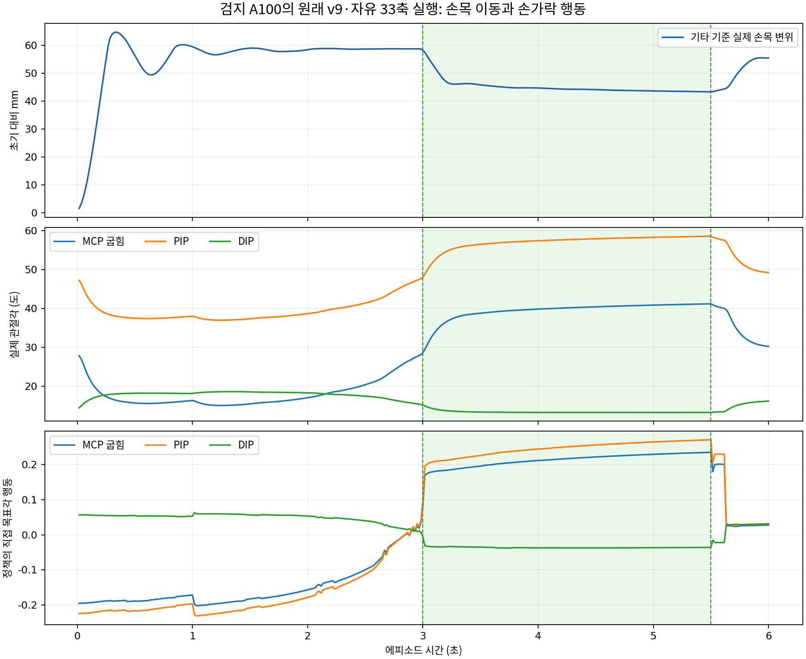

# 검지 A100 자유 실행의 손목·손가락 시간 분석

**손목을 먼저 운반한 뒤 음 시작에 맞춰 주로 MCP·PIP를 굽히는 동작이 관측되지만, 손목 이동 중 손가락 움직임을 차단하는 순차 제어는 아니다.** 손가락 목표는 상수가 아니며, 초기에는 손가락을 펴고 음 시작 전후에 다시 굽힌다. 이 한 영상만으로 정렬 완료를 인식해 다음 행동을 선택하는 순서 자체를 학습했다고 증명할 수는 없다.

분석 대상은 `renders/index_A100_free_v9`의 실제 env0 첫 에피소드다. 정책60Hz/물리240Hz, 6초/360개 실제 q·qd·목표각·body pose 표본과 같은 에피소드의 240Hz 손가락/접촉 로그 1,440개를 읽었다. 실제 재생이 성공한 렌더이며 압현 달성 1/1·clean 2.5초다. 새 GPU 실행이나 모델·환경 변경은 하지 않았다.

초록 구간은 목표 음의 3.0~5.5초다. 위 그래프는 기타 좌표계에서 초기 대비 실제 손목 위치 변화이며, 아래 두 그래프는 실제 손가락 각도와 정책 출력이다.

## 실제 진행

| 시점 | 관측한 동작 |
|---|---|
| 0초 | v9에서 시작. 검지 MCP 굽힘 28.19°, PIP 47.60°, DIP 14.15° |
| 0.033초 | 손목이 초기 대비 2mm 이상 이동 |
| 0.050초 | MCP·PIP도 이미 2° 이상 펴짐. 손목 운반과 손가락 움직임이 동시에 발생 |
| 0.233초 | 최종 손목 방향의 순변위 90%에 처음 도달. 정착 완료를 뜻하지 않으며 이후 overshoot·진동이 있음 |
| 준비 구간 | MCP 최소 15.09°, PIP 최소 37.00°. 즉 초기 대비 약 13.10°·10.60° 펴 두는 움직임 |
| 2.467 / 2.583초 | MCP / PIP가 준비 중 최소각보다 다시 5° 이상 굽혀짐 |
| 2.983초 | 해당 목표의 loaded candidate가 처음 로그에 나타남 |
| 3.004초 | clean 연속 유지가 처음 양수로 기록됨. 음 시작은 3.000초 |
| 3.100 / 3.117초 | MCP / PIP가 초기 v9보다 5° 이상 굽혀짐 |
| 4.000초 | 연속 1초 압현 달성 기록 |
| 5.500초 이후 | 목표가 끝나면서 MCP·PIP 굽힘이 감소해 풀어 주는 움직임 |

위 손가락 타이밍은 명시한 2°·5° 문턱의 관측 시점이며 정확한 생리적 움직임 시작 시각이 아니다. 손목 속도>5mm/s와 손가락 중 한 축의 속도>5°/s가 동시에 관측된 시간은 준비 3초 중 약 0.50초였다. 따라서 ‘손목이 완전히 멈추기 전에는 손가락이 움직이지 않는다’는 설명은 맞지 않는다.

## 손가락 목표는 상수인가?

아니다. 실제 정책 행동의 시간 범위는 MCP 굽힘 0.4374, MCP 벌림 0.0795, PIP 0.5025, DIP 0.1007이다. 직접 목표각의 정규화 행동이며 각도 단위가 아니다.

대표 실제 각도는 다음과 같다.

| 시간 | MCP 굽힘 | PIP | DIP |
|---|---:|---:|---:|
| 0.10초 | 22.31° | 42.52° | 16.46° |
| 0.50초 | 15.73° | 37.48° | 18.25° |
| 2.50초 | 20.42° | 41.40° | 17.49° |
| 3.00초 | 28.62° | 48.03° | 15.19° |
| 3.10초 | 33.71° | 52.33° | 14.19° |
| 4.00초 | 39.84° | 57.39° | 13.32° |
| 5.50초 | 41.18° | 58.55° | 13.32° |
| 6.00초 | 30.25° | 49.22° | 16.21° |

검지는 MCP·PIP를 크게 사용하고 DIP는 작은 보정·펴짐을 보인다. 마지막 관절만 접어 유지하는 동작으로 설명할 수 없다. 다만 자연스러운 사람의 손 모양 전체를 이 수치만으로 판정하지 않는다.

정책 구조는 관절·목표·시계·접촉 관측에 따라 다른 손가락 출력을 낼 수 있고, 실제 출력도 변했다. 그러나 단일 목표의 한 시계열에서는 시간 입력, 자세 변화, 접촉 변화가 함께 바뀐다. 이번 기록만으로 시계에 맞춘 패턴과 접촉 피드백의 인과 기여를 분리할 수 없다. ‘정렬을 인식해서 굽힘을 시작했다’고 확정하려면 시각/자세 오차를 독립적으로 바꾼 추가 평가가 필요하다.

## 팔 목표가 고정인데 손목이 또 움직이는 이유

팔 정책 행동 12축의 시간 범위는 모두 정확히 0이다. 미리 계산한 IK 정렬 bias를 같은 상수로 요청한다. 하지만 실제 적용 목표는 처음에 평활화·속도 제한으로 이동하고 실제 q도 유한 PD로 추종한다. 상수 요청은 실제 팔 상태를 고정한다는 뜻이 아니다.

첫 자세부터 마지막까지 실제 손목의 기타 상대 순변위는 55.45mm, 최대 초기 대비 변위는 64.74mm다. 특히 압현 중 3.0→5.5초 구간에서도 다음 움직임이 있었다.

- 손목의 월드 좌표 끝점 변화: **20.37mm**.
- 손목의 기타 좌표 끝점 변화: **21.14mm**.
- 기타 root의 월드 이동: **0.72mm**, 회전: **0.112°**.
- 팔 실제 관절은 이 구간에도 축별 약 **0.24~1.83°**의 이동폭을 보임.

따라서 압현 중 보이는 손 전체 이동을 기타만 움직인 결과로 설명할 수 없다. 팔·전신의 실제 상태가 유한 PD·접촉·동역학에서 움직인다. 반대로 정책이 손목 목표를 변경해서 이 20mm를 학습적으로 지시했다고 볼 수도 없다. 요청한 팔 행동은 변하지 않았다. 손가락 굽힘과 팔의 수동적/제어적 순응이 결합된 실행으로 기록하는 것이 정확하다. 힘의 인과 분담이나 실제 인간과의 유사성은 별도 분석이 필요하다.

## move→align→press 표시는 실제 제어 게이트인가?

이번 free_v9에서는 아니다. `StructuredPool.step`은 `stage != 'free_v9'`일 때만 A 팔 유지 또는 press 단계의 팔 보정 제한을 적용한다. 이 영상은 그 분기를 건너뛰고 전체 33축의 정책 평균 행동을 실행했다. 목표 손가락 네 축도 모든 구간에서 활성이다.

phase 관측과 latch 로그는 남는다. 이 에피소드의 move/align/press 누적 시간은 약 0.283/0.717/5.000초다. 하지만 press 표시는 실제 압현 시작 전에도 정렬 준비 조건만으로 켜질 수 있고, free_v9에서 이를 팔 잠금에 사용하지 않는다. 따라서 이 표시만으로 3단계 순서가 강제됐거나 학습됐다고 주장하면 안 된다.

지원 A에서도 목표 손가락 자체를 게이트로 막은 것이 아니다. A에서 학습한 손가락 행동이 원래 v9로 이전되어, 상수 IK 팔 운반과 동시에 준비 동작을 하고 음 시점에 압현한 결과다. 이번 영상은 그 실행이 가능함을 보여준다.

## 0.233초는 정착이나 정렬 완료 시각이 아니다

실제 목표의 손목 안내는 점이 아니라 고정 허용 영역이다. 이번 단일 목표의 전체 hand-position track이 같은 anchor·프렛 범위를 가지므로 완료 에피소드의 허용 상자 경계를 전체 6초에 동일하게 적용할 수 있음을 확인했다. 그 상자에서 가장 가까운 점까지의 실제 거리는 다음과 같다.

| 시간 | 안내 영역 밖 거리 |
|---|---:|
| 0.10초 | 5.21mm |
| 0.233초 | 0.70mm |
| 0.30초 | 10.46mm |
| 0.50초 | 6.37mm |
| 1.00초 | 9.42mm |
| 2.00초 | 8.97mm |
| 2.50초 | 9.10mm |
| 3.00초 | 8.53mm |
| 3.10초 | 0.66mm |
| 3.50~5.50초 | 0mm |

0.233초에는 순간적으로 안내 영역에 가까워졌지만 곧 overshoot했다. 준비 전체의 최대 이탈은 10.96mm였고, 60Hz 표본의 영역 내부 비율은 약 2.79%였다. 이 숫자는 물리 실패율이 아니며 현행 준비 유예·손목 종료 문턱과 구분한다. 특히 준비 후반 2→3초 손목의 끝점 변화/최대 변위는 약 0.67mm로 작지만, 그때도 상자 경계보다 약 9mm 밖에 머물렀다. 즉 ‘기하적으로 정확한 안내 정렬 완료’가 아니라 ‘허용 오차 근처에서 거의 정지’한 것이다. 음 구간 3~5.5초에는 표본의 약 95.36%가 안내 영역 내부였다.

압현 중 팔의 적용 목표와 실제 q 사이 오차도 증가했다. 팔 12축을 함께 계산한 RMS는 준비 중 0.248°에서 음 구간 0.784°로 증가했고 음 구간 최대 절대 오차는 1.94°였다. 같은 음 구간 검지의 적용 목표−실제각 RMS는 MCP 굽힘 2.26°, PIP 1.44°, DIP 0.27°였다. 입력 팔 행동이 상수여도 실제 상태를 고정하지 않는다는 근거다. 이것을 학습된 팔 보정으로 해석하지 않는다.

## 근거와 한계

- `renders/index_A100_free_v9/poses_env0000.npz`: 60Hz 실제 q105·qd105·적용 목표105·body106·행동39.
- 같은 디렉토리의 `scene/finger_control_trace.jsonl.gz`: env0/episode1의 240Hz candidate·clean·달성 시각.
- `episode_env0000.json`: 첫 에피소드 clean 2.5초, 달성1회, phase와 종료.
- `training_contract.json`·`settings.json`·봉인 실행 소스: free_v9의 지원 제외와 활성 축 확인.
- `timing_metrics.json`: 원자료 SHA, 좌표 변환, 문턱, 모든 수치와 표본.

기타 좌표 손목 위치는 원시 body pose에서 `inverse(guitar rotation)·(wrist−guitar root)`로 계산했고 마지막 값은 에피소드 공식 `wrist_G_m`와 일치했다. 렌더 보고서의 completed/policy_unchanged/native_pixels/source_pins_unchanged/source_checkpoint_pins_validated/lifecycle_verified는 모두 참이다. 모델 전용 free-v9 checkpoint SHA는 `7a279df3111c1ac70fd99ee373c28a08f3fe7fc7bc1c8218e984cdb80257ca32`다.

이 결과는 사전 지정 env0의 단일 목표·평균 행동이다. 여러 목표 일반화, 탐색 잡음이 있는 정책의 성공률, 원래 인간 압력·소리·자연스러움의 검증으로 확대하지 않는다.
