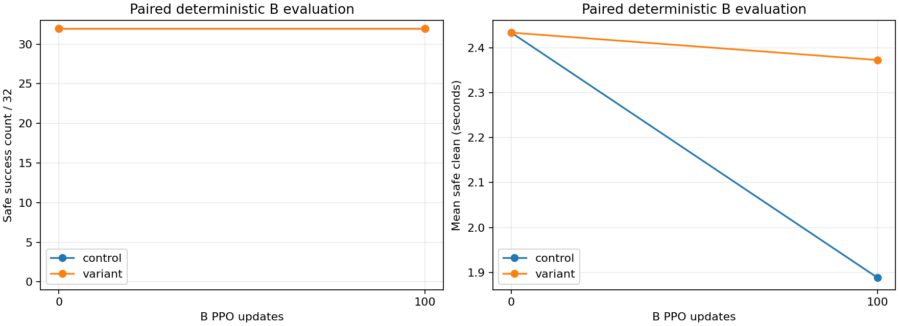

# 탐색 분산 축소 대응 비교

완료 입력만 집계한 시각: 2026-10-30T21:32:25.755833+00:00

원래 분포와 목표 손가락 4축 표준편차 ×0.1을 같은 A100 가중치에서 B100으로 이전해 비교한다. 물리·성공 기준·보상·적응 학습률 **규칙**은 유지하지만, KL 재시도로 실제 사용 학습률은 다를 수 있다.

## 고정 정책 평가

| 구분 | 분모 | 안전 성공 | 실패를 0초로 처리한 평균 clean(초) | 실패 |
|---|---:|---:|---:|---:|
| control_initial | 32 | 32 | 2.4339 | 0 |
| control_final | 32 | 32 | 1.8887 | 0 |
| variant_initial | 32 | 32 | 2.4339 | 0 |
| variant_final | 32 | 32 | 2.3729 | 0 |
| variant_free_v9 | 32 | 32 | 2.4227 | 0 |

B 초기/최종은 캡처한 32개 환경별 실제 초기 관절값·기하·목표·digest를 정확히 비교한다. seed가 같다는 사실만으로 대응을 주장하지 않는다. free-v9는 초기 분포 변경·지원 해제·33축 제어 조건이며 B 표와 별도로 해석한다.

실제 초기 상태 대응 검증: True (32환경의 전체 q105·유지 목표를 정확히 비교). 세부 SHA는 JSON을 따른다.

## 학습 중 확률 정책

| 조건 | 완료 episode | 안전 성공 | 평균 safe clean(초) | 실패 |
|---|---:|---:|---:|---:|
| control | 512 | 1 | 0.4843 | 0 |
| variant | 513 | 335 | 1.6638 | 1 |

| 조건 | 실제 actor LR 최소~최대 | KL 재시도 합계 |
|---|---|---:|
| control | 7.5e-06~3e-05 | 2 |
| variant | 7.5e-06~9.38e-06 | 3 |

초기 가중치와 CPU/CUDA 난수 상태의 실제 텐서 비교: `{"source_sha": "517dc84dc322af2d76b787f0bba3fcccbda357674e18c185bc964b0f3b6954db", "copied_source_equal": true, "all_initial_model_tensors_equal_source_except_active_mask": true, "control_cpu_torch_rng_equal": true, "control_cuda_rng_equal": true}`

학습은 변화하는 확률 정책의 완료 episode이고, 평가는 고정 체크포인트의 결정적 최초 32 episode이다. 미완료 episode를 성공으로 세지 않는다. 같은 기하·단일 검지 목표의 반복이며 새 목표 일반화 검증이 아니다.

## 학습 중 완료 에피소드의 평균 보상과 비용

| 항목 | 원래 B100 | 분산 ×0.1 B100 |
|---|---:|---:|
| 목표 패드 접근 | -1.276140 | -1.477141 |
| 최초 접촉 | 0.245850 | 0.250000 |
| 압현 유지 | 0.193724 | 0.665565 |
| 압현 달성 | 0.000488 | 0.163255 |
| 오압현 | -0.076089 | -0.042280 |
| 음 수행 부족 | -0.082148 | -0.022030 |
| 대기 자세 | 0.102681 | 0.102638 |
| 엄지 안내 | 0.003888 | 0.003922 |
| 행동 변화 | -0.000008 | -0.000007 |
| 전체 비용 | 0.000000 | 0.015098 |
| 보상−비용 | -0.887755 | -0.371177 |

control 세부 비용(물리 실패 포함): `{"termination_base": 0.0, "termination_remaining_time": 0.0, "termination_remaining_negative_note_budget": 0.0, "running_physics": 0.0}`

variant 세부 비용(물리 실패 포함): `{"termination_base": 0.009746588693957114, "termination_remaining_time": 0.005068225934956274, "termination_remaining_negative_note_budget": 0.00028346330798857395, "running_physics": 0.0}`

## 사전 smoke와 해석 한계

- factor 005: 상태 failed_or_running, optimizer_updates=0, committed=0, wall_s=8.241856756008929; 효과 비교에서 제외.
  실패: KLGuardError — actor KL budget exhausted; actor and Adam restored. 전체 원문은 JSON에 보존한다.
- factor 010: 상태 completed, optimizer_updates=2, committed=4096, wall_s=13.77946034699562; 효과 비교에서 제외.

작은 표준편차는 동일한 평균 이동에도 Gaussian KL을 크게 만든다. 기존 KL guard를 우회하지 않는다. 재시도 하한 7.5e-6보다 낮게 시작하는 후속 실험은 하한도 일관되게 낮추어야 재시도가 학습률을 오히려 올리지 않는다. 현재는 ×0.1이 같은 규칙으로 진행되는지를 확인하며 추가 LR 변경은 하지 않는다.

대기 입력 없음.

채택 판단: `{"ready": true, "better_paired_B": true, "free_v9_failure_zero": true, "eligible_for_further_experiment": true, "reason": "단일 seed·단일 목표 실험이며 자동 생산 반영 근거가 아님"}`

추가 학습 전 B0의 유지 시간은 2.4339초로 ×0.1 학습 후의 2.3729초보다 높다. 따라서 이번 결과는 같은 100회 추가 학습에서의 손실 완화이며 최고 모델 교체의 근거는 아니다. 지원 없는 평가도 원래 A100의 2.4965초와 새 모델의 2.4227초를 구분해 기록한다.

결정적 B 개선과 free-v9 실패 0을 추가 실험의 최소 조건으로 삼고 생산 코드는 유지한다. 잠재 Gaussian 평균 μ 유지가 tanh 이후 기대 행동 평균 유지라는 뜻은 아니다.

입력별 SHA·원시 분모·9항 보상·비용·실패·가중치/RNG 감사는 동명 JSON에 기록한다.
