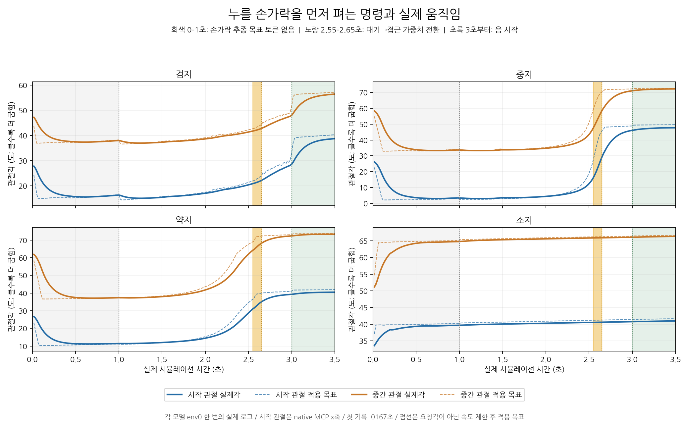

# 손목 이동 뒤 정체와 목표 손가락 펴짐 분석

검사 대상은 직전에 제공한 네 손가락 A→free_v9 비교 영상이다. 각 모델 env0의 실제1회 기록을 분석했다. 새 학습·GPU실행·코드 수정은 하지 않았다.

## 결론

영상에서 잠깐 멈춘 듯 보이는 구간과 손가락이 먼저 펴지는 현상은 실제 로그에 있다. **정책이 먼저 펴는 각도를 명령하고, 실제 관절이 이를 따라간다.** 저장 영상의 프레임 정지나 모든 손가락에 적용된 강제 정렬 대기로 설명할 근거는 없다.

현재 영상의 팔은 A에서 학습한 손목 이동 정책이 아니라 미리 계산한 고정 IK 목표를 요청한다. 실제 팔이 그 목표로 이동해 느려지는 과정과 손가락의 시간 의존 동작이 겹쳐 ‘손목 도착→잠시 정지→손가락을 펴고 누름’처럼 보인다. 정확히 어느 입력이나 보상이 큰 초기 펴짐을 학습시켰는지는 현재 로그만으로 단독 확정할 수 없다.

## 1. 작은 추가 펴짐도 1초 부근 명령에 존재한다

실제0.9833초와1.0167초의 요청각 차이다. 음수는 native 굽힘축을 더 펴라는 뜻이다. 이 시점에는 손가락 추종 목표 토큰이 새로 유효해진다. phase 등 다른 입력도 함께 달라질 수 있어 토큰 하나의 인과 효과로 단정하지 않는다.

| 목표 손가락 | 시작 관절 추가 요청 변화 | 중간 관절 추가 요청 변화 |
|---|---:|---:|
| 검지 | −1.71° | −1.42° |
| 중지 | −0.53° | −0.55° |
| 약지 | −0.21° | −0.38° |
| 소지 | +0.15° | +0.28° |

따라서 사용자가 말한 ‘조금 더 벌어진다’는 작은 반전도 요청 로그에서 확인된다. 검지·중지·약지는 옆 벌림보다 시작/중간 관절 굽힘이 풀리는 동작이 주된 변화다. [해당 시점 요청·실제각](one_second_transition.json).

## 2. 그보다 앞서 큰 초기 펴짐이 있다

첫60Hz 실제 기록(.0167초)과3초 전 최소각을 비교했다. 리셋 순간의 값으로 표현하지 않는다.

| 손가락 | 시작 관절 실제각 | 중간 관절 실제각 | 최소 시각 |
|---|---|---|---|
| 검지 | 27.84→15.09° | 47.25→37.00° | 약1.25초 |
| 중지 | 26.12→2.99° | 58.38→33.29° | 약1.22초 |
| 약지 | 26.68→11.20° | 61.89→37.13° | 약0.65~0.70초 |
| 소지 | 처음부터 더 굽힘 | 처음부터 더 굽힘 | 같은 초기 펴짐 없음 |

첫240Hz 요청에서 이미 검지 시작/중간=14.89/36.93°, 중지=2.11/32.91°, 약지=10.26/36.58°였다. 처음부터 더 편 목표를 요청한 것이므로 접촉 반동이나 계산 지연만으로 생긴 변화가 아니다.

검지·중지·약지의 옆 벌림축 증가 최대값은 각각 약0.37/0.38/0.003°로 작다. 소지는 반대로 처음부터 굽히면서 옆 벌림도약3.94° 증가했다. 네 손가락이 동일한 전략을 쓰는 것은 아니다.

점선은 속도 제한 후 적용 목표이며 정책의 원시 요청각과 구분한다. 시작 관절은 native MCP_x이고, 대기 보상의 기하 MCP각과는 정의가 다르다. [정량 수치·원본 SHA](kinematics.json), [상세 운동 분석](kinematics.md).

## 3. 기다리는 듯한 동작이 허용되는 시간 배치

모든 목표 음은3초에 시작한다.

| 시각 | 손가락 추종용 목표 토큰 | 목표 손가락 대기 가중치 | 목표 패드 접근 가중치 |
|---|---|---:|---:|
| 0~1초 | 유효하지 않음 | 1 | 0 |
| 1~2.55초 | 유효 | 1 | 0 |
| 2.55~2.65초 | 유효 | 1→0 | 0→1 |
| 2.65~5.5초 | 유효 | 0 | 1 |
| 3초 | 실제 음 시작 | 0 | 1 |

첫1초에 모든 목표 정보가 없는 것은 아니다. 위 표는 손가락의 유효 tracking token이며 손목 안내·일반 악보 관측 등과 구분한다. 목표가1초부터 보여도 **접근 potential의 tracking 가중치는2.55초까지0**이다. 손목이 먼저 이동했더라도 손가락이 곧바로 목표에 접근하도록 이 보상이 유도하는 것은 아니다. 고정3초 음 시작에 맞춰 뒤늦게 준비하는 동작과 정합하는 시간 구조다.

약한 대기 보상이 큰 펴짐을 강제하는 것은 아니다. 대기 보상은 목표각을 덮어쓰지 않으며 허용대 안에서는 같은 점수다. MCP허용대가±30°여서 초기 자세도 이미 그 안에 있다. 중지는 중간 관절을약5.7°만 펴도 대기 보상의 밴드 안에 들어오므로 실제25° 펴짐을 특별히 요구하지 않는다. 소지는 대기 보상을 개선하는 방향과 반대로 더 굽히기도 한다. 따라서 ‘대기 보상 때문에 모든 손가락이 펴진다’고 단정하지 않는다. [실제 gate·보상식·가중치·소스 위치](source_analysis.md).

## 4. 렉·단계 잠금·추종 지연을 구분한다

- 네 손 원본 영상과 비교 영상 모두6초·180프레임, PTS간격약1/30초다. 인접한 동일 디코딩 프레임은0개였다. native 포즈360개도1/60초 간격, 물리 스텝 간격4, 제어 틱 간격1이다. 저장 영상에 프레임 정지 구간이 삽입됐다는 증거는 없다. 사용자 재생 앱 자체의 순간 지연을 측정한 검사는 아니다. [프레임 검사](frame_timing.json).
- 손목의 실제 속도가 낮은 구간은 존재한다. 기타 상대속도5mm/s 미만이0.2초 이상인 예는 검지2.05~2.97초, 중지1.93~2.63초, 소지1.12~2.98초다. 속도가 작다는 사실을 정확한 목표 정렬 완료와 동일시하지 않는다.
- 네 영상은free_v9라 move/align/press에 따른 팔 hold·clamp분기를 건너뛴다. 목표 손가락4축은 처음부터 자유롭고3초에 관절을 재초기화하지 않는다. phase는 여전히 관측으로 들어간다. phase 총 누적시간을 시간순 전환 기록으로 바꾸어 해석하지 않는다.
- 팔 정책12축 행동은 시간 범위가 정확히0이다. 고정 IK 요청으로 이동한 후 느려지는 실제 팔과, 손가락 함수의 준비 동작이 결합돼 있다. 적용 목표에는 평활화·속도 제한이 있고 실제 관절에는 PD·관성·접촉이 작용한다. 고정 정책 요청이 실제 손목 고정을 뜻하지 않는다.
- A는 이미 정렬된 시작 자세에서 학습한 모델이며 이 영상은 학습 없이v9에서 자유 재생한 것이다. 팔이 이동하는 동안의 손가락·접촉 관측은 A 학습의 초기 상황과 다르다. 이 분포 차이가 펴짐에 기여했을 가능성은 있지만 대조 실험 없이 확정하지 않는다.

## 개선 우선순위

먼저 목표 노출과 대상 손가락의 대기→접근 전환을 검토하는 것이 타당하다. 첫 목표의 추종 정보를 초기부터 제공하는 조건, 준비 접근 보상을 더 일찍 켜는 조건, A정렬 시작과v9이동 시작의 차이를 각각 분리 비교해야 한다. 실제 음 시작3초와 기존 성공 판정은 유지해 타이밍 개선과 조기 압현을 혼동하지 않는다.

팔 정렬을 학습한 자연스러운 순서로 설명하려면 고정 IK 평균 이동과 학습된 팔 피드백도 구분해야 한다. 현재의 성공 재생만으로 그 능력을 선언하지 않는다. 대기 MCP범위를 바로 좁히거나 손가락 움직임 비용을 추가하는 변경부터 할 근거는 부족하다.

이번 요청은 로그 분석으로 마무리했고 학습 코드·보상·기존 결과는 변경하지 않았다.
