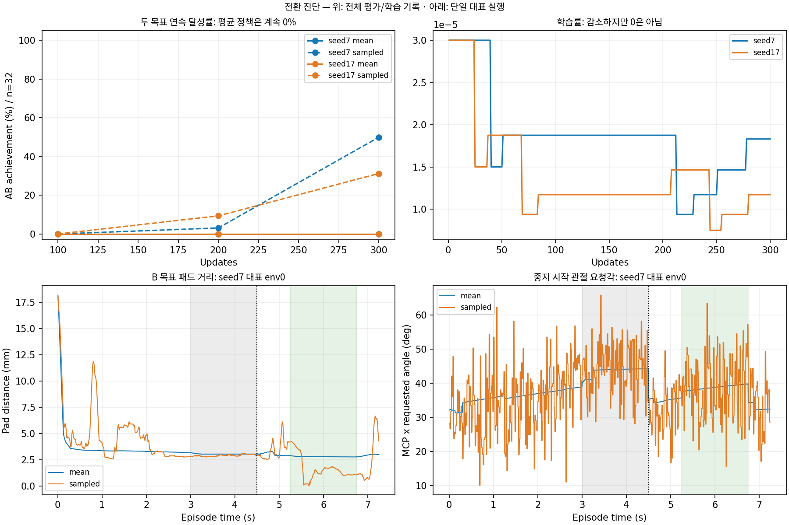

# 중지 목표 전환과 엄지 진단

## 결론

안정적인 전환은 아직 학습되지 않았다. 단순히 시간이 부족하다고 확정할 수 없으며, 현재 증거는 **A에 편향된 초기 조건에서 B의 정밀 정렬·유지를 평균 정책으로 배우지 못하는 문제**를 우선 지목한다. 새로운 GPU 실험은 아직 실행하지 않았다. 이 문서는 기존 원본의 읽기 전용 분석과 다음 통제 실험 설계다.

엄지는 별개의 명확한 설정 문제다. 이번 연구는 팔12+중지4의16축만 학습하고 엄지5축은 초기각에 고정한다. 기본 J33 정책은 엄지 축을 포함하므로 이 결론을 모든 현행 학습으로 일반화하지 않는다.

## 확인된 기록

같은3번줄 중지 A=6프렛(3.00~4.50초), B=7프렛(5.25~6.75초), 휴지0.75초, 에피소드7.25초. large64, H32, seed7/17 각300회. 평가 분모는 조건별 최초32회이며 실패도 포함한다.

| seed / 실행 | A 달성 | B 달성 | AB 달성 | B 평균 clean 유지 / 1.5초 | 두 음 전체 유지 |
|---|---:|---:|---:|---:|---:|
|7 평균|32/32|0/32|0/32|0초|0/32|
|7 확률|30/32|18/32|16/32|1.215초|1/32|
|17 평균|32/32|0/32|0/32|0초|0/32|
|17 확률|23/32|14/32|10/32|0.870초|0/32|

평균 실행은100·200·300회 모두 A32/B0이다. 확률 실행의 AB는 seed7 0→1→16, seed17 0→3→10으로 개선했다. 두 실행 방식 모두 물리/손목 종료0이다. 참조 제어는 같은 자유 기타와 휴지0.75초에서 전환을 수행했다. 참조 성공은 학습 정책 성공이 아니다. clean은 현 구현의 기하/몸체하중 기반 판정이며 실제 현 압력·음향 인증과 구분한다.

위 그래프는 전체 평가·학습 지표이며 아래 궤적은 seed7 env0 한 회다. 단일 대표 궤적으로 전체32회의 관절 운동 분포를 주장하지 않는다.

## 원인별 판정

### 학습 길이: 가능성은 있으나 충분한 설명은 아니다

300회는 seed당614,400 전이이며 환경 하나당 약21회의 완료 AB 경험이다. 확률 정책 개선은 추가 학습의 여지를 보여준다. 반면 평균 정책이 세 시점 모두 B0이라 시간만 늘리면 해결된다는 근거는 없다. 300→1000회 비교가 필요하다.

학습률은0이 아니다. seed7 처음3e-5/최종1.8311e-5, seed17 처음3e-5/최종1.1719e-5이며 최저는 각각9.375e-6/7.5e-6다. 중지 잠재 표준편차도 약0.15로 유지했다. 탐색 붕괴나 학습률이0이 된 문제로 설명하면 부정확하다.

### 목표를 못 보거나 단계가 손가락을 잠그는 문제: 현재 기록에서 지지되지 않음

최종 네 대표 실행에서 B가 다음 목표로3.25초부터 노출되고, A 종료4.50초부터 주목표가 된다. B 시작까지0.75초가 있다. E4는 단계에 따라 활성16축 행동을 차단하지 않는다. 다음 목표와 주목표 전환은 실제 trace에 기록돼 있다. 관측값이 정책에 유용하게 학습됐다는 보장은 별개다.

### 정밀 정렬과 정책 실행: 우선 분석 후보

평균 정책의 B 구간은 전체32회에서 clean0, wrong1.5초, missing0이었다. 무접촉 종료나 단순 시간 부족과 구분해야 한다. env0 평균 B 패드 거리는 seed7 2.816mm, seed17 2.878mm지만 candidate가 되지 않았다. 거리만 가까워도 셀·방향·하중 결합 조건을 통과하는 것은 아니다. 가까운 거리 자체를 압현 성공으로 해석하지 않는다.

중지 요청각은 A/휴지/B에서 달라져 명령이 완전히 고정된 상태는 아니다. 다만 탐색이 관절 움직임을 더 크게 만들며 성공 후보에 도달하는 정황이 있다. 평균과 확률 실행 차이가 행동 변환의 비선형성 때문인지, 성공 주변으로 평균이 이동하지 않은 학습 문제인지는 분리 검증해야 한다. 확률 정책의 성공을 단순히 여러 성공 자세를 평균낸 결과라고 단정하지 않는다.

### 학습 구조: A 초기 편향과 긴 책임 전파가 후보

매 reset이 A 정렬 자세에서 시작해 A는 쉽게 얻지만, B는 이동·정렬·유지를 새로 배워야 한다. B 단독/BA/초기분포 교환으로 목표 자체와 순서 효과를 구분할 필요가 있다.

H32는60Hz에서0.533초로 휴지0.75초와 음길이1.5초보다 짧다. PPO gamma=.99, GAE lambda=.98이다. 짧은 rollout의 경계에서는 critic의 미래 가치 추정에 의존한다. 장면·곡 시계는 경계에서 이어지므로 H32가 전환을 물리적으로 끊는다는 뜻은 아니다. H128 비교로 시간상 책임 전파가 병목인지 확인해야 한다.

### 보상: 총합만으로 실패 원인을 단정하지 않는다

최종 seed7 평균/확률 실행의 압현 유지는1.000/1.734, 접촉0.250/0.486, 달성0.250/0.375로 B를 수행하는 쪽이 관련 보상을 더 얻는다. 따라서 B 보상이 아예 빠졌다고 볼 근거는 없다.

접근 항의 비할인 합계 약−4.5만 보고 지배적 벌점이라고 단정해서는 안 된다. 현재 접근은 gamma·Phi(next)−Phi이고 PPO와 같은gamma=.99, terminal Phi=0이다. 완전 에피소드의 할인합에서 초기 Phi 상수로 상쇄되는 성질을 가진다. 유한 rollout·critic 근사·표본 분산 영향은 별도 확인해야 한다. 성공/실패 전환 구간의 실제 advantage를 비교하기 전에는 접근 보상부터 크게 바꾸지 않는다.

## 엄지: 접촉하지 않음을 확인

| seed / 실행 | 후면 거리 평균(60Hz) | 엄지 안내 보상 / 7.25초 | 접촉 후보 시간(240Hz) |
|---|---:|---:|---:|
|7 평균|48.93mm|0.00565|0초|
|7 확률|48.02mm|0.00614|0초|
|17 평균|50.11mm|0.00523|0초|
|17 확률|48.95mm|0.00541|0초|

128회 모두 후면10mm/3mm 이내 비율0, thumb3 native 합력과 후면 법선 하중0이다. seed17 평균 env0 엄지 목표각은[35,−63.204,10,10,50]도로 전 구간 고정됐다. 후면 signed gap은 다른 지표로 평균49.99~52.62mm이며 위60Hz 거리와 혼용하지 않는다.

엄지 보상은 존재한다. 기하 안내 최대0.01/초+접촉 후보 가산 최대0.01/초를240Hz 적분한다. 현재 받은 작은 양의 값은 멀리서 받는 기하 안내이고 접촉 보상이 아니다. 엄지 독립 제어가 잠겨 있으므로 보상만 강화하거나 오래 학습해 엄지 굽힘을 배우게 할 수 없다. 팔 움직임으로 엄지 위치가 변할 여지는 있지만 현재 기록은 접촉을 얻지 못했다.

접촉 후보는 유한 후면 영역·gap −1~+0.5mm·방향cos≥0.1·thumb3 후면 법선 합력≥0.01N을 결합한다. 합력은 몸체 쌍별 힘이 아니므로 특정 충돌쌍이나 실제 압력 인증은 아니다. 큰 간격과0N은 이번 thumb3 후면 지지가 없었다는 강한 근거다.

## 다음 통제 실험 — 승인 후 순차 실행

공통: 같은3번줄·6→7프렛·각1.5초·휴지0.75초·large64·seed7/17·60/240Hz·같은 접촉기준을 유지한다. 새 결과는 별도 디렉토리에 기록한다. D0 전에는 후보 탈락 사유를 같은 패드 표본 기준으로 프렛 내부·줄 횡거리·높이·방향·몸체하중으로 분해하는 진단을 설계한다. 최소거리 표본과 성공 후보 표본을 혼용하지 않는다. 이 계측은 모든 새 조건에 동일 적용하고 보상/물리를 바꾸지 않는다. 현재/과거 소스 SHA가 다르면 구형 checkpoint strict 재개를 우회하지 않는다. 호환 검증을 통과한 독립 재현 환경을 먼저 구성하거나, 동일한 새 소스의300회 비교군부터 재현한 뒤 모든 조건에 동일 적용한다. 재현 실패 원인을 고치기 전에 결과를 섞어 비교하지 않는다.

|순서|비교|변경하는 것|구분할 원인|
|---|---|---|---|
|D0|기존300회 정책, std 배율0/.25/.5/1, 요청관절각 기대값 실행|실행 방식만|잡음 필요성/비선형 행동 해석|
|L|300→600→1000회, 두 seed|학습 길이만|같은 구조의 수렴 지연|
|H|H32 대 H128, 동일614,400전이부터|rollout 길이만|짧은 책임 전파/critic 의존|
|I|A 시작 대 A/B 정렬 시작50:50|reset 분포만|초기 목표 편향|
|T|활성16축 대 엄지5축 추가21축|엄지 제어 허용만|엄지 제어 가능 여부와 압현 영향|

D0는 조건별32회, 개선 후보만128회 재평가한다. 요청각 기대값은 각 활성 축의 잠재 Gaussian에32점 Gauss–Hermite 적분을 적용하고,16점 대비 수렴을 확인한다. 물리 PD/속도 제한은 기존대로 수행한다. 비선형 행동·관절각 변환까지 적분한 값이며 tanh(mean)이나 latent 평균과 구분한다. 정책 재학습 없이 비교해 평가 방식 문제와 학습 부족을 분리한다. 낮은 잡음에서 개선해도 탐색 그 자체를 제거해야 한다는 결론은 아니다.

L은100회마다 평균/확률 각32회 평가, 최종은 각128회로 확인한다. 평균 AB≥90%, A/B 각각 유지≥90%, 정시 시작≥90%, 물리/손목 실패≤1%를 임시 채택 기준으로 미리 고정한다. 기존 달성0.6초와 전체1.5초 유지 지표는 계속 별도로 기록한다.300회 이후 평균AB 개선이 없더라도1000회까지가 시간 부족 가설의 사전 상한이며 무한 연장하지 않는다.

H는64환경 유지, H32 300회/H128 75회로 노출614,400전이를 맞춘다. 평가 노출점은204,800/409,600/614,400이며 필요 시 L 최종과 같은2,048,000까지 확장한다. rollout 길이를 바꾸면 optimizer 호출 횟수도 달라지므로 동등한 학습 시간·횟수라고 주장하지 않고 전이 수/gradient steps/실시간을 모두 기록한다. gamma/lambda/보상은 그대로 둔다.

I는 동일2,048,000전이 상한에서 reset 시에만 초기분포를 바꾼다. B 초기 상태는 새 native 검증을 통과해야 하며 전환 도중 상태 덮어쓰기는 하지 않는다. 통제군과 reset 노출을 맞추고, A/B 단독·AB·BA 평가를 구분한다. H와 I는 먼저 한 조건씩 시험하며 개선을 보인 조건만 조합한다.

T는 전환 연구의 비교군을 보존한 별도 분기로 현재 보상 그대로 엄지5축만 해제한다. 먼저 무학습/유한 제어로 후면 도달가능성과 충돌을 점검한 뒤 두 seed 각300회부터 비교한다.0/100/200/300회 접촉 후보 시간·후면gap·법선하중·중지clean·손목/물리 종료를 기록한다. 접촉이 안 되면 초기 위치/기하/제어범위부터 조사하고 보상 증폭은 다음 독립 실험으로 둔다. 엄지 접촉을 강한 종료조건으로 추가하지 않는다.

공통 중단: 비유한 상태, 판정의 모순된 동시성공, 입력 SHA변경, 저장/재개 실패가 생기면 해당 조건을 중단하고 실패도 분모/보고에 남긴다. 최종128회 안전성 기준에 못 미치면 기본값으로 채택하지 않는다. 우선 D0/L만 실행하고 결과에 따라 H 또는 I로 넘어가며 T는 별도 비교한다. 전체 조건을 무조건 연달아 실행하지 않는다.

기존 기록에서 수집은 대략5초/업데이트 규모다. L의 새1000회×2seed 자체는 약2.8시간, 검증·평가·렌더 포함 대략3~5시간을 계획값으로 둔다. 재현군부터 다시 만들거나 자원경합이 있으면 늘어난다. 실제 실행 전 짧은 측정으로 갱신하며 현재 시작된 학습은 없다.

## 근거와 재현

- 기존 비교 결과: `../target_transition_v2/runs/comparison_v1/RESULTS.md` 및 각 `metrics_mean.json` / `metrics_sampled.json`
- 이번 수치와 입력SHA: [log_analysis.json](log_analysis.json), [thumb_analysis.json](thumb_analysis.json)
-16축 계약/목표시간/단계: `../target_transition_v2/tools/transition_runtime.py:44`, `:54`, `:152`
- 비활성 축 reset hold: `guitar_learning/tool/experiments/natural_press.py:399`, `:423`; active_axes `:58`
- 엄지 안내 계산: `guitar_learning/gpu/contact.py:676`; 적분 `environment.py:1153`; 가중 `:1279`
- 기본33축과 구분: `guitar_learning/training/policy.py:495`

생산 코드·초기 자세·기존 원자료/모델은 변경하지 않았다. 그래프는 log_analysis 입력과 기존 전체 평가 JSON 및 env0 trace로 만들었다.
