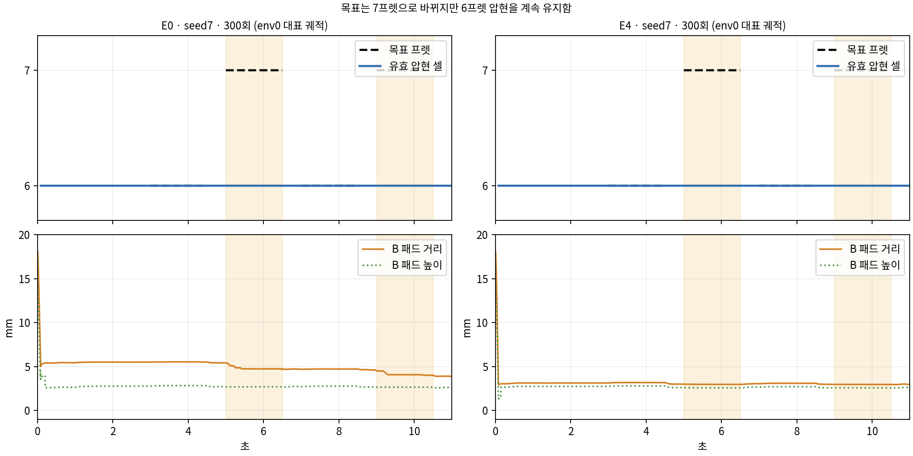

# 중지 두 프렛 전환 결과 분석

**추가 검증에 따른 정정:** 같은 중지가6·7프렛을 동시에 유효한 압현 후보로 인정받는 사례를 확인했다. 아래 확률 행동3/32는 현행 판정상의 달성이며 실제 전환 가능성의 증거로 사용할 수 없다. 물리 실현성은 아직 미확정이다. [휴지 시간·물리 실현성 추가 점검](PHYSICAL_FEASIBILITY.md)을 우선 읽는다.

**판정: 평균 행동으로 실행하는 프렛 전환 학습은 실패했다. E4의 접근 개선은 보였지만 연주 성과 개선으로 이어지지 않았다. 확률 행동의 성공 수치는 중복 판정 가능성을 포함한다.**

총1,200회 학습과12개 평가가2026-10-31 17:09에 모두 완료됐다. 각 조건·seed는300회씩 학습했고100/200/300회에서 평가했다. 실패·건너뛴 블록과 산출물 오류는 없다. 원래 봉인 입력과 각 작업의 결과SHA를 다시 확인했다. 학습 코드·물리·보상·성공 기준은 이번 분석에서 수정하지 않았다.

## 평균 행동 평가

모든12개 평가에서 같은 결과다. 평가별 분모는 실패를 포함한 최초32에피소드이며, 아래 표는 각 평가에서의 수치다.

|목표|6프렛 A1|7프렛 B1|6프렛 A2|7프렛 B2|4음 모두|
|---|---:|---:|---:|---:|---:|
|E0 / E4, 두 seed,100~300회|32/32|0/32|32/32|0/32|0/32|
|평균 clean 유지|1.5초|0초|1.5초|0초|—|

평가 물리 실패와 손목 종료는 모두0이다.32회는 같은 초기 분포의 반복이며 다른 목표32종을 검사한 결과가 아니다.100→300회 사이 평균 행동의 음 달성 개선은 없다.

**세 번째 A는 복귀 성공이 아니다.** seed7/17·E0/E4·100/300회에서 대표env0 궤적8개를 교차 확인했다.3~10.5초의 음과 휴지 구간 모두 A 접촉 후보가100%, B는0%다. 손이6프렛 접촉을 끊지 않은 채 머문다. 목표 선택 자체는4.5초 B,6.5초 A,8.5초 B로 정상 전환한다. 팔·중지 행동도 변하지만 A를 놓고 B로 갈 만큼 변하지 않는다.

위 그림은 seed7 최종 모델 env0 한 회의 실제240Hz 궤적이며32평균이 아니다. 주황 배경은 B 음 구간이다. 파란 선은 검사한 두 셀 중 유효 압현 후보이며, 계속6프렛에 남아 있다.

## E4의 효과와 한계

최종 모델의 B 음 구간 평균 패드 거리는 다음과 같다. 모두 대표env0 수치다.

|조건|첫 B|둘째 B|
|---|---:|---:|
|E0 seed7|4.83mm|4.13mm|
|E4 seed7|2.98mm|2.97mm|
|E0 seed17|4.49mm|4.50mm|
|E4 seed17|3.14mm|3.05mm|

E4는 B에 더 가까워졌다. 그러나 B 음1.5초 전체가 오압현으로 기록되고6프렛 접촉이 유지된다. 대표 원장에서 오압현 출처도 중지 말단의6프렛이다. 가까운 표면점이 있다는 것과 같은 표면점의 위치·방향·하중 및 오압현 배제 조건을 충족한 것은 다르다. 따라서 거리가3mm가 됐다는 사실로 압현 성공이라고 판단하면 안 된다.

평가의 행동 변화 비용은 최종 모델에서도 약10⁻⁸~10⁻⁷ 수준이며 LH 손가락은 원래 비용 대상이 아니다. 이번 정체를 손가락 움직임 비용이나 단계별 강제 고정으로 설명할 근거는 없다.

## 학습 중 표본과 평가의 차이

아래는201~300회 학습 구간에서 완료된 에피소드 전체다. 실패도 각 음 성공률 분모에 포함했다.4음 달성 수는 별도로 물리/손목 실패 없는 정상 완료만 센 값이다. 학습 중에는 모델 가중치도 계속 바뀌므로 최종 모델 평가와 직접 동일시하지 않는다.

|조건|완료 수|A1/B1/A2/B2 달성 수|B1 성공률|B2 성공률|4음 모두·안전 완료|
|---|---:|---|---:|---:|---:|
|E0 seed7|257|68/173/42/150|67.3%|58.4%|0|
|E4 seed7|257|181/59/161/80|23.0%|31.1%|4|
|E0 seed17|256|190/111/130/101|43.4%|39.5%|17|
|E4 seed17|257|176/71/98/66|27.6%|25.7%|16|

학습은Gaussian 표본 행동을 실행하고 기본 평가와 영상은 `tanh(mean)`을 실행한다. 학습 로그의 B 성공만으로 표본화가 원인이라고 단정하지 않도록 **동일한 최종 E4 seed7 300회 체크포인트**를 추가32환경에서 평가했다. 모델·초기 분포·물리·목표·보상·성공 기준을 유지하고 행동 표본화만 켰다. 학습 업데이트는0회다.

|같은 최종 모델의 실행 방식|A1|B1|A2|B2|4음 모두|물리/손목 실패|
|---|---:|---:|---:|---:|---:|---:|
|평균 행동, 기존 평가|32/32|0/32|32/32|0/32|0/32|0/0|
|확률 행동, 추가 진단|32/32|3/32|32/32|10/32|3/32|0/0|

확률 행동에서 첫B 평균clean은0.150초, 둘째B는0.532초다. 성공 사례가 있으나 안정적인 연주는 아니다. 달성 기준은 기존의 연속clean0.6초이며, 음 전체1.5초를 모두 유지했다는 뜻이 아니다. 추가 진단은 한 모델·한32회 묶음이며 원래12개 평균 행동 평가를 대체하지 않는다.

이 차이는 행동 표본화가 현행 목표 후보 판정에 영향을 준다는 증거다. 추가240Hz 전체환경 관찰에서 성공 사례가6·7프렛을 동시에 만족했으므로, 실제 전환 경로가 존재한다고 해석했던 결론은 철회한다. 단순히 확률 행동을 켜는 것을 최종 해결로 채택하지 않는다.

## 학습률·탐색·보상 해석

- 학습률: 초기3e-5에서 최소7.5e-6까지 감소했다. 일부 회복도 있지만 장기 수렴을 늦출 여지는 있다. 이번 로그만으로 주원인이라고 분리할 수는 없다.
- 중지4축 탐색 표준편차: 초기0.15, 최종0.14974~0.15005. 팔을 포함한 지원 축도 초기0.049787에서0.049709~0.049856로 거의 유지된다. 기록된 탐색 폭의 붕괴는 없다. 다만 매 tick 무작위 움직임이 계획적인 해제·이동·재접촉 탐색에 충분하다는 뜻은 아니다.
- 평균 행동은 A 두 음만으로 최초접촉+0.5, 유지+2.0, 달성+0.5를 얻는다. B 두 음의 오압현−0.3·수행부족−0.2를 감수하는 패턴이다. 이 값은6프렛 유지가 부분 보상을 받는다는 증거이며, 그 원인을 보상만으로 확정하는 통제 실험은 아니다.
- 접근항은 `gamma*nextPhi-beforePhi`, 종료 시nextPhi=0인 potential shaping이다. E0 원시합 약−4.0, E4 약−6.5만 보고 접근에 벌점을 준다거나 E4가 더 나쁘다고 해석할 수 없다. E0/E4의Phi 정의가 달라 원시 총보상 절대값으로 우열을 선정하지 않는다.

**원인 판단:** 평균 행동은 A에 머물며, 목표 전달이나 관절 잠금 문제로 설명할 근거는 없다. 추가 검증에서는 같은 손가락의 인접 두 프렛 동시 성공 판정 문제를 발견했다. 따라서 성공 표본을 실제 전환 동작으로 간주해 학습 방향을 정하기 전에 판정 정합성을 우선 확인해야 한다.300회보다 더 오래 학습하면 해결될지는 확정할 수 없다.

## 다음 작업 권고

아래 권고는 추가 검증 이전의 학습 관점 후보다. 현재 우선순위는 `PHYSICAL_FEASIBILITY.md`의 동시 후보/실제 발음 판정 점검→참조 동작의 물리 실현성 검사다. 중복 판정을 정리하기 전 성공 궤적 보조 학습을 진행하지 않는다.

1. 앞으로 같은 체크포인트의 평균/확률 행동 평가를 함께 기록한다.4음 총달성 외에 A 해제·B 접촉·B 연속 유지 성공을 별도 판정한다.
2. ABAB를 바로 늘리기 전에 A→B 한 전환을 집중 학습한다.현재 초기 자세와 자유 기타 물리는 유지하고, 성공적인 해제→이동→압현 표본을 충분히 확보한다. 이후 B→A,ABAB 순서로 확장한다.
3. 성공 표본을 평균 정책이 재현하도록 학습하는 방법을 기존PPO와 분리 비교한다. 성공 궤적의 보조 학습이나 전환 구간 학습 비중 조정을 우선 후보로 두되, 실제 행동·clean 기준을 그대로 둔 짧은 비교로 채택 여부를 정한다. 학습률/탐색/보상을 한꺼번에 바꾸지 않는다.

E4는 이번 실험에서 접근 거리는 줄였으나 달성률 우위가 없다. 곧바로 곡 학습으로 확대하거나 E4를 최종 개선으로 확정하기보다 전환 동작의 재현성부터 해결하는 것을 권한다.

근거: `analysis_details.json`, 원래 `../summary.json` 및각블록 원장·240Hz추적, `stochastic_seed7_E4_u300/`와 `stochastic_metrics.json`. 추가 진단 도구와 행동 방식은 `diagnostic_manifest.json`에 구분했다. 원본 실험 결과·체크포인트·소스는 보존했다.
