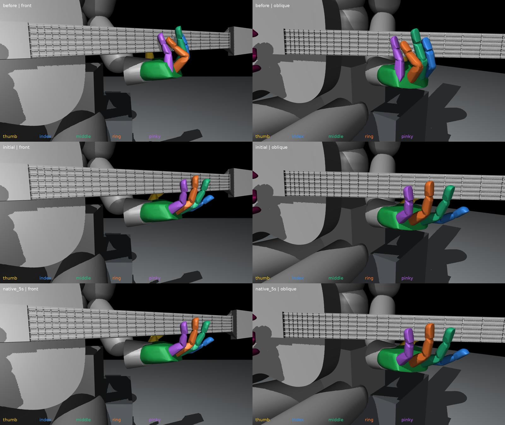

# 압현 진단용 새 왼손 대기 초기 자세

다섯 손가락을 넥에서 떨어뜨린 새 초기 상태다. **왼손 손가락 21축만 변경**했다. 팔·손목·몸통·하체·오른손의 초기 관절 위치·속도와 기타·의자의 초기 상태는 원035/v14 상태를 보존했다. 왼손 손바닥 초기 위치·회전도 원상태와 같다.

기존 B 대기 굽힘을 중심으로 엄지의 완만한 굽힘을 더하고, 넥과의 간격이 부족한 손가락만 보정했다. 약지·소지는 기존 B 목표각을 그대로 썼다. 팔이나 손목을 밖으로 이동시켜 간격을 만들지 않았다.

[초기 관절값·상태 파일](initial_pose.json) · [21축 각도 CSV](joint_degrees.csv) · [물리 검증 수치](verification.json)

## 외형

위부터 원준비 / 새 초기 / 실제5초 유지 후이며, 왼쪽 정면·오른쪽 사선이다. 색은 엄지 노랑·검지 파랑·중지 초록·약지 주황·소지 보라다. 모든 패널은 동일한 카메라와 같은 종횡비를 사용했다.

[새 초기 정면](initial_front.png) · [새 초기 사선](initial_oblique.png) · [새 초기 전신](initial_full.png)

[실제5초 후 정면](native_5s_front.png) · [실제5초 후 사선](native_5s_oblique.png) · [실제5초 후 전신](native_5s_full.png)

## 실제 물리 확인

별도 Isaac Gym GPU 환경에서 새 상태를 에피소드 경계에 한 번 복원하고 5초 유지했다. 자유 기타·중력·기존 관절 PD·힘/속도 제한·손가락 충돌·하체 유한 지지 제어를 유지했고, 그 뒤 상태를 덮어쓰지 않았다. 학습이나 압현 재검사는 아직 수행하지 않았다.

| 손가락 | 새 초기 source 간격 하한 | 5초 기록의 최소 간격 하한 | 기록상 최대 마디 순접촉합력 |
|---|---:|---:|---:|
| 엄지 | 20.01mm | 20.01mm | 0.00N |
| 검지 | 20.21mm | 15.06mm | 0.00N |
| 중지 | 20.36mm | 14.08mm | 0.00N |
| 약지 | 24.17mm | 17.26mm | 0.00N |
| 소지 | 28.05mm | 24.58mm | 0.00N |

최소 간격 하한은 약 **14.08mm**였다. 60Hz로 기록한 301개 표본에서 다섯 손가락의 순접촉합력은 모두0이었다. 실제 물리는240Hz이며, 표본 사이 순간 접촉이 전혀 없었다고 인증하는 검사는 아니다. 간격은 손끝 점만이 아니라 각 손가락 전체 마디 메시와 엄지 패드 캡슐을 포함해 계산했다.

기타의 최대 이동은 약4.07mm, 마지막 손가락 관절의 목표 대비 최대 오차는 약0.060도였다. 비손가락 초기 관절값은 실제 DOF 텐서에서도 원값과 정확히 일치했고, 손가락 초기 최대오차는2.47e−8rad였다. 물리 실행 중 다른 관절이 자연스럽게 움직이는 것은 허용했으며, 비손가락 최대 변화는 약2.68도였다. 따라서 ‘다른 관절 유지’는 초기 상태와 요청 기준 보존이며 모든 몸체를 물리적으로 고정했다는 뜻은 아니다.

## 상태 파일 사용 범위

`initial_pose.json`의 `q105_rad`는 새 초기 실제 관절각, `target105_rad`는 유지 요청 목표, `state`는 초기 복원 상태다. 기존 prepared reset 원파일을 수정하지 않았다. 새 진단에서 원계약을 복사하고 이 파일의 상태와 목표를 적용하는 예시는 [verify_native.py](tools/verify_native.py)에 있다. 현행 학습의 기본 초기 자세를 자동 변경하거나 구형 checkpoint와 호환된다고 선언하지 않는다.

`initial_*` 이미지는 원실제각/원몸체 자세에서 보정한 source FK로 만든 새 초기 모습이다. `reset_snapshot_*`는 초기화 직후 장면의 reset cache와 같은 자세이며, 독립된 native 몸체 readback 검증이 아니다. `native_5s_*`는 실제 물리5초 후 몸체 기록을 렌더한 이미지다. 시각화 중 물리를 다시 실행하거나 손가락 각도를 보간하지 않았다.

간격은 source neck1·headstock neck2·프렛·nut·목 부분 줄(보수적 반경0.5mm)을 덮는 두 볼록 형상과, 손가락 전체 메시/엄지 캡슐 사이의 분리 평면 거리 하한이다. 양수이면 그 이상의 기하 간격이 있음을 보수적으로 확인하지만, native의 가공된 충돌 형상 거리나 실제 접촉 상대를 인증하는 값은 아니다.

초기 source목표15mm 시도에서는 물리 중 중지 하한이9.49mm까지 줄어 최종 채택하지 않았다. 첫 시도의 소스·초기 상태·물리 기록·이미지는 [trials/clearance15mm](trials/clearance15mm)에 보존했다. 최종 채택은 source목표20mm로 보정한 현재 파일이다.

## 재현 도구

- [make_pose.py](tools/make_pose.py): 원준비 입력 확인, 왼손21축만 유한 범위에서 조정, 나머지 초기 상태 불변 검사와 새 상태 저장
- [verify_native.py](tools/verify_native.py): 새 상태의 독립 프로세스 초기복원과 실제5초 유지. 출력 위치가 같으므로 재실행 전 기존 결과를 별도 폴더로 보존해야 한다.
- [present_pose.py](tools/present_pose.py): 초기·실제 몸체 상태별 이미지와 간격 분석
- [native_hold.npz](native_hold.npz), [native_metadata.json](native_metadata.json): 60Hz 실제 유지 기록과 물리1200스텝/초기복원1회 기록

현재 상태는 다음 손가락별 압현 재검사의 출발점이다. 대기 자세 자체의 안정 확인과, 이 자세에서 모든 손가락이 목표를 압현할 수 있다는 검증은 구분한다.
