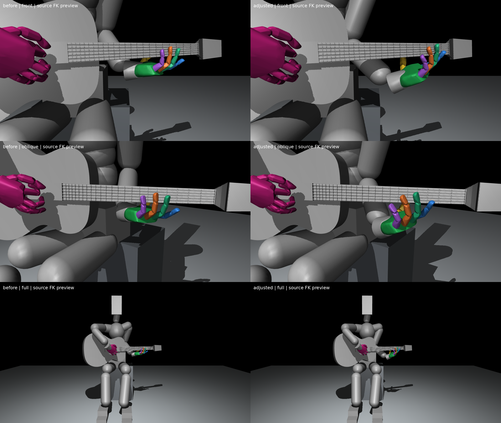

# 손목·손 방향을 보정한 대기 초기 자세 후보

기존 v1에서 왼손 손목을 몸 바깥쪽으로 옮기고 넥을 가로지르는 방향으로 손을 돌린 **원모델 FK 미리보기**다. 이번 후보는 실제 물리 유지나 압현 검사를 수행하지 않았다.

- 손목 이동: 신체 왼쪽 **4.78cm**, 앞으로 **3.31cm**, 아래로 **3.79cm**. 월드에서 왼쪽은−X, 앞은+Y, 아래는−Z다.
- 손 방향: 기타 표면 법선 주위 약**25도** 회전. 팔·손목 관절에 나누어 적용했으며 단일 손목 관절25도 명령이라는 뜻은 아니다.
- 검지~소지16축은 v1 대기 각 그대로 유지했다. 엄지5축은 넥과의 간격을 확보하기 위해 기존각±20도 안에서 보정했다.
- 왼쪽 thorax 연결축·어깨·팔꿈치·손목과 엄지 외 관절값, 오른팔·몸통·기타·의자 상태는 보존했다. 손목 y축은 native하한으로부터10도, 왼쪽 thorax y축은 상한으로부터3도 여유를 남겼다. 모든 관절이 같은 여유를 갖는다는 뜻은 아니다.

## 비교 이미지

왼쪽 기존 v1, 오른쪽 보정 v2. 위부터 정면·사선·전신이다. 각 쌍은 동일한 월드 카메라를 사용해 손이 움직인 만큼 화면에서도 움직이도록 했다. 손을 따라 카메라를 이동시키지 않았다.

[보정 정면](adjusted_front.png) · [보정 사선](adjusted_oblique.png) · [보정 전신](adjusted_full.png)

## 간격과 해석

손가락 전체 source메시·엄지 패드 캡슐과 넥·프렛·nut·목 부분 줄을 덮는 형상 사이의 분리 평면 간격 하한이다. 실제 native 충돌 가공 형상의 거리 인증은 아니다.

| 손가락 | 간격 하한 |
|---|---:|
| 엄지 | 14.43mm |
| 검지 | 30.29mm |
| 중지 | 47.19mm |
| 약지 | 58.20mm |
| 소지 | 70.48mm |

손가락이 넥에서 넉넉히 떨어진 대기 후보로, 특히 소지는 약7cm 떨어진다. 이 거리나 외형이 압현에 최적인지는 별도 검사해야 한다. 소스 FK 목표 위치 오차는0.001mm 미만, 방향 오차는0.002도 미만이다. 이는 수치적 목표 일치이며 해부학적 자연스러움이나 물리 안정성의 증명이 아니다.

30도 회전 중 엄지 관절이 극단값에 가까워진 후보는 `trials/rotation30/`에 보존하고 제외했다. 손목 y축이 하한에 붙은 중간후보도 `trials/wrist_limit/`로 분리했고, 현재 후보는 손목 여유를 확보한 버전이다. 이전 v1과 현행 학습 기본값은 변경하지 않았다.

## 파일

- [새 후보 초기 상태](initial_pose.json):105관절 위치·유지 목표·몸체 상태, 물리 미검증 표시
- [수치와 관절별 전후 각도](measurements.json)
- [생성과 렌더 도구](tools/create_candidate.py):원모델 FK·유한 IK·형상 간격 검증·동일 카메라 렌더

이 상태를 실제 압현 실험의 초기 상태로 채택하기 전에는 물리 유지와 손가락별 접근 동작을 다시 확인한다.
