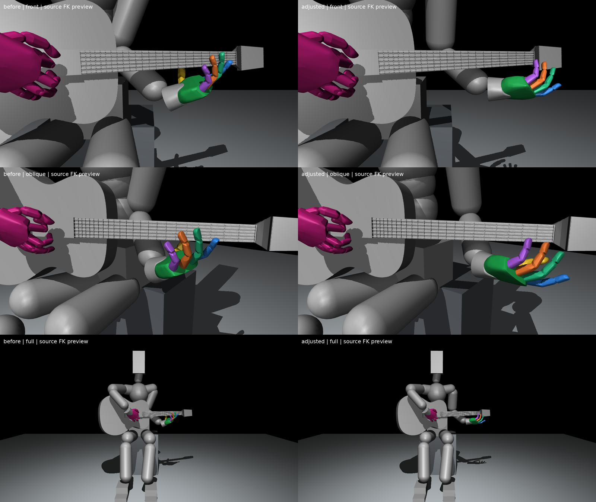

# 어깨·팔꿈치 중심으로 다시 만든 왼팔 대기 후보 v3

손목만 돌린 듯한 인상을 줄이기 위해 어깨·팔꿈치·전완 배치를 함께 조정했다. **손목은 각 모델 입력축 ±15도 안에서만 움직이게 했으며**, 어깨/팔꿈치9축에서 손의 위치와 방향을 함께 찾았다. 사람의 해부학적 각도를 입력각과 동일하다고 간주하지 않는다.

이 자료는 원래 모델의 FK로 만든 자세 미리보기다. 실제 물리 유지, 모든 몸체 충돌, 압현 가능성은 아직 검증하지 않았다. 현행 학습과 과거 결과를 변경하지 않았다.

## 전후 이미지

왼쪽은 이전 v2, 오른쪽은 새 v3다. 위부터 정면·사선·전신이며 각 쌍은 같은 월드 카메라다.

[보정 정면](adjusted_front.png) · [보정 사선](adjusted_oblique.png) · [보정 전신](adjusted_full.png)

## 실제 바뀐 점

- 이전 v2 대비 팔꿈치는 신체 왼쪽으로 약9.44cm, 뒤로 약6.97cm, 아래로 약1.25cm 이동했다. 몸 안쪽에서 손목만 비트는 배치를 줄이는 후보로 선정했다.
- 손목 모델 입력각은 이전 **21.46/−35.00/27.79도 → 5.52/−15.00/15.00도**다. 손목의 큰 편향을 줄였고 실제 native 경계 여유는 각축30도 이상이다. 어깨·왼쪽 thorax 연결축·팔꿈치의 값도 함께 변경했다.
- 전완축과 손의 길이 방향으로 정의한 기하 대조각은 **58.90도 → 44.40도**로 줄었다. 팔꿈치→손목과 손목→네 MCP 몸체 원점 평균을 이용한 모델상 지표이며, 해부학적 손목 굽힘각이나 자연스러움 점수는 아니다.
- 손가락21축은 처음 만든 **v1 대기 각도 그대로**다. v2에서 추가했던 엄지 보정도 제거했다. 오른팔·몸통의 비대상 관절값과 기타·의자 상태는 보존했다.

## 간격 확인

| 대상 | 넥 형상과의 source 기하 간격 하한 |
|---|---:|
| 엄지 | 26.26mm |
| 검지 | 62.04mm |
| 중지 | 54.56mm |
| 약지 | 48.66mm |
| 소지 | 58.08mm |
| 상완 캡슐 | 65.29mm |
| 전완 캡슐 | 4.03mm |

손가락은 각 마디 전체 source메시와 엄지 패드를 검사했다. 팔은 원본XML의 상완·전완 캡슐을 사용했다. 캡슐의 경우 각 넥 볼록 형상 평면에 대한 양 끝점의 최소 부호거리에서 반지름을 빼고, 가장 큰 분리값을 사용한다. 따라서 양수인 값은 해당 형상에 대한 보수적 간격 하한이다. 실제 가공 충돌 형상이나 기타 몸통·의자·전신의 모든 충돌 검증은 아니다.

초기 탐색에서 손목0도를 강제한 후보는 손이 아래로 처지거나 팔이 넥을 가로지르는 모양이 나와 제외했다. 팔꿈치의 극단값에 의존한 후보도 제외했다. 전완-손 기하각30도를 더 강하게 요구한 추가 후보는 엄지 간격을 확인하지 못해 제외했다. 중간 산출물은 `trials/`에 분리해 보존했다.

참조 손목·팔꿈치 위치는 최적화의 부드러운 목표이며 실제 위치와 각각52.47mm·116.94mm 차이가 있다. 이 위치를 정확히 달성했다고 해석하지 않는다. 최종 후보의 실제 위치·관절값·간격으로 외형을 평가한다. 손목 모델 입력±15도 제한도 해부학적 중립이나 자연스러움을 보장하지 않는다.

## 파일

- [새 초기 상태](initial_pose.json):105관절 위치·유지 목표·몸체 상태, 물리 미검증 표시
- [전후 관절각 CSV](joint_degrees.csv) · [전체 측정값](measurements.json)
- [생성 도구](tools/create_pose.py) · [소스 SHA](source_pins.json)

다음 압현 실험에 적용하기 전 실제 물리 유지와 손가락별 접근을 확인할 후보로 사용한다.
