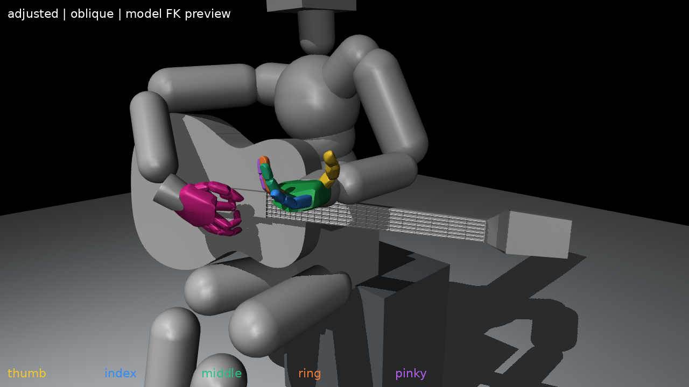
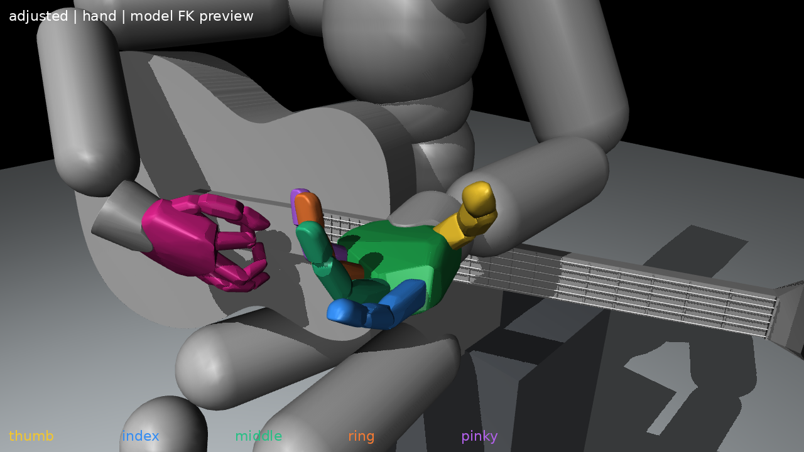
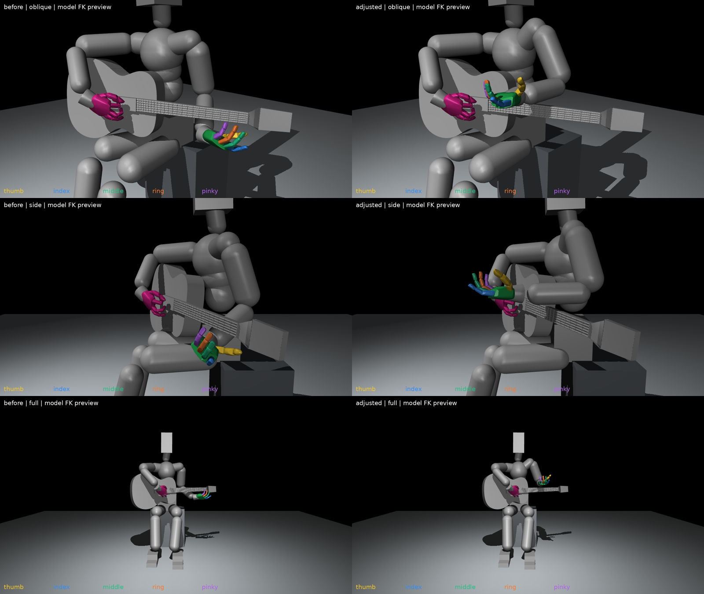

# 손바닥 위·손가락 뿌리 정면·전완 정면 후보 v4

이번에는 외형의 느낌만으로 손 방향을 정하지 않고, 사용자 요청의 세 방향을 원모델 FK에서 직접 계산해 맞췄다. 어깨·왼쪽 thorax 연결축·팔꿈치·손목12축을 함께 조정했다. 손가락21축은 처음 만든v1 대기값을 보존했다.

**실제 물리 유지 검증 전인 방향 확인용 후보**다. 손목이 넥 위쪽으로 올라가고 손가락은 넥에서 약15~20cm 떨어진다. 넥 아래 압현 준비 자세가 완성됐거나 학습에 적용됐다는 뜻은 아니다.

## 방향 기준과 결과

정면은 인체가 바라보는 월드+Y, 위쪽은 월드+Z다. 손가락 뿌리 방향은 손바닥 원점에서 검지~소지 MCP 몸체 원점의 평균으로 향하는 축으로 정의했다. 전완은 팔꿈치에서 손목으로 향하는 축이다. 손바닥 면은 MCP의 가로배치와 손의 길이축으로 구성한 평면에서 손가락이 굽혀지는 쪽을 택했다.

| 항목 | 목표 | 방향 오차 |
|---|---|---:|
| 손바닥 면 | 하늘(+Z) | 0.013도 |
| 손가락 뿌리의 길이 방향 | 정면(+Y) | 0.030도 |
| 전완 | 정면(+Y) | 1.411도 |

전완과 손의 길이 방향 사이 각도는 **1.425도**다. 이 각도는 실제 몸체 위치에서 정의한 기하 지표이며 해부학적 관절각은 아니다.

이전 문서 일부의 `palm_normal_world`는 손바닥 몸체의 로컬+Z를 보고한 것으로 손등 쪽 축에 가깝다. 이번에는 반대쪽인 palmar 면을 명시적으로 정의했다. 검수에서 MCP를 조금 더 굽혔을 때 끝마디가 현재 선택한 손바닥 법선 쪽으로 움직이는 것도 확인했다.

## 이미지

[사선](adjusted_oblique.png) · [측면](adjusted_side.png) · [손 확대](adjusted_hand.png) · [정면](adjusted_front.png) · [전신](adjusted_full.png)

전후 비교는 왼쪽 이전v3 / 오른쪽 새v4다. 위부터 사선·측면·전신이다. 각 쌍은 동일 월드 카메라이며, 손 위치가 올라간 것을 카메라 이동으로 숨기지 않았다.

## 위치·각도와 간격

- 손목 월드 높이:0.7665m. 이전v3의0.5987m보다약16.78cm 높아졌다. 팔을 몸 앞쪽으로 내밀고 전완을 거의 수평으로 둔 방향 우선 후보다.
- 손목 모델 입력각:약2.29/−22.22/−26.15도. 입력각0도를 해부학적 중립으로 강제하지 않고 실제 손·전완 방향을 목표로 삼았다.
- 손가락21축·오른팔·비대상 몸통 관절값·기타·의자 상태는 보존했다. 어깨 위치 자체는 왼쪽 thorax 연결축을 조정하며 바뀐다.
- 상완/전완 캡슐과 넥 형상의 정적 source 간격 하한은 각각71.05/5.86mm다. 손가락 전체 메시와 엄지 패드의 하한은147.65~202.24mm다.
- 이 간격은 source 형상에 대한 보수적 분리 평면 하한이다. native 가공 충돌 형상, 전신의 모든 충돌, 물리 안정성이나 압현 성공의 인증이 아니다.

정면을 향한 전완과 손바닥 위쪽 방향을 우선하면서 손 위치가 높아졌다. 이 자세를 실제 기타 초기 자세로 사용하려면 원하는 손 높이·넥 간격을 함께 제한해 다시 배치하고 물리 유지와 압현 접근을 확인해야 한다. 이번 요청에서는 방향을 확인할 수 있는 후보와 이미지를 저장했으며 현행 학습 기본값은 변경하지 않았다.

## 파일과 재현

- [초기 상태](initial_pose.json):105관절 위치·목표·몸체 상태, 물리 미검증 표시
- [측정값](measurements.json) · [관절각 CSV](joint_degrees.csv)
- [생성·렌더 도구](tools/create_pose.py) · [소스 SHA](source_pins.json)
- `trials/hand_only/`:손바닥/손 방향은 맞았으나 전완이 약58.5도 아래로 기울어 채택하지 않은 후보. 최종 탐색의 유한 초기값 하나로 사용했다.
