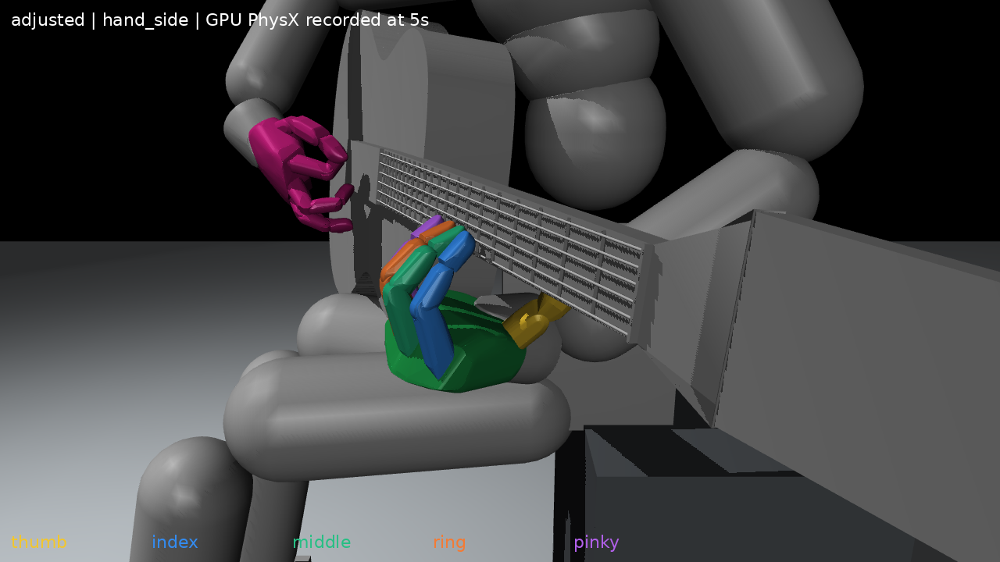
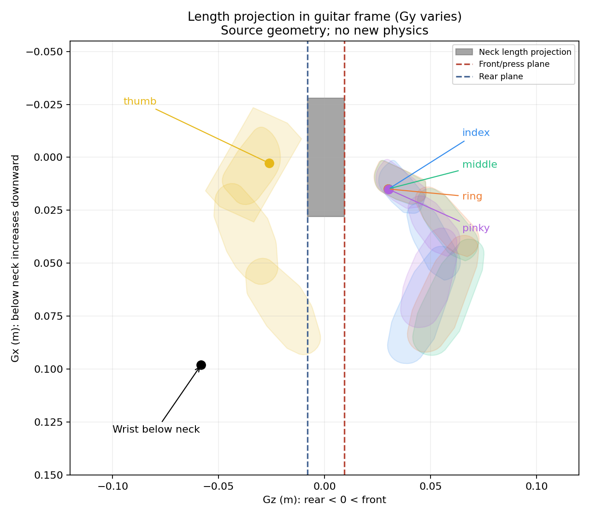

# 넥 아래 손목·넥 뒤 엄지·넥 앞 네 손가락 대기 자세 v5

어깨·왼쪽 thorax 연결축·팔꿈치·손목과 손가락을 함께 조정해 새 초기 자세를 만들었다. 손목은 넥 아래, 엄지는 넥 뒷면 쪽, 검지~소지는 줄이 있는 앞쪽에 놓였다. 손가락 패드와 넥 사이에 간격을 남긴 **비접촉 대기 배치**다.

**독립 Isaac Gym GPU 환경의 실제5초 유지 검사에서도 이 배치를 확인했다.** 물리1200스텝·초기복원1회이며, 초기복원 후 상태를 덮어쓰지 않았다. 실제 기록의60Hz 표본300개에서 손목 아래/엄지 뒤/나머지 앞 조건을 모두 유지했다. 학습과 곡 압현 성공 검사는 하지 않았다.

[초기 자세 파일](initial_pose.json) · [33축 각도 CSV](joint_degrees.csv) · [실제 유지 측정](native_verification.json)

## 실제 물리5초 후 모습

노랑=엄지, 파랑=검지, 초록=중지, 주황=약지, 보라=소지다. 아래 이미지는 실제 물리 몸체 기록을 렌더한 것으로, 새로 물리를 실행하거나 관절 모양을 다시 최적화하지 않았다.

[정면 확대](native_images/adjusted_hand.png) · [사선](native_images/adjusted_oblique.png) · [측면](native_images/adjusted_side.png) · [전신](native_images/adjusted_full.png)

## 배치 검증

기타좌표계+X가 아래쪽, +Z가 줄이 있는 앞쪽에 가깝다. 엄지는 실제 neck1 뒷면 평면Gz=−0.008m의 뒤쪽, 나머지는 압현 기준면Gz=0.0093m의 앞쪽인지 모든 유효 패드 표본을 검사했다. 이 기준면과 실제 시각용 줄 높이Gz=0.01230m는 다르다. 아래 앞면 거리에서3.0mm를 빼면 그 줄 높이를 기준으로 한 거리다.

손목은 전체 neck1 폭의 아래쪽 한계Gx=0.027908m보다도 아래에 있어야 한다. 길이좌표Gy도 연주용 넥 범위 안에 있는지 확인했다. 월드 수직높이와 기타좌표계의 아래 방향은 구분했다.

| 대상 | 원모델 초기 자세 | 실제5초 기록의 최소값 |
|---|---:|---:|
| 손목의 넥 아래쪽 경계까지 거리 | 70.04mm 아래 | 67.36mm 아래 |
| 엄지 패드(뒷면 뒤) | 13.31mm | 14.82mm |
| 검지 패드(앞면 앞) | 16.46mm | 10.94mm |
| 중지 패드(앞면 앞) | 14.40mm | 9.14mm |
| 약지 패드(앞면 앞) | 14.14mm | 9.14mm |
| 소지 패드(앞면 앞) | 15.13mm | 10.40mm |

각 손가락 패드128개 표본 전체 중 가장 가까운 점의 거리이며, 기록 표본에서도 항상 해당 방향에 있었다. 실제 시각용 줄 높이 기준으로도 검지~소지 패드의 최소 간격은 약6.1~7.9mm 남았다.

손끝 평균점만으로 판정하지 않았다. 원모델 초기 자세에서 각 손가락 전체 메시와 넥 형상의 보수적 간격 하한은 엄지2.88mm, 나머지10.24~12.37mm다. 실제 물리 몸체로 source 메시를 재구성했을 때의5초 기록 최솟값은 엄지4.41mm, 나머지5.23~6.86mm다. **패드의 평면 거리와 손가락 전체 형상의 간격은 서로 다르다.**

기록된 손가락 마디 순접촉 합력은 모두0이었다. 이는60Hz 표본이며240Hz 표본 사이 순간 접촉이 전혀 없다는 인증은 아니다. 접촉 합력은 접촉 상대를 식별하지 않는다. 기타는 최대약4.04mm 이동했고, 변경하지 않은 초기 관절각은 실제 DOF 텐서에서도 원값과 정확히 일치했다.

## 자세와 간격의 해석

- 손목을 넥 아래로 내리고 손가락을 앞뒤에 배치하면서, v4의 완전 수평 전완과 손바닥 정방향 목표는 완만한 선호로 바꿨다. 원모델 초기 자세에서 손바닥은 위쪽에서약22.6도, 손 길이축은 정면에서약28.4도, 전완은 정면에서약33.5도 기울었다.
- 엄지와 네 손가락의 자세도 함께 보정했다. 첫 탐색에서 나타난 엄지 끝관절89도·소지 뿌리89도 같은 후보는 제외하고, 초기 자세 탐색 범위를 좁혀 관절 부담을 나눴다. 이 탐색 범위는 공학적 후보 제한이며 해부학적 인증은 아니다.
- 원모델의 다른 손가락 사이 볼록껍질102쌍을 검사했다. 최대 공통 내접반경이−0.980mm로 겹침이 확인되지 않았다. 같은 손가락 내부의 의도된 연결부는 제외했고, 엄지 패드 캡슐은 보수적인 포함 상자로 비교했다. 실제 native 충돌 가공 형상에 대한 전신 충돌 검사는 아니다.
- 정적 상완/전완 캡슐과 넥 형상 사이 간격 하한은약76.07/47.84mm다. 기타 몸통·의자·모든 몸체의 충돌을 완전히 인증한 값은 아니다.

## 앞뒤 배치 도식

기타 길이방향으로 투영한 그림이다. 서로 다른Gy 위치의 손가락이 한 화면에 겹쳐 보일 수 있으며 한 단면의 실제 충돌 그림이 아니다. 왼쪽은 넥 뒤, 오른쪽은 넥 앞, 아래는 손목이 위치한 넥 아래 방향이다.

## 파일과 재현

- [원모델 전후 비교](comparison.png):왼쪽 이전v4 / 오른쪽 새v5. 동일 카메라.
- [초기 기하 검증](verification.json) · [초기 측정·관절 여유](measurements.json)
- [실제5초 기록](native_hold.npz) · [장면 메타데이터](native_metadata.json) · [실제 유지 분석](native_verification.json)
- [초기 후보 탐색](tools/create_pose.py), [기하 검증·이미지](tools/validate_render.py), [5초 물리 유지](tools/hold_native.py), [물리 기록 분석·렌더](tools/analyze_native.py)
- [도구·입력 SHA](source_pins.json). 원본 입력·기존 결과·현행 학습 코드는 변경하지 않았다.

`initial_pose.json`은 이 새 자세의 초기 관절값·유지 목표·복원 상태다. 실제5초 검증 범위를 표시했지만 학습 기본 초기 자세로 자동 적용하지 않았다. 다음 압현 재검사는 이 초기 상태에서 시작하는 별도 실행으로 진행할 수 있다.
