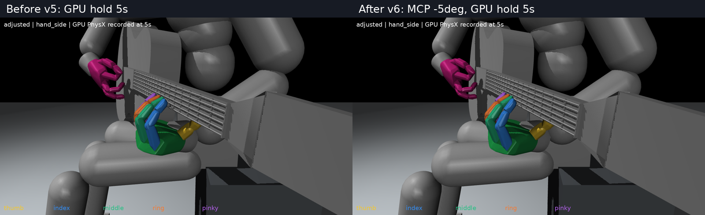

# 네 손가락 뿌리 굽힘5도 감소 v6

v5에서 검지~소지의 첫 굽힘 관절(MCP 입력1_x)만 각각5도 더 폈다. 벌림각, 가운데·끝관절, 엄지, 팔·손목·어깨와 기타의 초기 상태 및 유지 목표는 그대로다.

| 손가락 | v5 | v6 |
|---|---:|---:|
| 검지 | 58.19도 | 53.19도 |
| 중지 | 56.46도 | 51.46도 |
| 약지 | 57.02도 | 52.02도 |
| 소지 | 63.21도 | 58.21도 |

실제 Isaac Gym GPU에서5초 유지한 기록(초기캐시 제외60Hz300표본)에서도 손목 아래·엄지 뒤·검지~소지 앞 배치를 유지했다. 손가락 순접촉 합력은 기록 표본에서모두0이었다. 검사는 학습이나 압현 성공 평가가 아니다.

[새 자세 확대](native_images/adjusted_hand_side.png) · [정면 확대](native_images/adjusted_hand.png) · [전신](native_images/adjusted_full.png)

[초기 자세 파일](initial_pose.json) · [기하·변경량 확인](verification.json) · [실제5초 유지 결과](native_verification.json) · [수정 도구](tools/adjust_pose.py)

변경 전 v5와 현행 학습 기본값은 보존했다. 원모델 손가락간 볼록껍질102쌍의 최대공통내접반경은−1.068mm로 겹침이 확인되지 않았다. 이 검사는 원형상 대조이며 가공된 충돌 형상이나 모든 물리 순간의 무접촉을 인증하지 않는다.

5초 유지와 기록 분석은 v1의 `verify_native.py`, v5의 `analyze_native.py`를 독립 프로세스에서 이 디렉토리를 출력 위치로 지정해 재사용했다. 물리1200스텝·초기복원1회이며 이후 상태를 덮어쓰지 않았다.
