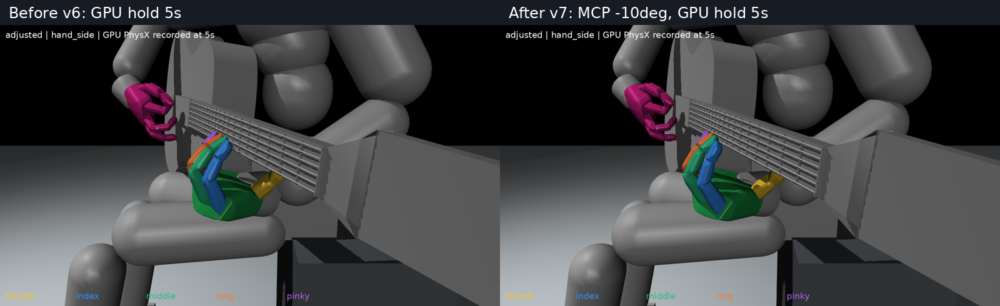

# 압현 접근을 보기 위해 더 편 대기 자세 v7

검지~소지 뿌리 굽힘 관절(MCP 입력1_x)을 v6에서 각각10도 더 폈다. v5 기준으로는 누적15도 감소다. 나머지 관절각·유지목표·속도·엄지·팔·손목과 기타 초기 상태는 그대로다.

| 손가락 | v6 | v7 |
|---|---:|---:|
| 검지 | 53.19도 | 43.19도 |
| 중지 | 51.46도 | 41.46도 |
| 약지 | 52.02도 | 42.02도 |
| 소지 | 58.21도 | 48.21도 |

압현할 때 굽혀지는 과정을 보기 위한 시작 여유를 더 확보했다. 실제5초GPU유지(1200물리스텝/초기복원1회) 기록300개60Hz표본에서도 손목아래·엄지뒤·네손가락앞 배치가 유지됐다. 순간접촉전체를인증하거나압현접근동작자체를검사한것은아니다.

| 손가락 | 실제5초 기록의 최소 앞쪽 패드 간격(압현기준면) | 시각용 줄 높이를 뺀 앞쪽 간격 |
|---|---:|---:|
| 검지 | 31.07mm | 28.07mm |
| 중지 | 29.86mm | 26.86mm |
| 약지 | 28.09mm | 25.09mm |
| 소지 | 26.42mm | 23.42mm |

앞쪽 간격은 기타Gz축의 부호거리이며, 특정 줄까지의3차원 최근접거리와 다르다. 압현기준면Gz=.0093m,시각용줄높이=.01230m를 구분했다. 손가락 전체 source형상을 실제물리몸체로 재구성한 넥 간격 하한도 네손가락22.39~26.94mm로 확인했다. 기록된손가락 순접촉합력은모두0이었다.

[새 자세 확대](native_images/adjusted_hand_side.png) · [정면 확대](native_images/adjusted_hand.png) · [전신](native_images/adjusted_full.png)

[초기 자세 파일](initial_pose.json) · [변경량·기하 검사](verification.json) · [실제5초 결과](native_verification.json) · [수정 도구](tools/adjust_pose.py)

손가락간 source볼록형상102쌍의 최대 공통내접반경은−0.959mm로 겹침이 확인되지 않았다. 실제 가공 충돌 형상의 전신 인증은 아니다. 이전v6과 현행학습기본값은 보존했다. 이 시작자세에서 목표로 접근해 실제로 압현하는 경로는 아직 검사하지 않았다.

5초유지와분석은v1 `verify_native.py`,v5 `analyze_native.py`를 새출력위치로 지정한독립프로세스에서 재사용했다. 상태복원은초기1회만수행했다.
