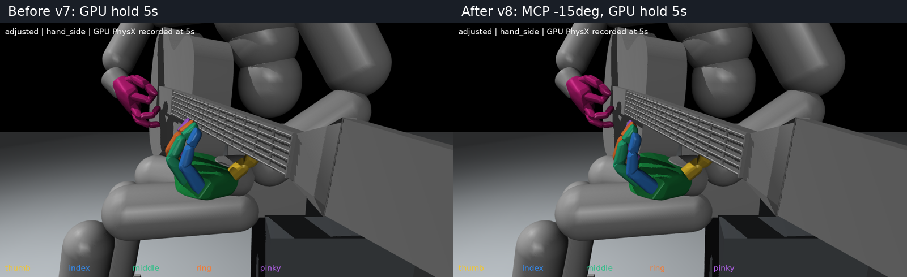

# 손가락을 더 편 초기 자세 v8

v7 대비 검지~소지의 뿌리 굽힘 입력1_x만 각각15도 추가로 폈다. v5 대비 누적30도다. 손목을 올리지 않고도 넥과의 간격이 확보되어 엄지·손목·팔과 다른 손가락 관절 및 기타 초기 상태는 유지했다.

실제 Isaac Gym GPU 물리1200스텝(5초), 초기복원1회로 검사했다. 복원 직후 캐시를 제외한60Hz300표본에서 손목은 넥 아래, 엄지는 뒤, 네손가락은 앞 배치를 모두 유지했다. 기타 최대 이동은 3.99mm다.

| 손가락 | 줄 높이 기준 최소 앞쪽 패드 간격 |
|---|---:|
| index | 46.84mm |
| middle | 46.82mm |
| ring | 43.42mm |
| pinky | 38.84mm |

앞쪽 간격은 기타 법선 방향 투영값으로, 개별 줄까지3차원 최단거리가 아니다. 압현기준면.0093m와 시각용 줄 높이.01230m 차이3mm를 뺐다. 기록된 손가락 순접촉합력은0이었다. 모든 물리 순간의 무접촉이나 압현 성공 경로까지 검증한 것은 아니다.

[확대](native_images/adjusted_hand_side.png) · [정면](native_images/adjusted_hand.png) · [전신](native_images/adjusted_full.png) · [초기 자세](initial_pose.json) · [변경·형상검사](verification.json) · [실제물리검사](native_verification.json)

손가락 사이 source볼록형상102쌍 검사에서 겹침이 확인되지 않았다. 실제 충돌 가공형상 전체에 대한 인증은 아니다. 기존 자세와 학습 기본값은 수정하지 않았다. 실제5초 유지는v1도구, 분석은v5도구를 출력 위치만 바꿔 재사용했다.
