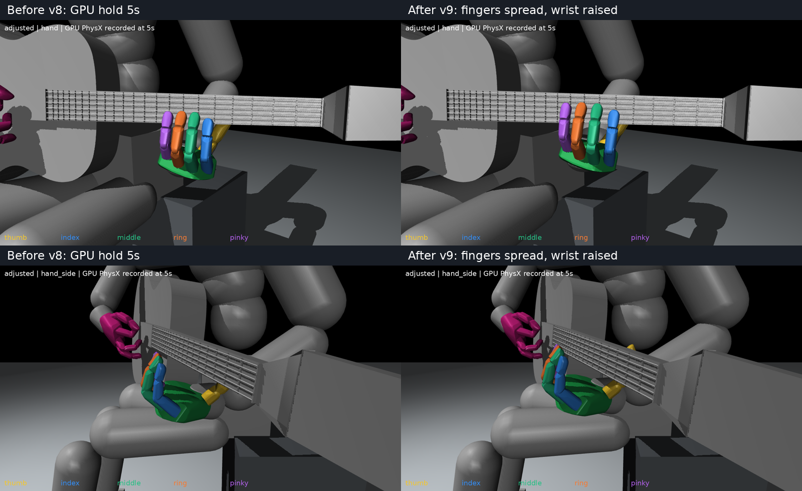

# 손가락을 벌리고 손목을 조금 올린 초기 자세 v9

v8 대비 검지·중지·약지·소지의 벌림 입력1_z를 각각−6/−2/+2/+6도 바꿨다. 손가락 굽힘과 엄지 입력은 유지했다. 손목을 위로10mm 옮기고 방향을 유지하도록 어깨3축·팔꿈치굽힘1축·손목3축을 역기구학으로 조정했다. 팔꿈치 y,z 비틀림은 유지했다. 총11축만 변경했다.

## 최종 검증

- source FK 손목 이동: 위로10.00mm, 방향 변화약.000107도.
- source 인접 손끝 패드 중심 간 거리:19.81/20.28/21.77mm →23.78/23.29/24.16mm. 실제 최단 표면 사이 거리와 다르다.
- 실제5초 유지 후v8 대비 손목 세계 이동: X-0.70mm/Y0.30mm/Z11.07mm. 위로 약1.1cm다.
- 실제 Isaac Gym GPU1200물리스텝, 초기복원1회.60Hz300표본 전체에서 손목은 넥 아래, 엄지는 뒤, 나머지는 앞 배치 유지.
- 기타 최대이동3.99mm. 기록된 각 손가락 순접촉합력0.
- 실제몸체에서 재구성한 엄지 전체source형상 넥 분리평면 간격 하한도 3.19mm로 양수다.

| 손가락 | 실제기록 최소 앞쪽 패드 간격(줄 높이 기준) |
|---|---:|
| index | 47.93mm |
| middle | 48.17mm |
| ring | 44.78mm |
| pinky | 40.05mm |

간격은 기타 법선 방향 투영값이며, 개별 줄까지3차원 최단거리는 아니다. 압현면Gz.0093m와 시각용줄Gz.01230m의 차이3mm를 보정했다. 검증은60Hz기록상배치와 원본형상에 대한 것이며 모든240Hz순간 무접촉·가공된 충돌형상 전체·압현성공을 인증하지 않는다.

[정면 확대](native_images/adjusted_hand.png) · [측면 확대](native_images/adjusted_hand_side.png) · [전신](native_images/adjusted_full.png) · [초기 자세](initial_pose.json) · [변경·source검사](verification.json) · [실제검사](native_verification.json) · [실제손목비교](actual_comparison.json)

## 제외한 후보

어깨·팔꿈치·손목9축을 모두 움직인 후보는10mm상승설정에서 실제5초후v8대비1.46mm 낮았고,15mm/20mm설정은 기타가 약9cm이동하며 앞뒤배치가 무너졌다. 따라서 채택하지 않았다. 이 후보의 물리기록은trials/에 보관했다. 이 현상의 단일원인을 확정한 것은 아니다.

최종후보는 팔꿈치비틀림을 유지하고 굽힘만 허용하는7축팔조정으로 상승과배치유지를 모두 확인했다. 기존v8과 학습기본값은 변경하지 않았다. 실행은v1 verify_native.py와v5 analyze_native.py를 출력경로만 지정해 재사용했다.
