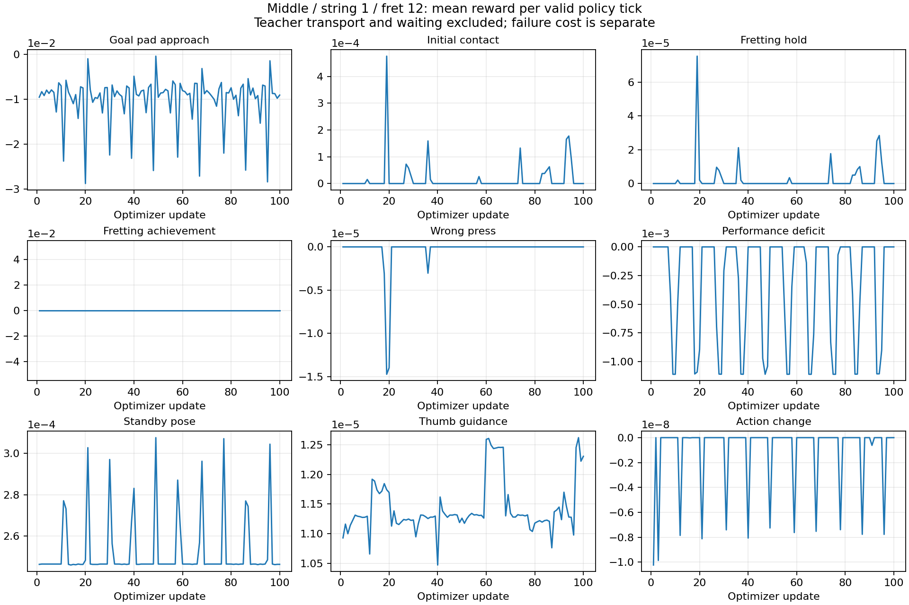

# 공통 출발 재실험 결과와 프렛 범위

기존 초기 자세 미확보 9조합의 준비 재검사와 대표 영상 9개를 저장했다. 준비를 통과한 중지·1번 줄·12프렛은 large64/H32로 100업데이트 학습하고 고정 정책 32환경 평가와 실제 물리 영상을 저장했다. **준비 도달은 개선했지만 압현 학습 성공은 얻지 못했다.**

## 프렛 운영 범위

| 범위 | 이번 연구의 처리 |
| --- | --- |
| 1~14프렛 | 학습 후보. 각 손가락·줄의 실제 물리 준비 검사를 통과해야 함 |
| 15~16프렛 | 경계 검증만 수행 |
| 17~22프렛 | 학습 보류 |

17프렛부터 목표점 아래에 몸통이 놓인다. 목표점 자체는 몸통 내부가 아니지만 손바닥·엄지·손목 접근은 별도로 제한된다. 중지의 1·3번 줄, 고정된 대기 손가락, 기존 팔 관절 범위에서 연속 탐색한 결과 13·14프렛은 각각2/2 기하 후보, 15프렛은1/2, 16~22프렛은 후보를 찾지 못했다. 이는 유한 탐색 결과이며 모든 자세에서의 물리적 불가능 증명이 아니다. 1~14프렛의 모든 조합이 압현 가능하다는 뜻도 아니다.

이 범위는 이번 재실험의 운영 정책으로 기록했으며 주 학습 코드·곡 목표 기본값을 변경하지 않았다. 원시 근거는 [정적 기하](프렛접근가능범위.md), [연속 탐색](중지12F_이웃프렛연속탐색_v1/중지_이웃프렛_결과.md), [범위 정책](../설계/프렛범위정책.json)에 있다.

## 준비 재검사

기존 실패9개 중 22프렛6개는 후속 학습을 보류했다. 나머지12프렛3개에서는 중지·1번 줄만4/4환경에서 준비 기준을 통과했다. 중지·3번 줄은 접선 오차 약16mm가 남고, 검지·3번 줄은 위치 오차와 오접촉 기록이 있어 준비 실패로 남겼다. 실패를 압현 학습 결과와 합치지 않았다.

[9조합 준비 결과](준비재검사_결과.md) · [준비 영상과 원문 SHA](준비영상목록.json)

## 100업데이트 학습과 평가

| 항목 | 결과 |
| --- | ---: |
| 유효 정책 결정 | 160,651 |
| 대기 중 학습 제외 결정 | 44,149 |
| 학습 준비 시도 | 768 |
| 준비 통과 / 실패 | 625 / 143 |
| 완료된 정책 에피소드 | 519 |
| 학습 중 최초 접촉 만족 / 압현 달성 | 1 / 0 |
| 가장 긴 clean 압현 유지 | 0.0625초 |
| 학습률 | 전 구간 0.00003 |
| KL 재시도 | 0 |
| 고정32 평가 준비 통과 | 32 / 32 |
| 고정32 평가 최초 접촉 / 압현 달성 | 0 / 0 |
| 고정32 평가 물리 실패 / 손목 이탈 종료 | 0 / 0 |

학습 중 준비 실패143개는 제외 사실을 보존하고 해당 환경만 정책 갱신에서 제외했다. 평가는 최초 시작32개가 전체 분모이며 준비에 실패하면 달성0으로 계산하도록 했다. 이번 평가에서는 준비32개가 모두 통과했으므로 전체·준비 조건부 압현 달성률 모두0%다. 평가32개는 고정 조건의 환경 반복이며 서로 다른 학습 seed32개의 일반화 검증이 아니다.

학습 완료 정책도 접촉을 만들지 못했다. 이번 실패를 학습률 감소로 설명할 근거는 없으며, 학습 기간 부족 여부도 단일100업데이트 실험만으로 판정할 수 없다. 준비 안정성과 접촉을 만드는 손가락 제어·탐색 문제를 분리해야 한다. 학습 준비 중에도 기타 이탈·발 변위 등의 실패가 남아 있으므로 전체 환경 안정성을 해결했다고 선언할 수 없다. 큰 접촉 합력은 접촉 상대를 식별하지 않으므로 특정 충돌쌍이 원인이라고 단정하지 않았다.

원시 학습 집계: [학습100_원시집계.json](학습100_원시집계.json). 보상항 그래프는 준비·대기 구간을 제외한 유효 정책 tick 기준이며 비용은 별도다.

## 산출물과 검증

- [학습100 대표 영상](../video/middle_s1_f12_학습100.mp4): 실제 공통 출발 이동과 첫 정책 압현 시도. 성공 영상이 아니다.
- [최종 모델](../모델/middle_s1_f12_seed7_v4_100/final.pt): 원본과 같은 hardlink이며 설정·재개 계보는 원래 학습 경로에 보존했다.
- 모델 SHA256: `9a7a502d31c9293fcd6dfe271ac9da571d7bc50fa5a325c893bf9a7806c3dbb4`
- [학습 원장](../로그/learning100_eval_render_v4/state.json): 학습·평가·영상 모두 complete. 각 보고서 completed=true, failure=null, changed_inputs=[], lifecycle_verified=true.
- [고정32 평가](../로그/learning100_eval_render_v4/jobs/evaluate32/attempt01/report.json)

운반은 유한 팔 보조 제어다. 팔 이동을 정책이 학습했다는 뜻이 아니며, 현재 압현 판정도 현 장력·음향을 보정한 실제 악기 측정과 구분한다.

## 알려진 손가락 각도의 실제 물리 대조

동일 공통 출발·준비 절차와 실제 손목 유지 제어를 사용하고 중지4축만 계산된 후보각0으로 0.5~2.5초에 걸쳐 부드럽게 이동했다. 학습·정책 갱신·이동 중 상태 재주입은 없다. 한 환경, 한 후보의 진단이다.

결과는 준비 통과, 정상5초 종료, 현재 과제 목표1/1달성, 목표 음 구간 clean 유지율100%, 오압현0이었다. 60Hz 기록상 candidate157tick, 음 구간 clean90tick(1.5초)이었다. 물리·손목 실패도 없었다. 입력 SHA 검증과 pool/scene 종료를 확인했다. 이는 학습 성공이 아니며 현재 접촉 합력·표면 기하 판정의 성공이다. 정확한 음 시작 타이밍을 요구하는 strict_music matched50/100은0으로, 음향·정밀 타이밍 성공까지 주장하지 않는다.

[진단 보고서](../로그/known_press_candidate0/report.json) · [원시 에피소드](../로그/known_press_candidate0/episode.json) · [60Hz 관절·접촉 기록](../로그/known_press_candidate0/trace.jsonl)

이 결과는 중지·1번 줄·12프렛의 압현이 현재 조건에서 전혀 불가능한 것은 아님을 보여준다. 반면 학습 정책은 같은 준비 절차 뒤 접촉0/32였다. 다음 개선은 이 알려진 성공 궤적과 정책의 각도·방향·탐색 분포를 비교하여 접촉 동작을 찾지 못한 이유를 좁히는 것이다. 이번 작업에서는 보상·주 학습 제어를 추가 변경하지 않았다.

독립 검토: change-reviewer가 학습 분모·평가·진단 원문·모델 SHA/하드링크·영상239프레임을 대조했으며 필수 수정사항이 없음을 확인했다.
