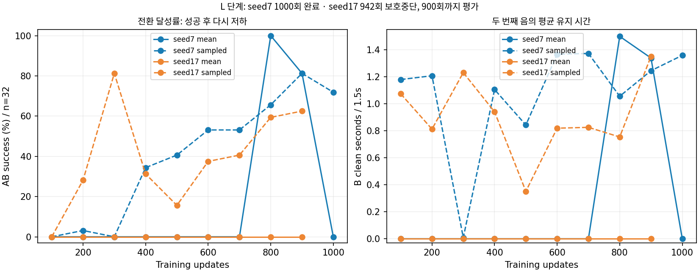

# 중지 목표 전환 학습 결과 — 2026-11-01

**중지의 두 목표 전환을 배운 모델은 나왔지만, 학습 안정성과 반복 성공률은 부족하다. 전체 비교는 완료되지 않았고 KL 보호 중단 이후의 독립 조건을 별도로 이어간다.**

## 실행 범위와 중단

- 목표: 중지·3번줄6프렛 A → 7프렛 B, 각1.5초, 휴지0.75초.
- large·GPU64환경·H32, 팔12+중지4축, seed7/17. 보상·물리·목표 판정은 유지했다.
- seed7은1000회 완료했다. seed17은942회 갱신을 완료한 뒤 다음 갱신에서 `KLGuardError`로04:03 KST에 중단됐다.
- 기존 감독 실행은 한 조건의 오류를 전체 중단으로 처리해 H/I/T 비교와 최종 렌더까지 진행하지 못했다. 10~12시 전체 종료 예상은 이 중단 때문에 성립하지 않는다.
- 원래 기록은 `study_v1`의 실패 상태 그대로 보존한다. 소스·입력488개는 바뀌지 않았다.

KL 보호는 정책이 한 번에 너무 크게 바뀌는 것을 막는 장치다. 보고된 오류는 KL 보호이며, 실패 당시 KL 값과 그 유한성은 기록 부재로 확인할 수 없다. 평가에서 관측한 물리 실패나 소스 변경과는 구분한다. 설정은 KL상한0.02·재시도3회·학습률하한7.5e-6이다. 재시도에서 하한에 도달하면 더 작은 학습률로 줄어들지 못한다. 직전 정상 갱신의KL은0.0119743이며 **실패 당시 실제KL은 로그에 저장되지 않아 이 값으로 대신할 수 없다.**

실패 갱신은 롤백됐지만942회 복구 저장본은 없다. 실패 블록에는900회 모델과 같은 `initial.pt`만 있다. 따라서 seed17의 마지막 정상 저장 모델은900회이고,942회나1000회 저장 모델로 표현하지 않는다.

## 32환경의 중간 평가

실패를 포함한 최초32에피소드의 평균 동작이다. 평균 동작에는 실행 잡음을 넣지 않는다.

|모델|A 달성|B 달성|AB 달성|두 음 전체1.5초 유지|물리/손목 종료|
|---|---:|---:|---:|---:|---:|
|seed7·100~700회 각 평가|32|0|0|0|0/0|
|seed7·800회|32|32|32|32|0/0|
|seed7·900회|32|26|26|26|0/0|
|seed7·1000회|32|0|0|0|0/0|
|seed17·100~900회 각 평가|32|0|0|0|0/0|

탐색 포함 실행에서는 seed17·300회AB26/32, seed7·1000회AB23/32 등을 관측했다. 이것은 탐색 없는 평균 실행의 안정적인 전환 성공과 구분한다.

## 확인 요청 후 실시한 128환경 재평가

같은 저장 모델을 더 많은 병렬 환경에서 평균 동작으로 재평가했다. 다른 줄·프렛·곡·초기 자세에 대한 일반화 검사는 아니다. 병렬 환경 수가 바뀌면 GPU 물리 실행 조건도 달라지므로32환경과128환경을 엄밀히 같은 궤적의 반복이라고 가정하지 않는다.

|모델|A 달성|B 달성|AB 달성|두 음 전체 유지|A/B 평균 clean(초)|물리/손목 종료|
|---|---:|---:|---:|---:|---|---:|
|seed7·800회 최고 모델|113/128|116/128|107/128 (83.6%)|100/128 (78.1%)|1.341 /1.356|0/0|
|seed7·1000회 마지막 모델|111/128|19/128|5/128 (3.9%)|2/128 (1.6%)|1.301 /0.222|0/0|
|seed17·900회 마지막 정상 저장|82/128|25/128|0/128|0/128|1.057 /0.293|0/0|

800회 모델의 정시 전환 지표는109/128이다. AB90%·유지90%·정시90%의 기존 임시 채택 기준을 충족하지 못했다. 높은 성공의32환경 결과만 골라 안정적 성공으로 선언하지 않는다.

## 원인에 대한 판단

1. **학습 시간이 전혀 효과 없었던 것은 아니다.** 같은 조건의seed7은800회에 전환을 수행했다. 현재 구조로도 적어도 이 대표 목표의 전환 동작을 찾을 수 있음을 보여준다.
2. **시간만 늘리면 해결된다는 설명은 맞지 않는다.** seed17은900회까지 평균 전환에 실패했고, seed7은800회 성공 뒤1000회에 성능이 크게 떨어졌다. 성공 동작 유지와 난수별 학습 안정성이 남은 문제다.
3. **물리 종료나 손목 종료가 주원인은 아니다.** 완료된44개 중간 평가와 이번128환경 재평가에서 해당 종료는0이었다.
4. **평균 실행의 실패는 주로 패드 위치 조건이다.** seed7·1000회32환경의B구간11,520개 끝점은 위치 결합 조건에서 탈락했다. 방향 또는 하중의 단독 탈락으로 분류된 것이 아니다. 위치 결합 조건은 프렛 내부·줄 횡거리·높이를 함께 포함하므로 어느 한 축이 원인이라고 아직 단정하지 않는다.
5. **성공 후보의 정확한 위치와 접촉 여유가 중요하다.** 최근접 패드 표본의 거리만으로 성공을 판단하면 안 된다. 다른 패드 표본이 위치·방향 조건을 함께 만족할 수도 있어 최근접 표본의 한 좌표만으로 탈락 원인을 확정하지 않는다.
6. **PPO 보호 중단은 별도의 최적화 문제다.** 안전장치를 낮춰 통과시키거나 실패한 조건을 성공으로 바꾸지 않는다. 학습률하한·재시도 설계 변경은 기존 길이/구조 비교와 다른 실험으로 다뤄야 한다.

따라서 현재 우선순위는 **좋은 모델 보존·평균 전환의 유지 안정성·긴 시간에 걸친 학습·초기 목표 편향·엄지 제어**를 분리해서 확인하는 것이다. 보상 구조 전체를 새로 쓰는 근거는 아직 부족하다.

## 실행 방식 D0와 엄지의 해석

300회 모델에서 탐색0.25배는 두 seed 모두AB0/32였고,0.5배는seed7 0/32·seed17 5/32였다. 탐색을 줄이는 것만으로 전환이 안정화되지 않았다.

기존 기대각32/16점 적분은 최대오차1.526mrad/1.057mrad로 사전1mrad 수렴 기준을 넘었다. 당시 실행 결과0/32만으로 기대각 방식의 효과를 확정하지 않고, 봉인된 모델·물리·정책을 유지한 별도 고정밀 평가에서 다시 확인했다.256/128점 적분은 두 seed 모두1mrad 기준을 통과했고, AB는 모두0/32였다. 따라서300회 모델에서는 기대 요청각만 바꿔도 전환이 회복되지 않았다. 이 결론을800/1000회 모델의 기대각 실행까지 일반화하지 않는다.

L 단계에서는 엄지5축을 학습하지 않았다.800회128환경에서도 접촉 후보0초·signed gap평균43.76mm였다. 따라서 이 결과로 엄지 지지 학습의 성공/실패를 판단하지 않는다. 제어5축만 추가하는T조건의 장기 비교는 원래 감독 실행 중단으로 미실행 상태였다.

## 실제 영상

|모델|손 확대|전신|영상에서 확인한 범위|
|---|---|---|---|
|seed7·800회 최고 모델|[손 확대](동영상/13_중지3번줄6에서7프렛_800회_최고모델_seed7_손확대.mp4)|[전신](동영상/13_중지3번줄6에서7프렛_800회_최고모델_seed7_전신.mp4)|실제native 환경0 한 에피소드, 두 음 각각1.5초clean.128회 성공률을 대신하지 않음|
|seed7·1000회 마지막 모델|[손 확대](동영상/14_중지3번줄6에서7프렛_1000회_마지막모델_seed7_손확대.mp4)|[전신](동영상/14_중지3번줄6에서7프렛_1000회_마지막모델_seed7_전신.mp4)|최고 모델과 동일 렌더 조건의 평균 실행, 성능 저하 비교|

영상은 새 학습이나 참조 강제 동작이 아니라 해당 저장 정책의 평균 실행이다. 소스·입력·정책 불변과ffprobe를 확인했다. 압현 성공 판정은 기하·몸체 하중 기반이며 특정 접촉쌍 압력·실제 음향의 인증이 아니다. 자연스러운 전체 손 모양이나 엄지 지지가 완성됐다는 의미도 아니다.

## 후속 실행 원칙

기존 실패 블록과 부분 로그는 보존한다.942회 저장본이 있는 것처럼 재개하지 않는다. 기존KL·학습률·보상·물리는 바꾸지 않고, 이미 승인된 **독립 H128 → 필요 시 A/B 초기분포 → 엄지21축** 비교를 새 출력에서 이어간다.

후속 감독 실행은 입력 봉인·정리·lifecycle에 이상이 없는 KL 보호 중단만 해당 seed의 종속 연장을 중단한다. 독립 조건은 계속하고, 다른 오류는 전체를 중단한다. 기존 실패 상태를 성공으로 덮어쓰거나 검사를 우회하지 않는다.

원본 근거: [중간44평가와 실패 상태](../압현성공/experiments/transition_diagnosis_v3/runs/study_v1/RESULTS.md), [128환경 재평가 원장](../압현성공/experiments/transition_diagnosis_v3/analysis/review_20261101/), [기존 실험·계획 통합 안내](README.md).

후속 비교는2026-11-01 10:08 KST에 실제 시작했다. large·64환경·H128 조건부터 진행 중이며, [진행상황](../압현성공/experiments/transition_diagnosis_v3/runs/continuation_v1/진행상황.md)에 기록한다. 전체 조건 수행 시 초기 추정은 당일17:51 KST이며 실행 속도와 조건 분기에 따라 갱신한다.
