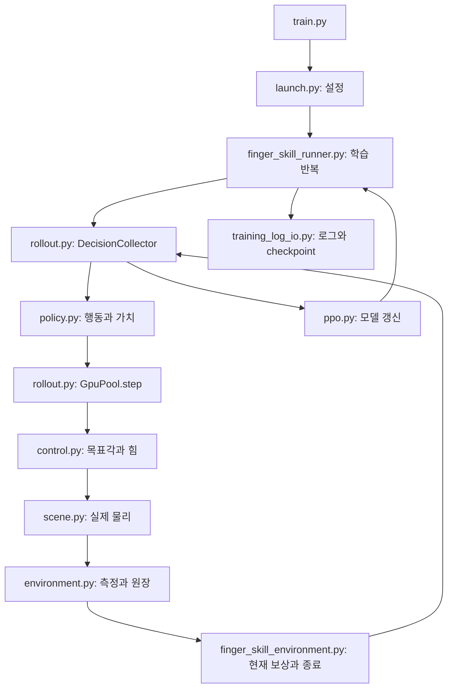

# 전체 학습 흐름과 코드를 읽는 방법

[해설 목차](/home/ajou/yigyu/3/docs/2026-11-02/코드해설/README.md)

이 문서는 현재 기본 명령 `python -m guitar_learning.train`이 실행하는 **GPU 왼손 finger-skill v3**를 기준으로 한다. 현재 파일을 분석한 설명이며, 과거 학습이 성공했는지 평가하는 문서는 아니다. 먼저 이 문서에서 전체 흐름을 이해한 다음 역할별 해설과 코드를 나란히 읽으면 된다.

## 1. 이 학습이 해결하려는 문제

정책은 현재 몸·기타 상태와 악보 목표를 보고 왼팔·손목·엄지·네 손가락을 어떻게 움직일지 결정한다. 그 행동을 Isaac Gym에서 실제 물리로 실행하고, 지정된 손가락 패드가 목표 프렛에 접근하거나 접촉·압현을 유지했는지 측정한다. 보상과 실패 비용을 이용해 다음에는 더 나은 행동을 고르도록 정책의 가중치를 바꾼다.

여기서 **초기 자세**, **제어 목표**, **실제 관절 자세**, **악보 목표**는 서로 다른 값이다.

| 값 | 의미 | 코드에서 만나는 예 |
| --- | --- | --- |
| 초기 자세 | 에피소드 시작 때 복원하는 전신·기타 상태 | prepared reset 계약의 `state`, `target105` |
| 정책 행동 | 정책이 매번 출력하는 정규화된 관절 명령 | `action`, 전체39열 중 기본 J의 활성33열 |
| 제어 목표 | PD 제어기에 제출할 관절 목표각 | `BatchedController.targets()`의 반환값 |
| 실제 자세 | 물리에서 힘·충돌·제약을 거친 결과 | snapshot의 `q`, `qd`, body state |
| 악보 목표 | 어느 손가락으로 어느 현·프렛을 언제 수행할지 | `ScoreTarget`, 환경의 `onset`, `press`, `end` |

손가락에 움직임 비용이 없다는 것은 해당 움직임을 벌점으로 제한하지 않는다는 뜻이다. 물리의 힘 상한·PD·관절 한계가 사라진다는 뜻은 아니다. 대기 자세 보상도 손가락 목표각을 자동으로 대기 자세에 덮어쓰는 기능이 아니다.

## 2. 실행 명령에서 시작되는 순서

예를 들어 다음 명령은 큰 정책과1024개 환경으로 학습하도록 설정한다. 이 문서 작성 중 이 명령을 실행한 것은 아니다. 출력은 아직 없는 새 경로로 정한다.

```bash
cd /home/ajou/yigyu/3
conda activate rl38
export PYTHONPATH="$PWD/isaacgym/python:$PWD${PYTHONPATH:+:$PYTHONPATH}"
export LD_LIBRARY_PATH=/home/ajou/miniconda3/envs/rl38/lib:${LD_LIBRARY_PATH:-}

python -m guitar_learning.train \
  --size large --num-envs 1024 --horizon 32 --updates 3000 \
  --checkpoint-every 250 --seed 7 \
  --out /home/ajou/yigyu/3/runs/left_code_reading_01
```

1. [train.py](/home/ajou/yigyu/3/guitar_learning/train.py:1)가 `training.launch.main`을 호출한다. 이 파일에는 학습 반복이 없다.
2. [launch.main()](/home/ajou/yigyu/3/guitar_learning/training/launch.py:222)이 명령행을 읽는다. [settings_document()](/home/ajou/yigyu/3/guitar_learning/training/launch.py:205)와 `build_settings()`가 곡·물리·정책·PPO·노출 일정을 설정한다.
3. [finger_skill_runner.run()](/home/ajou/yigyu/3/guitar_learning/training/finger_skill_runner.py:603)이 새 출력 디렉토리와 J 학습 일정을 만든다. 재개할 때는 이 단계에서 이전 일정과 소스 pin을 검사한다.
4. [_train_phase()](/home/ajou/yigyu/3/guitar_learning/training/finger_skill_runner.py:143)가 GPU 환경 풀, 정책, PPO 학습기, 수집기와 기록기를 구성한다.
5. 수집 → PPO 갱신 → 학습 반영 확정 → 진행도·로그 갱신 → 필요 시 checkpoint 저장을 반복한다.
6. 마지막 모델을 저장하고 물리 장면·파일을 닫은 후 입력 변경과 종료 처리를 확인하여 보고서를 쓴다.

Isaac Gym은 NumPy·Torch보다 먼저 가져와야 한다. `train.py`가 곧바로 모델 파일을 import하지 않고 `launch`를 거치는 이유 중 하나가 이 실행 순서다. 함수 안 import도 실제 실행 단계의 의존성을 만든다.



그림의 `control.py`, `scene.py`, `environment.py`, `finger_skill_environment.py`는 모두 `guitar_learning/gpu/` 아래 파일이다. 같은 이름이 있는 `core/`의 CPU 공통 계산과 구분한다. 그림은 실행 흐름을 읽기 위한 요약이며 각 파일 사이의 모든 함수 호출을 나타내지는 않는다.

## 3. 한 번의 행동이 실제 물리로 바뀌는 과정

[DecisionCollector.collect()](/home/ajou/yigyu/3/guitar_learning/training/rollout.py:193)에서 현재 관측을 정책에 넣는다. 정책은 행동뿐 아니라 그 행동의 확률과 현재 상태의 보상·비용 가치도 반환한다. 행동의 확률은 나중에 PPO가 이전 정책과 현재 정책을 비교할 때 필요하다.

[GpuPool.step()](/home/ajou/yigyu/3/guitar_learning/training/rollout.py:78)은 다음 순서로 진행한다.

```text
현재 snapshot 읽기
environment.begin_control(action)
target = controller.targets(action, snapshot)

네 번 반복:
    efforts = controller.efforts(snapshot)
    제어의 유한성·접촉 기하 검증
    snapshot = scene.step(target, efforts)
    environment.substep(snapshot)

observation, reward, cost, terminated, truncated, episodes = environment.end_control()
```

`targets()`는 정책60Hz에서 한 번 호출한다. 힘과 측정은 물리240Hz의 각 끝점에서 다시 계산한다. 기본 J/K1에서는 다음60Hz tick에 곧 새 정책 행동을 고른다. 따라서 “물리 한 번”과 “정책 행동 한 번”은 같은 단위가 아니다.

GPU 왼손 손가락의 기본 누적 제어는 개념적으로 `다음 목표 = 현재 목표 + 행동 × 4rad/s ÷ 60`이다. 행동이1이면 한 tick의 최대 목표 변화는 약0.0667rad, 즉3.82도다. 관절 한계로 제한된 목표를 다음 tick에 보관한다. 이것은 **목표 변화량**이며 실제 관절이 반드시3.82도 움직였다는 의미가 아니다. 행동0은 현재 목표를 유지한다. 이 때문에 “손가락 행동0”과 “대기 자세로 복귀”를 같은 동작으로 읽으면 안 된다. 팔·손목·손가락을 모두 이 식으로 해석해서도 안 된다. 자세한 구분은 [물리·제어 해설](/home/ajou/yigyu/3/docs/2026-11-02/코드해설/05_물리장면과제어.md)을 따른다.

종료된 환경은 먼저 마지막 결과·종료 플래그·bootstrap에 필요한 가치를 기록하고, 수집기가 해당 환경만 초기화한다. 다른 환경은 자기 에피소드를 계속한다. 오류 때문에 환경 풀 전체가 무효가 된 경우와 정상적인 개별 에피소드 종료도 별도다.

## 4. 코드를 읽을 때 반드시 구분할 네 가지 시간

| 시간·횟수 | 의미 | 기본값·관계 |
| --- | --- | --- |
| 물리 substep | Isaac Gym에서 물리 한 번 진행 | 1/240초 |
| 제어 tick | 정책 행동을 물리4회 동안 적용 | 1/60초 |
| 정책 decision | 새 행동을 샘플링하는 시점 | 기본 K1이므로 매 제어 tick |
| update | 자료를 모아 PPO를 한 번 갱신 | 기본 H32 수집 뒤1회 |

여기에 악보의 원시각, 준비 시간을 더한 악보 시각, 선택한 구간에서의 로컬 시각이 따로 있다. 구간 학습에서 환경의 물리 시계가0이라고 해서 원곡의 첫 음을 수행한다는 뜻은 아니다. [곡·목표 해설](/home/ajou/yigyu/3/docs/2026-11-02/코드해설/07_곡과목표일정.md)에서 `_score_time()`, `score_offset`, `pre_roll_s`를 연결해 읽는다.

H32는 환경당32/60초, 약0.533초의 자료를 수집한다는 뜻이다. H32가 끝나도 곡·기타 위치·누적 손가락 목표·접촉 원장·손목 종료 타이머를 초기화하지 않는다. 현재 환경 상태에서 다음 수집을 이어간다. 곡 또는 선택 구간의 정상 끝, 물리 실패, 손목 실패가 에피소드 경계다.

1024환경/H32라면 한 update가 수집하는 원시 전이는 `1024 × 32 = 32,768`개다. 업데이트3000회의 계획 전이는98,304,000개다. 전체 가상 시간과 실제 소요 시간은 다르며, 이 숫자로 실시간 학습 시간을 바로 계산할 수는 없다.

## 5. 구간 학습에서 전곡 학습으로 넘어가는 시점

현재 학습은 처음부터 끝까지 J33 공동 학습이다. 기존 R/F 단계·단계 전환·actor 이전·정책 동결은 제거했다. [ExposureSchedule](/home/ajou/yigyu/3/guitar_learning/training/finger_skill_runner.py:20)이 처음 정한 계획 전이 예산의25%를 문턱으로 기록한다.

앞의3000회 예시에서는 문턱이24,576,000전이이고 정상적으로 계속 학습하면750회 갱신 뒤 이 수에 도달한다. 이후 **다시 시작하는 환경부터** 전곡을 선택한다. 아직 끝나지 않은 구간 에피소드를 중간에 전곡으로 바꾸지 않는다. 따라서 전체 전이의 정확히25%가 구간이고75%가 전곡인 것은 아니다. 실제 비율은 `exposure_transitions`에 별도 기록한다.

수집한 수와 학습에 반영한 수도 구분한다. PPO 갱신과 기록의 commit이 완료된 전이만 일정에 더한다. 진행 중 오류로 버린 수집 결과로 전곡 전환을 앞당기지 않는다. 재개 시에는 저장본의 원래 문턱을 복원하므로 추가 업데이트 수를 입력했다고 문턱을 다시 계산하지 않는다.

## 6. 관측·행동·보상은 어떤 모양인가

`N`을 환경 수, `M`을 컴파일한 목표 음 수로 읽는다. 현재 기본 곡의 M은67이다. 일반 토큰 용량64와 목표 음 수67은 다른 개념이다. 토큰은 관측 창에서 제공하는 목표 정보이며 악보 전체 원장은 별도로 남아 있다.

| 데이터 | 기본 모양 | 읽는 방법 |
| --- | --- | --- |
| `state` | `[N, 557]` | 환경별 관절·기타·손·시간·이력·종료 상태 |
| `events` | `[N, 64, 24]` | 일반 목표 토큰, 한 목표 정보24열 |
| `mask` | `[N, 64]` | 실제 유효한 일반 토큰만 선택하는 bool |
| `priority_events` | `[N, 8, 24]` | 네 손가락 각각 tracking/next 두 칸 |
| `priority_mask` | `[N, 8]` | 우선 토큰의 유효 여부 |
| 정책 `action` | `[N, 39]` | 공통 행동 배열. 기본 J는 왼손33축 활성, 나머지6축0 |
| 한 제어 tick의 `reward`, `cost` | 각각 `[N]` | 현재 행동에 대한 이득과 별도 실패 비용 |
| `terminated`, `truncated` | 각각 `[N]` | 현재 환경은 실패·정상 시간 끝 모두 terminated, truncated는 항상False |
| 음별 원장의 일반 항목 | `[N, M]` | 환경·목표별 접촉시간·최장연속 유지·지급 여부 |

`[N, 557]`의557개를 전부 같은 값으로 해석하면 안 된다. 위치는m, 각도는rad, 시간은s 등 원래 단위가 다르다. 환경은 계약의 `scales`로 나누고 범위를 제한한 값을 정책에 제공한다. 공유 왼손 관측552열 뒤에 `SKILL_FIELDS`의 `finger_skill.remaining_s` 1열과 손목 종료 관련4열을 붙인다. 마지막5열은 남은 로컬 에피소드 시간·손목 검사 active·normal 누적시간·준비 유예 잔여시간·severe 연속시간 순서다. R/F/J one-hot과 계획 결정 길이는 없다. 값의 정확한 순서는 `training_contract.json`의 `observation.fields`가 기준이다.

정책 안에서도557열을 동일하게 쓰는 것은 아니다. 지지 출력17축은 명시한 부분 관측과 목표 토큰 앞9열을 사용하고, 검지·중지·약지·소지의16축은 전체 정보·자기 목표·자기 관절 정보를 사용한다. 두 출력은 같은 환경에서 함께 실행된다. 엄지는 지지17축에 들어간다. 이 구조가 엄지를 넥에 자동 부착한다는 뜻은 아니다.

수집기의 버퍼에는 H와 N이 함께 생긴다. 예를 들어 `state`의 배치는 개념적으로 `[H, N, 557]`이고, 현재 기본 K1에서는 매 환경·매 tick의 결정이 유효하다. 저장한 `old_mean`, `old_log_std`, `logp`는 **자료를 수집할 때 정책**의 값이며 PPO 반복 중 새로 계산하는 값과 구분한다.

## 7. 보상과 실패 비용은 어디에서 최종 결정되는가

접촉과 보상은 한 함수에 전부 들어 있지 않다. 패드 표면과 목표의 기하 판정은 `gpu/contact.py`, 목표 선택·대기 품질은 `gpu/finger_reward.py`, 물리 끝점별 시간 누적과 음악 원장은 `gpu/environment.py`가 담당한다. 현재 기본은 그 상위에 있는 [FingerSkillEnvironment](/home/ajou/yigyu/3/guitar_learning/gpu/finger_skill_environment.py:48)가 최종9항과 종료 비용을 구성한다.

따라서 부모 환경에 `wrist_region`, `finger_tracking`, `terminal_failure` 관련 계산이 보인다고 곧바로 현재 총보상에 더해진다고 판단하면 안 된다. **최종 선택·계수는 자식의 `_reward_components()`와 계약**까지 확인한다. 반대로 부모 코드를 현재 보상에 안 쓰이는 이름이라는 이유로 지우면 관측·진단·상속 기반을 깨뜨릴 수 있다.

| 구분 | 이름 | 해설에서 확인할 것 |
| --- | --- | --- |
| 양성 진행·수행 | 목표 패드 접근, 최초 접촉, 압현 유지, 압현 달성 | potential 차이·음별 지급 예산·연속 유지 문턱 |
| 잘못된 수행·부족 | 오압현, 음 수행 부족 | audible 구간·원인 분류·이미 지급한 감점·마지막 정산 |
| 약한 자세 안내 | 대기 자세, 엄지 안내 | 적용 gate·초당 rate·손가락별/엄지의 별도 기하 |
| 비손가락 변화 비용 | 행동 변화 | LH21 제외와 제어 tick당 적용 |
| 별도 `cost` | 물리·손목 실패 | 한 번의 종료 비용, 남은 시간·미관측 음 예산 포함 |

최초 접촉은 같은 접촉을 매번 새 사건으로 지급하는 방식이 아니다. 최장 접촉 연속시간이 늘어날 때 음별 예산 진행분을 지급한다. 압현 유지도 단순 접촉 전체가 아니라 잘못된 압현을 제외한 clean 상태를 바탕으로 한다. 목표 패드 접근은 거리 자체를 매번 가산하는 보상과 다르며 `gamma * Phi(next) - Phi(current)` 형태다. 실제 수식과 정산 사례는 [GPU 환경 해설](/home/ajou/yigyu/3/docs/2026-11-02/코드해설/04_GPU환경과종료.md)과 [접촉·보상 해설](/home/ajou/yigyu/3/docs/2026-11-02/코드해설/06_접촉과손가락보상.md)을 함께 읽는다.

## 8. 수집한 행동으로 모델을 바꾸는 과정

[DecisionPPOTrainer](/home/ajou/yigyu/3/guitar_learning/training/ppo.py:420)는 수집기의 유효한 결정만 학습 자료로 쓴다. 현재 K1은 고정 계약이므로 한 결정이 항상 한 제어 tick과 같다. 수집기는 매 tick 새 정책 행동을 만들고 duration=1·valid=True를 기록한다. 이전의 F 유지 행동·가변 결정 길이·계획 길이 관측 API는 제거했다. PPO의 공용 duration 계산기가 남아 있어도 현재 경로에 행동 유지 옵션이 있다는 뜻은 아니다.

학습기는 보상 가치와 비용 가치의 예측 오차에서 advantage를 계산한다. 기본 v3는 보상과 비용을 고정 가중치1로 결합하는 joint advantage를 사용한다. 그러므로 실패 비용은 로그에 `cost`로 분리되어 있어도 정책 학습에는 영향을 준다. 최적화에서는 수집 때 확률과 새 확률의 비, clipping과 KL 보호를 사용한다. entropy는 진단으로 기록하며 별도 entropy 보너스는 없다. 자세한 식은 [정책·PPO 해설](/home/ajou/yigyu/3/docs/2026-11-02/코드해설/02_정책과PPO.md)을 따른다.

`update` 한 번 안에서도 여러 미니배치를 처리한다. H32가32개의 경사 갱신을 뜻하는 것은 아니다. `large`도 관절 수나 관측 수를 늘리는 옵션이 아니라 네트워크 크기를 고르는 옵션이다. large여도 관측557·활성 행동33이라는 계약은 같다.

## 9. 저장된 결과에서 어떤 파일을 먼저 볼 것인가

실제 모델·상세 기록은 출력의 `J/` 아래 있다. 출력 최상위의 `report.json`은 전체 실행 보고서이고 `J/report.json`은 실제 J 학습의 소스·장면 종료 확인을 포함한다.

1. `report.json`에서 `completed`, `stopped`, `final_checkpoint`를 본다. completed는 실행·기록 검사가 완료됐다는 뜻이며 곡 연주 성공을 의미하지 않는다.
2. `J/learning_metrics.jsonl`에서 update별 보상9항 평균, 비용, PPO 수치, 구간·전곡 노출을 본다.
3. `J/episodes.jsonl`에서 실제로 끝난 환경의 음별 달성·오압현·종료 원인을 본다. 저장 공간을 줄이기 위해 분리한 공통 정보는 `episode_metadata.json`과 함께 읽는다.
4. `J/transitions.jsonl.gz`와 `J/decisions.jsonl.gz`는 실제 경험·정책 결정·반영 여부를 추적할 때 읽는다. 모든 물리240Hz 표본이나 보상9항의 매 시점 분해를 저장한 파일은 아니다.
5. `J/final.pt`는 가중치만이 아니라 optimizer·난수·진행도·입력 계약을 포함한다. 동일 소스·동일 계약에서 재개해야 한다. 새 정책 schema는 `guitar_learning.finger_skill_policy.v2`이며 이전561상태 및 구형 R/F/J checkpoint와 호환되지 않는다.

`sampled`, `durable`, `committed`, `discarded`는 모두 같은 “전이 수”가 아니다. 자세한 차이와 저장 시점은 [저장·로그 해설](/home/ajou/yigyu/3/docs/2026-11-02/코드해설/03_저장과로그.md)을 따른다. 주석만 고쳐도 소스 SHA가 바뀌므로 기존 checkpoint가 현재 트리에서 strict 재개되지 않을 수 있다.

## 10. 실제로 읽는 순서

첫 통독은 `train.py` → `launch.main/settings_document` → `finger_skill_runner.run/_train_phase` → `DecisionCollector.collect` → `GpuPool.step`으로 진행한다. 이 순서에서는 함수 내부의 세부 수식을 모두 이해하려 하지 말고 각 단계가 주고받는 값을 확인한다.

두 번째에는 `FingerSkillPolicy.forward/act` → `BatchedController.targets` → `GpuScene.step` → `TensorSongEnvironment.substep/end_control` → `FingerSkillEnvironment`의 override를 읽는다. 실제 행동이 어떤 측정을 거쳐 보상으로 바뀌는지 연결된다.

세 번째에는 `DecisionPPOTrainer._update` → `checkpoint_metadata/restore_checkpoint` → `EpisodeWriter/TransitionJournal`를 읽는다. 학습 반영·복원·해석 가능한 로그의 조건을 이해하게 된다.

필요할 때 곡 번들·악구·프렛 기하·과거 입력 pin 해설로 내려간다. 모든 파일의 모든 함수가 기본 루프에서 매 tick 호출되는 것은 아니다. [전체 함수 찾아보기](/home/ajou/yigyu/3/docs/2026-11-02/코드해설/11_클래스와함수찾기.md)에는 해당 파일에 남은 재사용 함수까지 표시하며, 실행 여부는 역할별 본문의 설명으로 구분한다.
