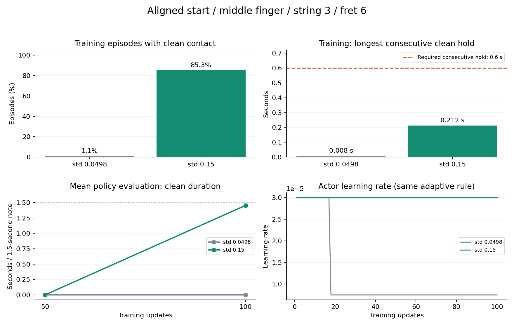

# 정렬 출발 단일 압현: 1차 검증 결과

2026-11-02 실행 완료. 중지·3번줄·6프렛에서 **정렬 출발과 팔 유지 지원을 받은 손가락4축 정책이 압현을 학습으로 재현했다.** 탐색 표준편차0.15·100회 모델은 평균 정책16환경 모두에서 달성했고, 올바른 연속 압현은 평균1.453906초/1.5초였다. 오압현·물리 종료·손목 종료는0이었다.

## 진행한 순서

1. 성공했던 실제 준비 도착 자세·속도와 원본 입력522개의 SHA를 검증했다. 기타의 논리 몸체 상태를 실제 compound root로 역변환해 에피소드 시작에서 함께 복원했다. 에피소드 도중 상태를 덮어쓰지 않는다.
2. 같은 환경에서 알려진4축 명령을 재생했다. 팔은 도착각을 유한 제어로 유지하고 손목 보정기는 사용하지 않았다. 음 전체1.5초의 압현에 성공했다. 이 검사는 학습이 아니다.
3. GPU 학습2회·엄격 재개1회·평가2환경·손/전신 영상 저장을 검증했다. 최초 검사에서 발견한 비활성 오른손 명령 오류는 새 실험 실행기에서 수정했다. 실패 원문은 `검증/oracle_static_v1`에 보존했다.
4. 기본 탐색과 확대 탐색을 각각 large·64환경·H32·100회·seed7로 학습했다. 각각204,800전이·완결640에피소드이며, 학습 시간은537.1초와542.9초다.
5. 양쪽의50/100회 모델을 각각 평균 정책16환경으로 평가하고, 성공한100회 모델의 대표 손/전신 영상을 저장했다.

기본 학습 패키지와 기존 봉인 연구는 수정하지 않았다. 실행 코드는 이 연구의 `도구/inputs.py`, `도구/learning.py`에 있다. 현재 보상9개, 직접 목표각 제어, 관절 한계·속도·PD, 압현 판정과 물리·손목 종료를 유지했다. 알려진 압현각은 재생 검사에만 사용했고 학습의 초기 명령으로 넣지 않았다.

## 비교 결과

초기 표준편차는 관절각이 아니라 행동 Gaussian의 latent 공간 값이다. 두 조건은 초기 분산만 바꾸어 시작했다. 동일한 적응 학습률 규칙의 반응은 조건에 따라 달라졌다.

| 조건 | 학습 중 접촉 발생 에피소드 | 학습 중 최장 연속 압현 | 50회 평균 정책 달성 | 100회 평균 정책 달성 | 100회 평가 평균 연속 압현 |
| --- | ---: | ---: | ---: | ---: | ---: |
| 기본 std=exp(-3), 약0.0498 | 7/640 | 0.0083초 | 0/16 | 0/16 | 0초 |
| 확대 std=0.15 | 546/640 | 0.2125초 | 0/16 | **16/16** | **1.4539초** |

학습 중에는 양쪽 모두 달성0이었다. 확대 조건은 탐색을 포함한 행동에서 압현이 자주 끊겼다. 평균 정책으로 평가한100회 모델은 연속 유지에 성공했다. 두 결과의 차이는 탐색을 제거한 효과와 일치하지만, 동일 최종 체크포인트의 별도 확률 정책 평가로 인과를 분리한 것은 아니다.

평가에서 달성에 필요한 연속 유지량은0.6초다. 성공 모델의16환경 압현 시간은1.4292~1.4667초였고, **1.5초 전체를 빠짐없이 유지한 환경은0개**다. 초반 접촉 지연이 남아 있으며 누락은 평균0.0401초다. 기하 조건 성립과 하중·압현, 준비 ready 신호와 실제 압현 성공은 서로 구분했다. 손목 안내 박스 내부 비율은0이지만 종료 허용 범위 안이어서 손목 실패는 없었다. 안내 영역 중앙까지 도달한 검사로 해석하지 않는다.

## 확인된 원인과 해석의 범위

- 같은 정렬 환경에서 알려진 동작과 학습한 정책이 모두 성공했으므로 이 한 목표가 물리적으로 불가능하거나 관절 제어가 전혀 전달되지 않는 상황은 아니다.
- 기본 탐색 모델도 손가락이 움직였지만 요청이 부족했다. 100회 평균 정책의 패드는 약3.4mm까지 접근했으나 하중이 없었다. 성공 재생과 비교하면 MCP-z 이동 요청이 특히 작았다. 실제 관절 추종오차보다 요청 부족이 더 컸다.
- 알려진 한 성공각까지의 MCP-z latent 거리는 기본 탐색에서 약3.02표준편차, 확대 조건에서 약1.00표준편차다. 이 두 끝점은 tanh 포화 구간이 아니다. 알려진 각도는 유일한 해답이 아니며, 실제100회 정책은 다른 관절 조합으로 성공했다.
- 확대 탐색은 접촉 경험을 크게 늘렸고 학습률3e-5도 유지했다. 기본 조건은18회에서7.5e-6으로 감소했다. 따라서 탐색 변경과 그에 따른 적응 학습률 반응의 기여를 각각 분리했다고 주장하지 않는다.
- 확대 조건의50회 모델은 실패하고100회 모델은 성공했다. 이 조건에서는50회가 부족했다는 근거지만, 모든 목표의 수렴 시간이100회라는 뜻은 아니다.
- 이전 v9 출발 J33 실험과 이번 연구는 출발 자세뿐 아니라 담당4축 학습·팔 지원도 다르다. 기존 실패의 원인을 초기 자세 하나로 단정하지 않는다.

## 영상과 원문

- [성공 모델 손 확대](동영상/중지_3번줄6프렛_정렬출발_100회_손확대.mp4)
- [성공 모델 전신](동영상/중지_3번줄6프렛_정렬출발_100회_전신.mp4)
- [평가 수치와 원문 SHA](분석/최종비교_수치.json)
- [학습 중 접촉·보상·학습률 분석](분석/탐색비교_학습로그.md)
- [평균 정책의 실제 관절·하중 분석](분석/확대평균정책_진단.md)
- [GPU 실행 검증](검증/GPU_실행검증.json)

대표 영상은 `실행/explore_std015_s7/J/final.pt`를 엄격 입력·구조 검증 후 촬영했다. 별도1환경에서도1.4583초 압현에 성공했다. 공개 영상은 원본과 같은 파일을 링크해 용량을 중복 사용하지 않는다.

## 다음 비교

먼저 같은 정렬 출발·단일 목표에서 팔을 자유롭게 했을 때 압현이 유지되는지 비교한다. 그 뒤 필요하면 팔 정책에 실시간 패드 오차 관측을 추가하는 조건을 따로 비교한다. 이 단계들은 아직 실행하지 않았다.

이번16환경은 같은 준비 입력에서 출발하는 재현 검사다. 다른 초기 자세·난수·손가락·줄·프렛, 원거리 이동·전환·동시 압현·곡 연주는 검증하지 않았다. 탐색0.15를 모든 운영 학습의 최적값으로 확정하지 않는다.

최종 독립 검수에서도 집계 불일치·입력 SHA 변경·차단 결함은 발견되지 않았다. [검수 원장](검증/최종독립검수.md)과 [최종 실행·봉인 검사](검증/최종실행_봉인검사.json)를 함께 보존한다.
