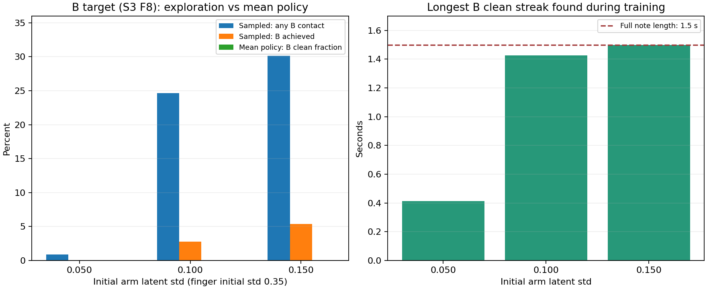

# 중지 6→8프렛 전환 실패 분석

분석일: 2026-11-03, 한국 시각. 기존 학습·평가·렌더·native 참조 원문만 읽었다. 새 학습이나 보상·제어 수정은 하지 않았다.

## 결론

**평균 정책은 첫 음인 6프렛 압현은 유지하지만, 이를 해제하고 8프렛으로 이동해 다시 누르는 동작을 학습하지 못했다.** 목표는 정상적으로 바뀌고 요청각도 제어기에 적용되지만, 정책이 충분한 방향·크기의 이동을 요청하지 않는다. 같은 물리·제어의 참조 동작과 일부 확률적 탐색에서는 8프렛 압현이 가능했다.

따라서 실패를 “8프렛이 물리적으로 불가능하다”, “목표를 못 본다”, “손가락이 대기 보상이나 속도 제한 때문에 잠겼다”로 설명할 근거는 없다. 가장 강하게 지지되는 설명은 **6프렛 유지에 머무르는 평균 행동에서 시간에 맞는 해제·이동·재압현 행동으로 전환하지 못했다**는 것이다. 그 학습 실패에 보상·학습률·학습량이 각각 얼마나 기여했는지는 별도 비교가 필요하다.

## 1. 실제로 어디에서 실패했나

시간표는 중지 3번 줄 6프렛을 3~4.5초, 같은 중지로 8프렛을 5.5~7초 누르는 과제다. 4.5~5.5초에 1초의 휴지가 있다.

| 확인 사항 | 실제 원문 |
| --- | --- |
| 목표 전환 | 4.5초에 담당 목표가 6에서 8프렛으로 바뀜 |
| 평균 정책의 압현 | 6프렛 1.5초, 8프렛 0초; 세 팔 탐색 조건·50/100/200회 모두 같은 실패 |
| 실제 손목 이동 | 전환 1초 동안 순변위 약 4.7/8.5/9.5mm |
| 남은 목표 패드 거리 | 8프렛 구간에서 약 25.3/25.9/25.6mm |
| 오압현 | 8프렛 구간에도 중지 끝마디의 6프렛 접촉이 남아 1.5초 기록 |
| 손가락 요청→적용 | 8프렛 구간 중지 4축의 요청각−적용각 RMS 0 |
| 평균 정책 안전 종료 | 물리·손목 종료 모두 0/16 |

손목 이동은 대표 렌더 env0의 구간 양끝 순변위이며 누적 이동 거리가 아니다. 패드 거리와 접촉은 평가 env0의 실제240Hz 원장이다. 손목이 25mm만큼 반드시 이동해야 한다는 의미도 아니다. 손가락과 팔이 함께 만드는 패드 위치가 그만큼 목표에서 벗어나 있다는 뜻이다.

적용각과 실제각 사이에는 유한 PD·접촉에 따른 오차가 있다. 따라서 물리 추종 오차의 영향이 전혀 없다고 단정하지 않는다. 다만 대규모 요청 차단은 없고, 같은 제어기로 참조 동작이 성공했다는 사실은 정책 명령의 부족을 더 강하게 지지한다.

## 2. 손목 안내를 통과해도 전환은 실패할 수 있다

손목 안내는 넓은 허용 영역이며, 현재 정책의 손목을 특정 지점으로 자동 이동시키는 제어기가 아니다. A의 허용 프렛 범위는4~9, B는6~11이고 실제 프렛 방향 박스는 약71.3mm 겹친다.

팔 초기 탐색0.10/0.15의 실패 자세는 B 손목 박스의 모든 축 안에 있었다. 기준 탐색도 최대 약1.96mm 밖일 뿐 종료 문턱에 이르지 않았다. 따라서 **손목 조건을 만족했다는 사실은 손가락이 8프렛에 도착했다는 뜻이 아니다.** 목표 접근과 전환은 정책이 별도로 배워야 한다.

## 3. 탐색은 개선됐지만 평균 정책으로 이어지지 않았다

각 조건은 같은 입력·seed7·large64·H32에서200회, 완료 에피소드896개다. 손가락 초기 탐색은 공통0.35이며 학습 가능한 분산이다.

| 팔 초기 탐색 std | 학습 중 8프렛 접촉 | 8프렛 달성 | 발견한 최장 연속 유지 | 200회 평균 정책의 8프렛 유지 |
| --- | ---: | ---: | ---: | ---: |
| 약0.05 |8/896 (0.9%)|0|0.413초|0초|
|0.10|221/896 (24.7%)|25|1.425초|0초|
|0.15|270/896 (30.1%)|48|1.500초|0초|

접촉은 원장의 contact_time>0, 달성은 연속0.6초 기준의 left 플래그다. 이 달성이 음 길이90% 유지·엄격 시각까지 통과했다는 뜻은 아니다.

0.10/0.15에서는 두 음이 같은 에피소드에서 모두 달성된 경우가 각각1개뿐이었다. 해당 사례도 오압현이나 앞 음의 불완전 유지가 남았다. 8프렛을 찾아본 경험은 늘었지만 두 음을 순서대로 안정적으로 연주한 경험은 매우 드물었다.

다만 “8프렛을 누르면 6프렛을 반드시 희생한다”는 상관은 확인되지 않았다. B달성 에피소드의 A 평균 유지시간은 오히려 B미달성 에피소드보다 길었다. 공동 수행이 드물다는 사실과 보상 충돌의 인과 주장을 구분한다.

## 4. 다른 손가락 교대보다 어려운 이유

다른 손가락 교대 N07/N08은 다음 손가락이3.5초부터 자신의 목표를 준비할 수 있다. A0의 중지는 현재 음을 유지해야 하므로 담당 추적 목표가4.5초에 바뀐다. B 시작까지 실질적인 담당 준비는 각각2초와1초로 다르다. A0도 미래 목표 토큰은 미리 제공되므로 미래 목표가 관측에서 사라진 문제는 아니다.

N07/N08의 손목 안내 범위는 유지되는 반면 A0는 프렛 방향 안내 구간도 바뀐다. 따라서 교대 성공이 동일 손가락의 두 프렛 이동도 같은 난도로 해결됐다는 증거는 아니다. A0는 현재 손가락의 해제와 공간 이동을 시간에 맞춰 연결하는 능력이 더 필요하다.

현재 GPU 학습 경로에서 팔을 자동으로 이동시키는 DLS 교사는 없다. 활성12축은 왼흉곽3·왼어깨3·왼팔꿈치3·왼손목3이며 오른팔을 포함하지 않는다. 정책이 팔의 직접 목표각을 출력하고 PD가 추종한다. 손가락별 단계와 안내가 관측에 있다는 것만으로 실제 이동 순서가 보장되지는 않는다.

## 5. 보상·학습률·학습 길이에 대한 판단

**보상이 성공을 전혀 구분하지 못한다는 근거는 없다.** 학습 후반의 B달성 에피소드는 B미달성보다 기록 보상이 높았다. 같은 native 참조의 할인 전 기록 합은 약−1.663, 팔 탐색0.15 평균 정책은 약−2.650이었다. 다만 이 에피소드 합은 PPO의 할인된 advantage나 정확한 정책 gradient를 대신하지 않는다.

목표 패드 접근 항이 약−4라고 해서 그 항이 실패를 강제한다고 해석하지 않는다. 이 항은 potential 차이와 종료 정산을 포함한다. 대기 보상은 준비·압현 중인 중지에서0이며, 작은 행동 변화 감점이 주원인이라는 수치도 없다.

**학습률 감소는 기여 가능성이 있지만 단독 원인으로 확인되지 않았다.** 세 조건은40/68/83회에3e-5에서7.5e-6으로 줄고 복원되지 않았다. 성공 탐색이 늘어나는 후반에 평균 행동을 바꾸는 속도가 느려졌을 수 있다. 그러나 감소 후에도 B달성은 증가했으며 학습률만 바꾼 대조가 없다. 팔·손가락의 탐색 분산이 붕괴한 현상도 없었다.

**200회가 충분했다고 단정할 수 없다.** 0.15의 마지막50회에서 B달성37개와 연속1.5초가 나왔다. 학습 중 성과는 아직 개선되고 있었다. 반면 평균 정책은50/100/200회 모두 B0초라, 시간을 더 주기만 하면 해결된다고 말할 근거도 부족하다.

## 6. 다음에 먼저 분리할 문제

1. 같은6프렛 출발 자세에서8프렛만 목표로 하는 학습으로 해제·이동·재압현 자체를 배울 수 있는지 확인한다. 8프렛에 이미 정렬된 출발과 구분한다.
2. 전체 두 음 과제에서 휴지1초→2초만 바꾼 대조로 전환 시간과 준비 난도의 영향을 확인한다. 양 조건의 목표 노출량과 실제 전이 수를 함께 보고한다.
3. 위 결과를 보고 팔 탐색0.15를 고정한 채 학습률 감소 규칙만 비교한다. 보상·시간표·탐색·학습률을 한 번에 바꾸지 않는다.

손목 안내를 무조건 좁히거나 모든 오압현을 즉시 종료하는 것은 첫 조치로 권하지 않는다. 현재는 전환 경험이 부족하므로 새로운 실패 종료가 그 경험을 더 줄일 수 있다. 먼저 정확한 이동 경로를 학습할 수 있는지 확인하고, 필요한 진행 신호나 단계 연결을 한 가지씩 비교하는 편이 원인 분리에 적합하다.

## 근거와 한계

- [이동분석](이동분석.md): 실제240Hz 목표·접촉과 대표 손목·관절 이동, 원문52개 SHA
- [로그분석](로그분석.md): 확률적 접촉·달성, 학습률·분산·보상과 원문 행
- [코드검토](코드검토.md): 목표 노출, 단계·대기 보상·접근 potential과 현재 GPU 제어 경로
- [핵심수치](핵심수치.json): 세 조건 원시집계와 같은 A0 native 참조, 원문 SHA

native 참조는 A1.5초/B1.4125초 유지, B 최초 접촉 지연 약83.3ms, A 해제 지연 약20.8ms, 오압현0으로 기존 엄격 기준을 통과했다. 이는 현재 접촉 후보 정의에서 가능한 동작이 있다는 증거이며 실제 줄별 힘·음향의 검증을 대신하지 않는다. 평가16환경은 같은 준비 입력 반복으로16개의 독립 학습 seed가 아니다. native 전체 손목 궤적은 저장되지 않아 요청 waypoint를 실제 궤적으로 가장하지 않았다.
