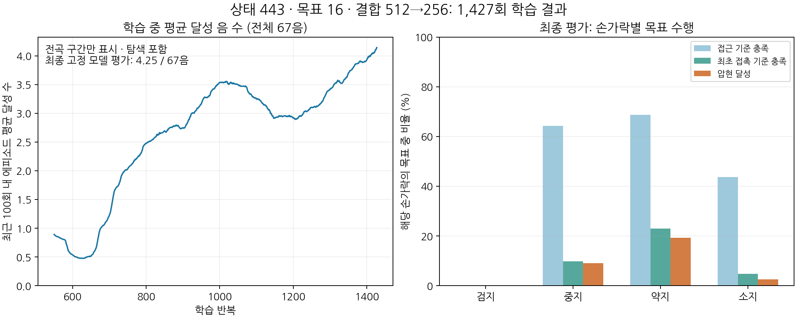

# 상태443·목표16·결합512 전곡 학습 결과

학습과 최종 평가는 정상 완료했다. **평균 달성은 4.25/67음(6.34%)으로, 전곡 압현 성능은 아직 낮다.** 평가 16회 모두 곡 끝까지 진행했지만 전곡 성공은 0회다. 실행 완료와 연주 성공은 서로 다른 의미다.

## 실행과 검증

- 정책: 상태443→256→256, 목표16→64→64를 8개 슬롯에 공유, 결합768→512→256→33.
- 학습: 1,024환경, H32, seed7, 1,427회, 46,759,936개 전이.
- 실제 학습 시간: 6시간 32분 25초. 처리량 측정으로 산정한 반복 수를 먼저 채워 약7시간 상한 전에 정상 종료했다.
- 완료: 2026-11-04 08:45 KST. 최종16환경 평가 완료: 08:50 KST.
- 초기25% 노출은 구간 학습이며 이후 reset부터 전곡이다.
- 학습·평가 `completed=true`, 입력 변경·누락 import pin·정리 오류 없음. 원문 보고서의 lifecycle 검증도 통과했다.
- 최종 체크포인트 SHA256: `fabace6a12cc920a13d4f2812dcaf8f18459fce725a39cabcd1afe3fa3ae212f`.

## 최종 고정 정책 평가

| 지표 | 결과 |
| --- | ---: |
| 평균 달성 | 4.25 / 67음 |
| 환경별 달성 범위 | 1–8음 |
| 곡 시간 끝까지 진행 | 16 / 16 |
| 물리 실패 / 손목 이탈 종료 | 0 / 0 |
| 전곡 압현 성공 | 0 / 16 |
| 음별 유효 압현 유지 비율의 평균 | 5.80% |
| 손목 허용 영역 안에 있던 시간 비율의 평균 | 87.01% |

16환경은 동일 seed로 학습한 하나의 모델에 대한 평가다. 16개 독립 학습 실험이 아니다. 달성은 현재 GPU의 하중·패드 기하 판정이며 실제 현 압력이나 음향 성공을 검증한 수치는 아니다.

| 손가락 | 곡 목표 수 | 평균 달성 | 달성 비율 | 접근 기준 충족 | 최초 접촉 기준 충족 |
| --- | ---: | ---: | ---: | ---: | ---: |
| 검지 | 25 | 0 | 0% | 0% | 0% |
| 중지 | 18 | 1.625 | 9.03% | 64.24% | 9.72% |
| 약지 | 12 | 2.3125 | 19.27% | 68.75% | 22.92% |
| 소지 | 12 | 0.3125 | 2.60% | 43.75% | 4.69% |

접근은 노출 구간에서 목표 패드 거리1cm 이내를 합계0.1초 채웠는지의 원장 지표다. 접근·최초 접촉에는 준비 구간도 포함되므로 발음 구간의 유효 압현 유지 비율과 동일하게 해석하지 않는다.

검지는 16환경×25목표의 모든 평가에서 접근 완료·접촉 완료·유효 유지가 0이었다. 유지 시간이 조금 모자란 단계보다 앞에서 실패한다. 중지·약지·소지는 목표에 접근한 비율에 비해 접촉과 달성 비율이 낮다.

중지는 발음 구간의 목표별 오압현 시간이62.73115/67.432목표·초로93.03%다. 소지는 누락 시간이47.9503667/49.6224목표·초로96.63%다. 분모는16환경에서 해당 손가락에 배정된 목표의 발음 길이를 모두 합한 값이다. 동시 목표는 각각 계산하므로 전체 경과 시간 중 비율과는 다르다. 원장의 `wrong`·`missing` 배열과 현행 곡 목표의 담당 손가락을 대응시켰으며 모든 목표 ID 순서도 일치했다. 중지의 오압현 원인이 자기 손가락의 잘못된 줄·프렛인지 다른 손가락 간섭인지는 별도 분해가 필요하다.

엄지는 모든 평가에서 넥 뒤 접촉 후보와 넥 방향 하중이 0이었다. `thumb.mean_distance_m`의 평균은26.78mm이며 후면10mm 이내 시간도0이다. 엄지 안내 보상을 조금 받았다는 사실은 접촉이나 지지를 달성했다는 뜻이 아니다. 이번에는 엄지도 정책 제어 대상이므로 과거 단일 손가락 실험의 엄지 고정을 원인으로 적용하면 안 된다.

## 학습 경향과 해석

| 전곡 학습 구간 | 완료 에피소드 수 | 평균 달성 |
| --- | ---: | ---: |
| 451–550회 | 1,936 | 0.892음 |
| 901–1,000회 | 1,820 | 3.537음 |
| 1,328–1,427회 | 1,843 | 4.144음 |

각 구간은 완료 에피소드 수로 가중 집계했다. 학습 중에는 탐색이 포함된다. 후반 마지막100회의 물리 실패는304/1,843(16.49%), 손목 종료23/1,843(1.25%)였다. 고정 정책 평가의 조기 종료0과 구분한다.

학습률은3e-5에서7.5e-6으로 내려갔다. 이번 실행은 기존 PPO 규칙을 유지했고 별도 학습률 하한 회복을 적용하지 않았다. 후반 달성 수가 다시 증가했으므로 완전히 정체됐다고 단정할 수 없다. 동시에 검지 접근0과 엄지 접촉0을 단순히 학습 시간 부족만으로 설명할 근거도 없다. 신경망 폭, 관측 구성, 보상 중 어느 하나가 원인이라고 확정하려면 조건을 통제한 비교가 필요하다.

우선 검지 목표의 거리·목표각·실제각을 확인하고, 다음으로 다른 손가락의 접근 후 접촉 거부와 오압현 원인을 구분하는 것이 적절하다. 이번 확인 과정에서는 학습·보상·제어 구현을 변경하지 않았다.

## 영상과 원문 기록

최초 자동 촬영은 영상 인코딩 자체는 완료했으나 촬영 도중 새로 추가된 `guitar_learning/song/strike_task.py`와 `guitar_learning/tests/test_strike_task.py`의 내용이 바뀌어 최종 소스 검증에 실패했다. 기존 `영상원문/`과 `진행상황.json`의 실패 기록은 그대로 보존한다. 학습493개·평가500개 입력의 해시는 재확인 때도 모두 일치했다.

동일 최종 모델을 엄격한 체크포인트·입력·identity 검사로 다시 촬영했고 모두 통과했다. 재촬영은 평가와 같은16환경 중 사전에 정한 환경0의 첫 에피소드만 기록했으며6/67음을 달성했다. 성공 장면을 골라 이어 붙이지 않았다. 손·전신 영상 모두1280×720, 30fps, 984프레임, 32.8초이며 전체 디코딩도 통과했다. 최신 촬영의 검증 결과는 [영상재검증/report.json](영상재검증/report.json), 최종 산출물 정리는 [최종결과.json](../최종결과.json)에 기록했다.

- [대표 손 확대 영상](../동영상/hand.mp4)
- [대표 전신 영상](../동영상/fullbody.mp4)

- [학습 원문 보고서](../학습/J/report.json)
- [최종 평가 원문 보고서](../최종평가/report.json)
- [재집계 수치](summary.json)
- [분석 재현 코드](분석.py)
