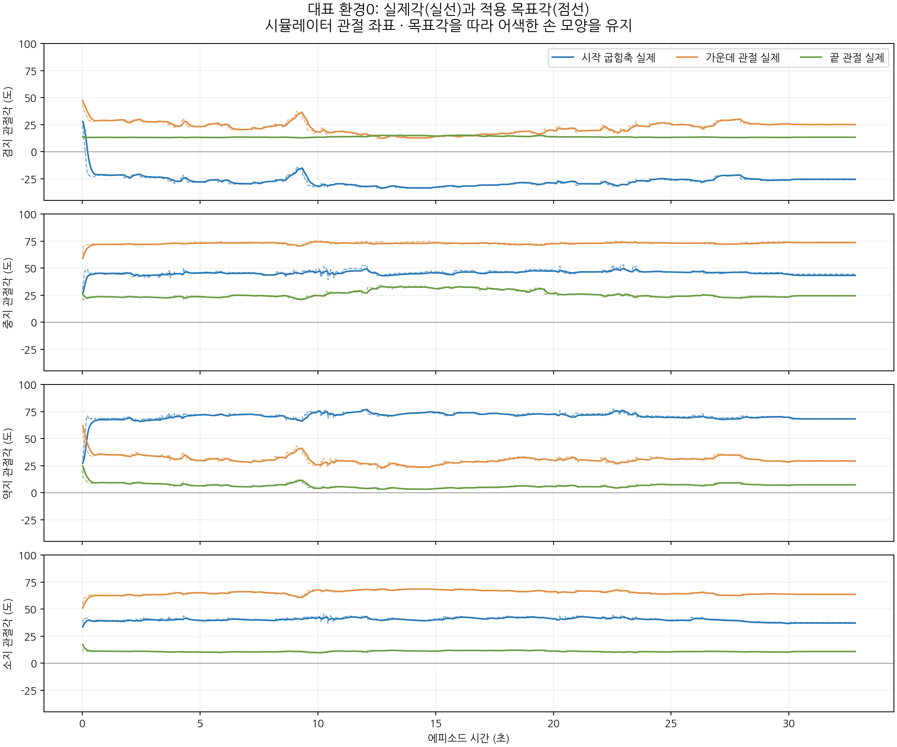
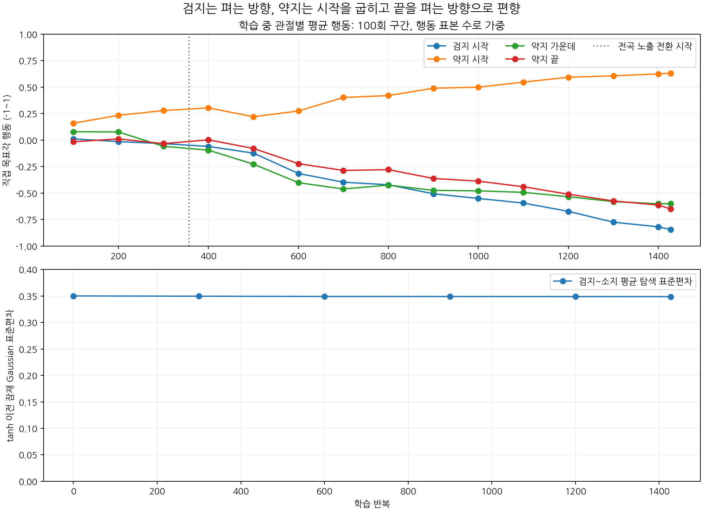

# 손가락 자세 이상 원인 분석

분석일: 2026-11-04. 대상: 상태443·목표16·결합768→512→256→33, 1,427회 전곡 학습의 최종 모델.

**정책이 어색한 목표각을 선택하고 관절이 대체로 그 각도를 따라간 것이 이번 영상의 주된 현상이다.** 검지는 뒤로 펴진 채 목표에서 멀어지고, 약지는 시작 관절을 많이 굽힌 채 끝 관절을 펴는 자세를 유지한다. 숫자가 무한히 커지는 물리 발산이나 정확한 관절 한계 포화는 확인되지 않았다. 약지 벌림축에는 별도의 추종 오차가 있어 모든 축이 완벽히 추종한다고 해석해서는 안 된다.

상태·목표 벡터만 바뀌고 보상을 유지했기 때문이라는 설명에는 일부 근거가 있다. 현재 보상은 자연스러운 손 모양과 관절 협응을 충분히 요구하지 않는다. 그러나 **입력뿐 아니라 손가락별 출력 구조도 공통33축 출력부로 바뀌었고, compact 환경은 E4 준비 조건을 사용한다.** 따라서 입력, 정책 구조, 보상·준비 조건의 상호작용을 살펴봐야 한다. 어느 하나의 기여도를 확정하려면 조건을 고정한 비교가 필요하다.

## 1. 분석 범위와 신뢰할 수 있는 기록

- 검증된 최종 평균정책 평가16개 완결 에피소드.
- 동일 모델·16환경 중 사전에 선택한 환경0의 재촬영: 실제각·속도·적용목표·정책행동·강체 자세를60Hz로1,969시점 기록.
- 대표 환경0 최초10초의240Hz 제어·목표·E4 실제 대기 보상 trace 2,400행.
- 1,427개 PPO 학습 지표, 전체57,205개 완료 학습 에피소드, 초기·300·600·900·1,200·최종 체크포인트.
- 학습 입력493개는 분석 시작 시점 현재 파일과 해시가 모두 일치했다. 입력·행동 변환의 핵심 코드도 평가와 일치했다. 새 학습·GPU 재평가·학습 소스 변경은 수행하지 않았다.

최상위 `최종평가/finger_control_diagnostics.json`에는 평가 마지막 수집 경계에서 재시작된 다음 에피소드의0.25초 부분 상태가 남아 있다. 이번 분석에서는 이 파일을 전곡 요약으로 사용하지 않고 `episodes.jsonl`의32.8167초 완결 에피소드 진단을 사용했다.

## 2. 실제로 어떤 자세가 만들어졌는가

대표 환경0에서 다음 각도를 확인했다. 값은 native 관절 좌표이며, 다축 시작 관절의 해부학적 각도와 동일하다고 가정하지 않는다. 별도의 대기 보상은 실제 강체 회전에서 구한 기하 굽힘각을 사용한다.

| 시점 | 검지 시작 굽힘축 | 검지 가운데/끝 | 약지 시작 굽힘축 | 약지 가운데/끝 |
| --- | ---: | ---: | ---: | ---: |
| 첫 기록0.017초 | +27.84° | 47.25° / 14.04° | +27.35° | 61.89° / 24.70° |
| 0.5초 | −20.31° | 28.97° / 13.25° | +66.15° | 35.08° / 9.22° |
| 15초 | −32.86° | 14.11° / 14.39° | +74.29° | 25.21° / 3.75° |
| 32.8초 | −25.54° | 25.09° / 13.37° | +68.29° | 29.40° / 7.28° |

15초의 검지 시작 목표각은−32.80°, 실제각은−32.86°다. 약지 시작 목표각은73.99°, 실제각은74.29°다. 이 축들은 제어기가 요청과 다른 방향으로 밀린 것이 아니라 정책이 요청한 자세를 따라간다. 중지는 시작 약45°·가운데73° 부근, 소지는 시작40°·가운데65° 부근의 구부러진 모양을 상당 시간 유지한다.

완결 평가16개에서 손가락별 적용목표 추종 RMS를 관절별로 먼저 계산한 뒤 평균하면 검지 약1.25°, 중지1.14°, 약지3.17°, 소지0.94°다. 약지 시작 벌림축 `LH:ring1_z`는 개별8.76°로 크고, 대표15초에도 목표−3.77°에 실제+6.61°다. 접촉·다축 제약·추종 특성 중 무엇이 이 오차를 만드는지는 이 기록만으로 분리하지 못한다. 반면 약지 굽힘축들의 평균 오차는 약1.87°/1.35°/0.71°로 작다.

- 원문 자세 배열과 저장 가중치에서 비유한 값 없음.
- 대표 평균정책의 LH21 행동 `abs(action)≥0.98` 비율0%.
- 16개 평가의 actual/target native-limit fraction 모두0. 이 지표는 한계1e-6rad 이내를 뜻하며, 부자연스러운 조합이 없다는 뜻은 아니다.
- 제어는 직접 목표각 방식이며 누적 행동 분기는 사용하지 않는다.

## 3. 학습하면서 잘못된 자세 편향이 강해졌다

학습 원문을 스트리밍으로 집계했다. 아래는 각 구간에서 완료된 에피소드의 행동 표본 수로 가중한 실제 수집 행동의 평균이다. 음수는 준비 기준각에서 관절 하한 쪽, 양수는 상한 쪽 요청이다.

| 학습 반복 | 검지 시작 | 약지 시작 | 약지 가운데 | 약지 끝 |
| --- | ---: | ---: | ---: | ---: |
| 1–100 | +0.011 | +0.159 | +0.079 | −0.017 |
| 501–600 | −0.316 | +0.274 | −0.403 | −0.223 |
| 901–1,000 | −0.552 | +0.499 | −0.480 | −0.388 |
| 1,401–1,427 | −0.845 | +0.631 | −0.601 | −0.651 |

초반은 구간 학습이고 이후 전곡으로 전환하므로 초기/후기 관측·목표 분포가 같지 않다. 이 표는 동일한 고정 관측에 대한 정책 출력 비교가 아니다. 그 제한을 고려해도 전곡 구간에서 검지는 더 펴고, 약지는 시작을 굽히며 나머지를 펴는 명령이 실제로 점차 강해진 것은 확인된다.

검지~소지16축의 학습된 잠재 Gaussian 탐색 표준편차 평균은 **0.3500→0.3487**, 마지막 축별 범위0.3438–0.3522다. 탐색이 거의0으로 사라진 상태가 아니다. 이 수치는 tanh 이전 분포이며 실제 목표각 탐색 폭과 같지는 않다. 대표 영상은 탐색을 뺀 평균정책인데도 같은 편향이 나타난다.

학습률은574회에서3e-5→7.5e-6으로 한 번 감소했다. 이후까지 자세 편향이 강해졌다. 학습률 감소가 나쁜 자세를 발견한 유일한 원인이라고 볼 수 없으며, 단순히 학습률만 되돌리면 자연스러운 손 모양이 된다고 말할 근거도 없다.

그래프의 일반 집계 구간은100회이며 마지막 구간만27회다.

## 4. 대기 보상은 왜 이 자세를 복구하지 못했는가

### 실제 보상 기회는 기존 진단값보다 짧다

E4에서는 손가락의 미래 목표가 준비 대상으로 노출되면 지급용 `standby_reward_gate`를0으로 바꾼다. 그러나 기존 진단의 `eligible_s`, `gate_weighted_s`, `actual_gate_runs`는 변경 전 `gate`를 읽는다. 실제 지급액은 변경된 보상률을 적분하므로 맞지만, 대기 기회 요약은 현재 지급 조건을 정확히 설명하지 못한다.

악보·현재 E4 함수를 CPU로 재구성하여 최초10초 trace의 지급/진단 gate와 비교했고 최대 절대오차는 모두1.11e-16이었다. 전곡의 구형 gate 적분도 원문과1e-10 이내로 일치했다. 접촉·근접 veto와 무효 각도·비유한 거리는 이번16개 평가에서 모두0이므로 실제 전곡 기회를 재구성할 수 있었다.

| 손가락 | 기존 진단 가중 대기 시간 | 실제 E4 가중 대기 시간 | 실제 가능 최대 대비 받은 대기 보상 |
| --- | ---: | ---: | ---: |
| 검지 | 15.676초 | 8.399초 | 70.37% |
| 중지 | 18.736초 | 8.215초 | 69.65% |
| 약지 | 22.036초 | 9.118초 | 87.97% |
| 소지 | 24.008초 | 19.594초 | 96.99% |

최초10초 약지는 실제 대기 보상이 계속0인데 기존 gate 평균은0.6204다. 따라서 기존 요약만 보고 대기 보상을 충분히 받았는데 무시했다고 설명하면 안 된다. 다만 검지·중지에도 전곡 실제 기회는8초 이상 있으므로 준비 조건만으로 모든 실패를 설명할 수도 없다.

### 어색한 모양에서도 높은 대기 품질이 남는다

B 권고의 기하 굽힘각 중심(MCP/PIP/DIP)은 검지25.49°/35°/12°, 중지28.02°/38°/14°, 약지31.03°/41°/16°, 소지34.33°/44°/18°다. 반폭은±30°/±15°/±15°다. 밴드 안은 모두 같은 점수이며 바깥에서도 `1/(1+Σ(outside/30°)²)`로 부드럽게 점수가 남는다.

손가락당 최대 보상률은0.005/s이고, 현재16평가의 전체 대기 보상 평균은0.1933/에피소드다. 강제로 B 목표각을 요청하는 기능은 아니다. 벌림축, 손가락끼리의 교차·간격, 마디 간 자연스러운 협응을 직접 평가하지도 않는다. 실제 기회에서 약지88%, 소지97%의 최대 보상을 받은 결과는 사람 눈에 어색한 자세에도 현재 품질값이 높을 수 있음을 보여준다.

이 보상이 약하다는 것과 움직임 비용이 필요하다는 것은 별개다. 사용자가 원한 손가락 움직임 비용0은 유지되고 있다. **움직임을 억제할지보다 어떤 자세 조합을 허용하고 무엇을 회복시키려는지**를 명확히 하는 것이 먼저다.

## 5. 압현 중 자세 제약과 이상 자세 진단의 빈틈

현재 `shape_rate_per_s=0`이며 평가의 관절 협응 shape 보상도 모두0이다. 개별 native 관절 한계와 충돌은 있지만 그 범위 안의 어색한 조합을 억제하는 활성 자세 보상은 없다.

기존 이상 조합 진단도 아래 세 패턴만 검사한다.

1. MCP<−20°이면서 PIP>60°이면서 DIP>60°.
2. MCP>75°이면서 PIP>75°이면서 DIP<10°.
3. DIP−PIP>50°.

이번 검지는 시작이 뒤로 펴져도 나머지가60°보다 작아 첫 조건에 안 걸린다. 약지는 시작이 많이 굽어도 가운데가75°보다 작아 두 번째 조건에 안 걸린다. 따라서 `extreme_combinations=0`은 현재 자세가 자연스럽다는 증거가 아니다. 이는 분석 지표의 빈틈이며 직접 제어 오작동을 일으키는 원인은 아니다.

## 6. 손가락별 실제 압현 실패 양상

검지는16평가×25목표에서 접촉·유효 유지·목표 기하·목표 distal 하중 시간이 모두0이다. 대표 환경 최초10초에서 목표가 노출된 검지 패드 거리는 평균112.81mm, 최소102.74mm다. 검지는 접촉한 뒤 유지가 짧은 문제가 아니라 목표 근처로 가지 못한다.

중지는 목표에는 접근하지만 발음 구간 오압현 비율93.03%다. 정확한 발음 구간 원인 원장으로 분해하면 아래와 같다.

| 원인 | 중지 목표 발음 시간 대비 |
| --- | ---: |
| 자기 끝마디의 다른 줄 접촉 후보 | 85.22% |
| 자기 끝마디의 다른 프렛 접촉 후보 | 11.97% |
| 다른 손가락의 높은 프렛 간섭 | 18.20% |

원인은 동시 발생하므로 합산하지 않는다. 다른 손가락의 높은 프렛 간섭 출처는 전부 약지 끝마디 `LH:ring3`였다. 전체 발음 길이는 에피소드당4.2145목표·초이며, 이는 동시 목표를 각각 더한 분모다. 현재 GPU 판정은 몸체 하중과 가상 줄·메시 기하 기반으로, 실제 소리나 현 압력을 측정한 것은 아니다.

엄지는 활성 제어 중이지만 평균 후면 signed gap31.43mm, 안내 영역 초과32.44mm, 방향 일치도0.833이다. 접촉 후보와 넥 방향 하중은0이다. 방향보다는 위치·간격이 부족하다. 접촉 없이도 기하 품질 보상이 일부 지급돼 평균0.0172를 받았다. 현재 손목 위치에서 엄지 접촉이 가능한지와 작은 보상 때문에 덜 학습됐는지는 별도 검증해야 한다.

## 7. 입력만 바꾸고 보상을 유지해서 생긴 문제인가

다음 세 가지를 구분해야 한다.

**확인한 구조 변화:** 기존 정책은 손가락별 출력부에 해당 손가락의 tracking/next 목표와 로컬 상태를 직접 연결했다. 새 정책은 상태·8목표 인코딩을 결합한 공통 특징으로33축을 출력한다. 입력과 행동의 인덱스·부호 오류는 발견하지 못했지만, 새 정책은 담당 목표와 손가락 행동의 관계를 새로 배워야 한다. 공통 출력의 학습 간섭이 원인인지는 아직 검증하지 않았다.

**확인한 보상 한계:** 자연스러운 마디 조합은 활성 압현 보상에서 요구하지 않고, 대기는 약한 밴드 보너스이며 미래 준비 때 꺼진다. 목표가 없는 손가락의 목표 벡터를0으로 마스킹해도 그 손가락의 행동을 B 자세로 제한하는 것은 아니다. 이러한 설계는 현재의 어색한 손 모양을 허용한다.

**비교 기준의 주의:** 9개 보상항과 주요 가중치를 유지했더라도 compact 환경은 E4를 명시한다. 일반 기본 J 환경과 비교하면 실제 대기 지급 gate·준비 노출·접근 기준의 E4 적용 여부까지 확인해야 한다. 이전 E4 단일 목표 실험과 새 전곡 실험은 제어 범위와 목표 난이도도 다르다. 이번 결과만으로 상태 차원 감소나512폭, 보상 하나의 효과를 따로 판정할 수 없다.

가장 강한 설명은 **손 모양이 나빠져도 일부 목표 접근·접촉을 늘리는 방향이 학습됐고, 그 과정에서 모든 손가락의 준비·정렬·자세 회복을 요구하는 신호가 충분하지 않았다**는 것이다. 관측된 행동과 현재 계산식이 이 설명에 부합한다. 각 보상·정책 구조가 얼마만큼 원인이었는지는 대조 실험 전까지 가설로 남긴다. 잠재함수 차분인 접근 보상의 큰 음수 합만 보고 해당 항이 학습을 지배했다고 단정하지 않는다.

## 8. 다음 개선을 위한 우선순위

1. E4 실제 지급 gate와 품질·회복 구간을 별도로 기록하고, 현재 영상의 과신전·마디 편중·벌림 추종을 놓치지 않는 진단을 만든다.
2. 검지는 도달, 중지는 목표 줄 정렬, 약지는 타 손가락 간섭을 분리하여 짧게 검증한다. 움직임 비용0을 유지하면서 자세 조합과 접근 방향의 문제를 다룬다.
3. 준비 예정이라는 이유만으로 대기 권고를 오래 끄는 조건과, 너무 넓은 자세 허용 구간을 각각 별도로 비교한다. 압현 중 자유로운 굽힘을 막는 강제 고정은 별도 문제다.
4. 새 입력을 유지한 채 손가락별 출력부를 복원하는 비교, 공통 출력부를 유지한 채 자세·정렬 신호를 바꾸는 비교를 구분해 설계한다.
5. 엄지는 현재 손목 범위에서 후면 접촉 가능성을 먼저 확인한다. 모든 변경을 한 번에 넣고 다시7시간 학습하는 것은 원인 분리에 적합하지 않다.

이 문서는 분석과 후속 검증 제안이다. 보상·제어·학습 구조는 수정하지 않았다.

## 재현 자료

- [원문 집계 코드](analyze.py), [관절·학습 집계값](diagnosis.json)
- [보상·E4·오압현 재계산 코드](reward_checks.py), [재계산 결과와 근거 SHA](reward_checks.json)
- [최종 평가](../최종평가/report.json), [평가 에피소드](../최종평가/episodes.jsonl)
- [검증된 영상 보고서](../결과검토_20261104/영상재검증/report.json)
- [실제 제어](../../../../../guitar_learning/gpu/control.py), [새 정책](../../../../../guitar_learning/training/compact_press.py)

코드 근거: `gpu/control.py:452` 직접 목표각, `training/compact_press.py:77` 공통 출력, `training/policy.py:474` 기존 손가락 출력, `gpu/finger_skill_environment.py:337` E4 gate, `gpu/episode_diagnostics.py:300` 구형 gate 진단, 같은 파일348행 이상 조합, `gpu/finger_reward.py:298` B 품질, `gpu/contact.py:943` 이후 오압현 출처.
