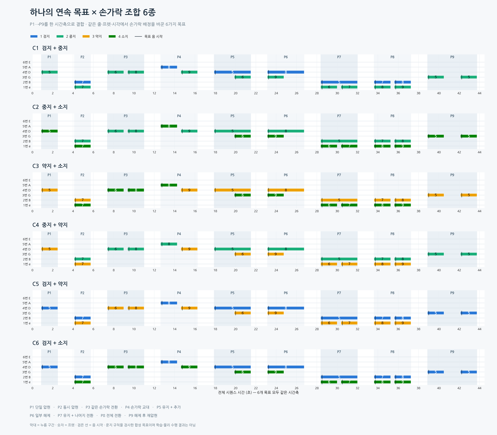

# 하나로 이어지는 압현 목표 · 손가락 조합 6종

[앞서 만든 9개 과제](../압현_예시목표_시각화_v1/README.md)의 유형을 P1→P9 순서로 하나의 시간축에 합쳤다. 각 파일은 0~43.75초의 연속 목표 하나이며, 20개 음과 20개 누름 이벤트를 포함한다. 두 손가락 조합 6가지를 모두 담았다.

모든 버전의 줄·프렛·시각은 같고 담당 손가락만 다르다. 조합 순서와 허용되는 역할 배정은 seed `20261110`으로 추출했다. 과제 안에서는 담당 손가락을 유지한다. 동시에 누르는 위치에서는 손가락 순서 등의 원래 운지 제약이 있으므로 가능한 배정 중에서만 선택한다.



## 입력과 그림

| 목표 | 손가락 조합 | 상세 이미지 | 목표 JSON |
| --- | --- | --- | --- |
| C1 | 검지 + 중지 | [PNG](이미지/개별/C1.png) · [SVG](이미지/개별/C1.svg) | [입력](입력/C1.fingering.json) |
| C2 | 중지 + 소지 | [PNG](이미지/개별/C2.png) · [SVG](이미지/개별/C2.svg) | [입력](입력/C2.fingering.json) |
| C3 | 약지 + 소지 | [PNG](이미지/개별/C3.png) · [SVG](이미지/개별/C3.svg) | [입력](입력/C3.fingering.json) |
| C4 | 중지 + 약지 | [PNG](이미지/개별/C4.png) · [SVG](이미지/개별/C4.svg) | [입력](입력/C4.fingering.json) |
| C5 | 검지 + 약지 | [PNG](이미지/개별/C5.png) · [SVG](이미지/개별/C5.svg) | [입력](입력/C5.fingering.json) |
| C6 | 검지 + 소지 | [PNG](이미지/개별/C6.png) · [SVG](이미지/개별/C6.svg) | [입력](입력/C6.fingering.json) |

[모음 SVG](이미지/연속목표_6조합_모음.svg)도 제공한다. 상세 그림은 하나의 시퀀스를 3행으로 나눈 것이며 시간은 매 행 초기화하지 않는다. 모음 그림의 6개 시간축은 동일하고 상세 그림은 행마다 표시 범위가 다르다.

그림은 기존 finger mapping의 색·줄 순서를 따른다. 막대는 누름 시작~해제, 숫자는 프렛, 검은 세로선은 목표 음 시작이다. 위에서부터 실제 6번줄(E)→1번줄(e)이다. JSON/CSV에서는 **string=0이 실제 6번줄**, finger=1/2/3/4는 검지/중지/약지/소지다.

## 하나의 목표 안에 들어가는 과제

| 구간 | 음 시작~마지막 해제(초) | 수행할 작업 |
| --- | --- | --- |
| P1 | 1.00~2.50 | 한 손가락으로 진입·압현·유지·해제 |
| P2 | 4.25~5.75 | 서로 다른 두 줄의 같은 프렛을 동시에 누르기 |
| P3 | 7.50~11.00 | 같은 손가락이 다른 프렛으로 전환 |
| P4 | 12.75~16.25 | 이전 손가락 해제 후 다른 손가락으로 교대 |
| P5 | 18.00~21.50 | 한 손가락을 유지하며 다른 손가락 추가 |
| P6 | 23.25~26.75 | 두 손가락 중 하나만 먼저 해제 |
| P7 | 28.50~32.00 | 한 손가락은 계속 유지하고 다른 손가락만 전환 |
| P8 | 33.75~37.25 | 두 손가락의 목표를 함께 전환 |
| P9 | 39.00~43.75 | 같은 위치를 해제한 뒤 다시 누르기 |

선행 누름은 기본 120ms이므로 첫 누름 시각은 0.88초다. 과제 사이 음 간격은 1.75초이며 누름 목표가 없는 시간은 1.63초다. 이 쉼은 목표의 일부이며 시뮬레이션 초기화나 손 자세 재주입 명령이 아니다. 원래 동일 목표 병합 임계 1.5초보다 길게 두어 과제 경계가 우발적으로 하나의 긴 압현으로 합쳐지지 않도록 했다.

P7의 유지 목표는 28.38~32.00초 동안 하나의 누름 이벤트다. P9는 38.88~40.50초와 42.13~43.75초의 두 누름으로 분리된다. P3·P4·P7·P8 내부 전환은 첫 음 종료에서 다음 음 시작까지 0.50초를 둔다.

## 검증 범위

기존 `tab2fingermapping/fingermapping/assign.py`의 `_melody_candidates()`, `validate()`, `press_events()`를 그대로 사용했다. 각 과제의 누름을 단순 연결하지 않고 **20개 음 전체에서 누름 일정을 다시 계산**했다.

- 6개 목표 모두 원래 후보·검증 규칙 통과. 모든 누름 경계 사이 활성 목표 합집합도 검사했다.
- 한 손가락 한 목표, 한 줄 한 목표, 바레 제외, 1~14프렛, 손가락 이동시간 및 원래 음 길이를 보존했다.
- 각 과제의 역할·시간 조건, P7 연속 유지, P9 실제 해제·재압현, 과제 경계의 해제 구간을 확인했다.
- 손가락 조합 6개 전체 포함, 버전 간 줄·프렛·시각 일치, 원시 CSV 재입력 일치를 확인했다.
- 독립 검수에서 파일을 쓰지 않고 다시 계산한 6개 JSON·검사 결과가 저장본과 일치했다. 참조 원본 7개 파일의 SHA도 보존됐다.

검사 기록: [규칙 검사](검증/rules_report.json), [독립 검수](검증/independent_review.json), [그림 입력 SHA](검증/render_report.json).

이는 **유효한 운지 후보를 뽑은 합성 목표**다. 원래 빔서치의 최소 비용 운지라는 뜻은 아니며, 위 생성 단계에서는 휴머노이드의 물리적 압현 가능성·접촉력·음향 성공을 검사하거나 학습·GPU 실행을 수행하지 않았다. 후속 v5 연결과 작동 검증은 [별도 기록](../압현_v5_합성목표연결_v1/README.md)에서 확인한다.

## 파일 구성과 재현

`입력/`에는 버전별 표준 notes/presses/hand JSON, 원시 notes CSV, N 코드 트랙을 둔다. 세부 과제 구간과 역할 배정은 JSON의 `metadata.sections`에 있다. `이미지/`는 PNG/SVG, `검증/`은 검사·소스 기록, `도구/`는 이번 합성 자료 재생성용 스크립트다.

프로젝트 루트에서 실행한다. 앞선 예시 생성기의 과제·검사 함수를 읽기 전용으로 재사용하므로 이 디렉토리와 프로젝트를 함께 보관한다.

```bash
CUDA_VISIBLE_DEVICES='' PYTHONDONTWRITEBYTECODE=1 \
  python -B docs/2026-11-09/압현_연속목표_손가락조합_v1/도구/build_combined.py
CUDA_VISIBLE_DEVICES='' PYTHONDONTWRITEBYTECODE=1 \
  python -B docs/2026-11-09/압현_연속목표_손가락조합_v1/도구/render_combined.py
```

생성 원본은 그대로 보존한다. 후속 작업에서 `data/song_bundles/press_sequence_c1_v1`~`press_sequence_c6_v1`에 학습용 사본을 등록한다. [v5 목표 실행기](../압현_v5_합성목표연결_v1/README.md)는 줄 번호 변환·입력 SHA·원본 동시 압현 시각을 검사하며, 이 원본 생성기의 규칙 검증과 물리 학습 성과를 구분한다.
