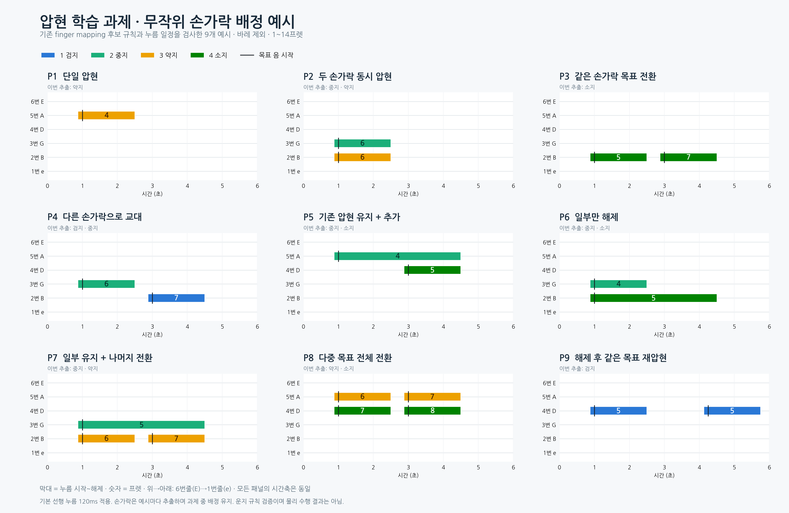

# 압현 9과제 — 운지 규칙을 검사한 예시 목표

[과제 정의](../압현_학습과제_정리.md)에 대응하는 합성 목표다. 손가락을 과제별로 고정하지 않고, 기존 finger mapping의 유효한 포지션 후보 중 역할·시간 조건을 만족하는 배정을 seed로 추출한다. 생성 seed는 `20261109`다.



## 그림 읽기

- 가로축: 시간(초). 모음 그림의 모든 패널은0~6초로 동일하다.
- 위→아래: 실제6번줄(low-E),5번(A),4번(D),3번(G),2번(B),1번(high-e).
- 막대: 왼손 누름 시작~해제. 막대 안 숫자는 프렛이다.
- 색: 파랑=검지, 청록=중지, 주황=약지, 초록=소지. 범례 번호1~4는 손가락 번호다.
- 검은 세로선: 목표 음 시작 시각. 실제 타현이나 음향을 측정한 결과는 아니다.

JSON의 `string=0`은 실제6번줄이다. 현재 물리 학습의 다른 입력에서 쓰는 `0=high-e` 관례로 그대로 읽으면 안 된다. 이 자료는 등록 전 합성 운지 예시이며 현행 학습 입력으로 자동 등록하지 않았다.

## 과제별 원래 finger mapping 형식 이미지

| 과제 | 내용 | 이미지 | 목표 JSON |
| --- | --- | --- | --- |
| P1 | 한 손가락 진입·유지·해제 | [보기](이미지/개별/P1.png) | [입력](입력/P1.fingering.json) |
| P2 | 두 손가락 동시 압현 | [보기](이미지/개별/P2.png) | [입력](입력/P2.fingering.json) |
| P3 | 같은 손가락으로 프렛 전환 | [보기](이미지/개별/P3.png) | [입력](입력/P3.fingering.json) |
| P4 | 다른 손가락으로 교대 | [보기](이미지/개별/P4.png) | [입력](입력/P4.fingering.json) |
| P5 | 한 손가락을 유지하며 목표 추가 | [보기](이미지/개별/P5.png) | [입력](입력/P5.fingering.json) |
| P6 | 두 손가락 중 하나만 해제 | [보기](이미지/개별/P6.png) | [입력](입력/P6.fingering.json) |
| P7 | 한 손가락 유지 + 다른 손가락 이동 | [보기](이미지/개별/P7.png) | [입력](입력/P7.fingering.json) |
| P8 | 두 손가락 목표를 모두 전환 | [보기](이미지/개별/P8.png) | [입력](입력/P8.fingering.json) |
| P9 | 같은 목표를 해제하고 다시 압현 | [보기](이미지/개별/P9.png) | [입력](입력/P9.fingering.json) |

[SVG 모음](이미지/압현_9과제_모음.svg)도 제공한다. 개별 이미지는 프로젝트의 기존 `guitar_learning.tool.render_timeline` 함수를 그대로 호출한 결과이며, 모음 이미지는 같은 색·줄 순서·표기 규칙으로 그렸다.

## 어떤 규칙을 확인했는가

기준은 현행 `tab2fingermapping/fingermapping/assign.py`와 `ALGORITHM.md`다. 바레를 제외한 포지션 후보 경로를 사용한다. 코드 이름이나 곡의 화성을 주장하는 입력이 아니므로 코드 트랙은 `N`으로 두며 코드 그립 사전을 강제로 적용하지 않는다.

1. 기존 `_melody_candidates()`가 생성하는 후보에 실제 손가락 배정이 포함되는지 확인한다. 손가락 순서·프렛 폭·손가락 간 거리 제약을 이 경로로 검사한다.
2. 기존 `validate()`로 음 구간의 위반을 검사한다.
3. 기존 `press_events()`의 선행 누름120ms·병합 간격1.5초·이동시간30ms·최대 조기 단축80ms 기본값을 유지해 누름 일정을 만든다.
4. 생성된 **누름 일정의 모든 경계 사이 구간**에서도 후보 유효성·한 손가락 한 목표·한 줄 한 목표·바레 없음·1~14프렛을 검사한다. 원문 `validate()`만으로 잡히지 않는 비바레 중복 점유도 별도로 검사한다.
5. 목표 음의 유지 길이가 조기 단축되지 않았는지, P7 유지가 끊기지 않는지, P9가 실제 두 누름 이벤트로 남는지 과제별로 검사한다.

P9의 두 음은1.0~2.5초와4.25~5.75초다. 음 사이 간격을1.75초로 두어 기본 병합 규칙을 건드리지 않고 실제 해제·재압현을 표현했다. 두 번째 누름 시작은4.13초다. P7의 유지 목표는 하나의 긴 음·누름으로 보존한다.

9개 과제 모두 검사를 통과했다. 결과는 [rules_report.json](검증/rules_report.json)에 있으며, 중복 손가락·같은 줄 중복 목표의 변조 입력2개가 거부되는 것도 확인했다. [독립 검수](검증/independent_review.json)에서 같은 seed로 다시 계산한 목표·개별 검사 결과가 저장본과 일치했다. 네 손가락의 역할 배정 횟수는 검지2·중지5·약지4·소지4이며, 9개 예시의 빈도가 완전히 균등하다는 뜻은 아니다.

**이는 기존 후보 규칙을 만족하는 예시의 무작위 추출이며, 원래 빔서치가 선택하는 최소 비용 최종 운지와는 다르다.** 원래 비용 최적화는 손가락 선호·이동 비용 등에 따라 한 가지 결과를 고르지만, 여기서는 학습 과제의 여러 손가락 역할을 보여 주는 것이 목적이다.

기본 운지 규칙의 유효성과 휴머노이드의 실제 공통 자세·동역학 가능성은 구분한다. 이번 자료에는 GPU 물리 실행·학습·압현 성공 영상·음향 검증이 없다.

## 재생성

프로젝트 루트에서 CPU로 실행한다. 기존 생성기·렌더러·학습 소스는 수정하지 않는다.

```bash
CUDA_VISIBLE_DEVICES='' PYTHONDONTWRITEBYTECODE=1 \
  python -B docs/2026-11-09/압현_예시목표_시각화_v1/도구/build_examples.py
CUDA_VISIBLE_DEVICES='' PYTHONDONTWRITEBYTECODE=1 \
  python -B docs/2026-11-09/압현_예시목표_시각화_v1/도구/render_examples.py
```

입력에는 원시 노트 CSV와 표준 `notes/presses/hand` 형식의 JSON을 보존한다. `검증/`에는 규칙 검사, 참조 소스 SHA, 렌더 입력 SHA 및 독립 검수 기록을 둔다. 그림은 학습한 정책의 움직임이 아니라 **앞으로 수행하도록 제시할 목표**다.
