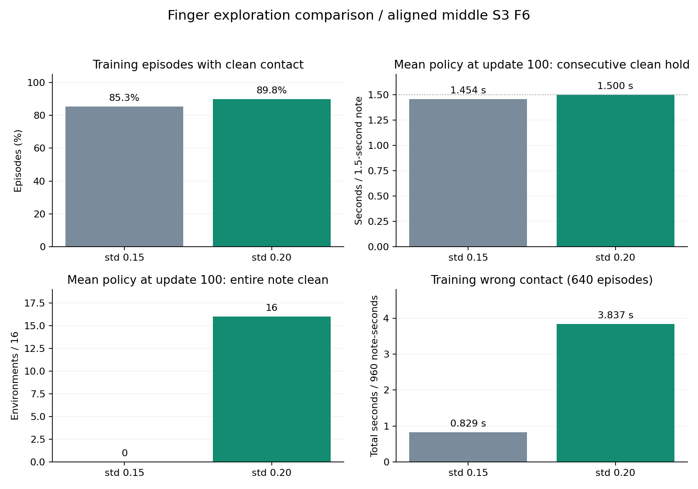

# 손가락 탐색0.15와0.2 비교 결과

2026-11-02 완료. **이번 정렬 출발 단일 압현에서는0.2가 음 전체 유지에 더 좋은 결과를 냈다.** 다음 같은 계열의 손가락 실험에서 초기 탐색0.2를 우선값으로 사용할 근거가 생겼다. 다만 학습이 더 빨라졌다고 확인한 것은 아니며, 전체J33·다른 손가락·곡 학습의 최적값으로 확정하지 않는다.

## 조건과 검증

목표는 중지·3번줄·6프렛 하나다. 실제 준비 도착 상태에서 시작하고 팔은 도착각을 유한 제어로 유지한다. 담당 손가락4축만 학습하며 기타는 자유 강체다. 초기 자세·입력·보상9개·제어·관절 한계·종료 기준·노출 일정은 유지했다.

양쪽 large·64환경·H32·100업데이트·seed7이며 각각204,800전이, 완결640에피소드다. 기존0.15 원본과 모델은 보존하고0.2만 새로 학습했다. 설정 재귀 비교의 차이는 `natural_press.finger_initial_std` 하나다. 초기 모델에서도 `core.finger_log_std`의 담당4개 값만 다르고 나머지 가중치는 동일하다. [조건 동일성](검증/조건동일성.json)을 참조한다.

값은 관절rad가 아닌 Gaussian latent 공간의 **초기 표준편차**다. 하한은 양쪽 모두exp(-3)로 유지했고 팔 탐색을0.2로 올리지 않았다. 별도 소스 변경이나 입력·체크포인트 검증 우회는 없다.

## 평균 정책 평가

각50/100회 모델을16환경에서 탐색 잡음 없이 평가했다. 같은 준비 입력에서의 반복 재현 검사이며 서로 다른 초기 자세16개의 일반화 검사는 아니다.

| 지표 | 초기 탐색0.15 | 초기 탐색0.2 |
| --- | ---: | ---: |
| 50회 모델 달성 | 0/16 | 0/16 |
| 100회 모델 달성 | 16/16 | 16/16 |
| 100회 평균 연속 압현 | 1.453906초 | **1.500000초** |
| 음1.5초 전체 유지 | 0/16 | **16/16** |
| 100회 평균 누락 | 0.040104초 | **0초** |
| 100회 평균 오압현 | 0초 | 0초 |
| 100회 물리/손목 종료 | 0/0 | 0/0 |

0.2는16환경 모두 clean과 최장 연속 clean이 정확히1.5초다. 0.15에서 남았던 시작 직후 누락이 이번 평가에서는 사라졌다. 두 조건 모두50회에서는 실패하고100회에서 성공했으므로 더 이른 수렴을 입증하지는 않았다. 50~100회 사이의 정확한 최초 성공 시점은 측정하지 않았다.

## 학습 중 탐색과 부작용

| 완결640에피소드 지표 | 0.15 | 0.2 |
| --- | ---: | ---: |
| 올바른 접촉이 있었던 에피소드 | 546 | 575 |
| 최초 접촉 완료 | 220 | 326 |
| 올바른 압현 누적 합계 | 73.433초 | 104.233초 |
| 오압현 누적 합계 | 0.829초 | 3.837초 |
| 최장 연속 압현 | 0.2125초 | 0.3458초 |
| 압현 달성 | 0 | 0 |
| 물리/손목 종료 | 0/0 | 0/0 |
| 최종 학습률 | 3e-5 | 3e-5 |
| 학습 시간 | 542.9초 | 539.6초 |

확대 탐색은 접촉 경험을 늘렸지만 오압현 경험도 늘렸다. 학습 중에는 잡음이 섞인 행동으로 접촉이 끊겨 연속0.6초의 달성 기준에 미달했다. 평균 정책 평가의 성공과 구분해야 한다. 학습 마지막 묶음과 최종 평균 정책은 수집 시점도 다르므로 그 차이 전부를 잡음 제거만의 효과로 단정하지 않는다.

전체 최초 contact 보상은 두 조건 모두6번째 수집창에서 기록됐다. 음이3초부터 시작하기 때문에 이 창은 일정이 허용하는 첫 보상 창이다. 따라서 이 값으로 탐색 발견 속도가 같다고 결론 내리지 않는다. 전체64환경의 정확한240Hz 최초 사건은 기록 범위 밖이며, 대표env0 추적과 창 단위 기록을 분리했다.

## 판단과 다음 적용 범위

이번 목표에서는 성공 수가 같아도0.2가 음 전체 유지와 누락에서 우세했다. **다음 손가락 단일 압현 실험은 초기 탐색0.2를 우선 후보로 삼는 것이 타당하다.** 팔의 탐색 크기는 별도로 유지한다. 초기값0.2와 최소 탐색값0.2를 혼동해 하한까지 올리지 않는다.

이 비교는 한 난수·한 목표·팔 유지 조건이다. 반복 난수, 다른 손가락과 줄·프렛, 팔 자유도 확대, 목표 전환에서의 재현은 아직 검증하지 않았다. 기본 운영 코드의 전역 기본값은 이 비교에서 변경하지 않았다. 이전0.15 원문·모델·봉인도 보존했다.

## 자료

- [상세 수치와 원문 SHA](분석/최종비교_수치.json)
- [학습 로그와 초기 모델 대조](분석/학습로그_비교.md)
- [0.2 성공 모델 손 확대](동영상/탐색020_중지3번줄6프렛_100회_손확대.mp4)
- [0.2 성공 모델 전신](동영상/탐색020_중지3번줄6프렛_100회_전신.mp4)
- [기준0.15의 이전 결과](../단일압현_정렬출발학습_v1/최종결과.md)

대표 영상은0.2의100회 최종 모델을 엄격 입력·구조 검증 후 별도1환경에서 촬영했다. 이 실행에서도1.5초 전체 압현에 성공했다. 영상 공개본은 원본과 같은 파일을 링크해 저장 용량을 중복 사용하지 않는다.

독립 검수에서64개 평가에피소드 재집계와569개 고유파일 SHA 대조가 일치했다. [독립 검수](검증/독립검수.md), [최종 실행·봉인 검사](검증/최종실행_봉인검사.json)를 함께 보존한다.
