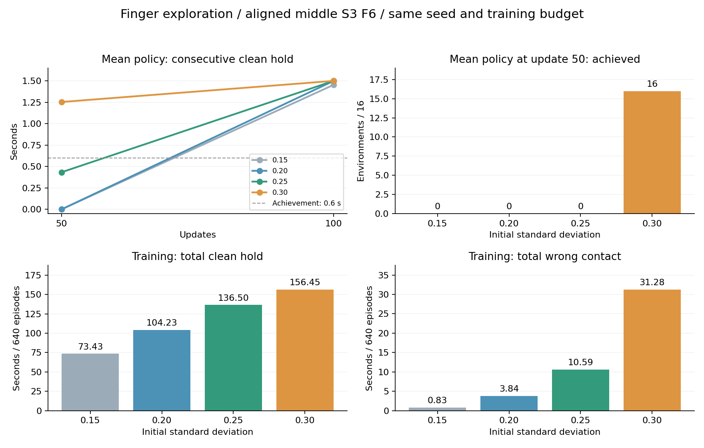

# 손가락 초기 탐색0.25·0.3 비교와 4조건 종합

2026-11-02 완료. 이번 목표에서는0.3이 가장 이른 평가 시점에 압현을 달성했다. 0.3의50회 모델은16환경 모두 달성했고100회 모델은1.5초 음 전체를 유지했다. 0.25도100회에서1.5초 전체 유지에 성공했다.

## 조건과 검증

중지·3번줄·6프렛의 실제 정렬 도착 상태에서 출발하고 팔을 유한 제어로 유지하는 담당4축 학습이다. 기존0.15·0.2 결과를 보존하고0.25·0.3을 각각 새 정책으로 학습했다.

모두 large·64환경·H32·100업데이트·seed7, 조건별204,800전이·완결640에피소드다. 설정 비교의 차이는 natural_press.finger_initial_std 하나이고, 초기 모델의 가중치도 담당 중지4축의 표준편차 값만 다르다. 출발 상태·입력·보상9개·제어·관절 한계·PD·종료·노출 일정·학습률 규칙은 같다.

값은 Gaussian latent 공간의 초기 표준편차다. 하한은 네 조건 모두exp(-3)이며,0.3을 최소 탐색값으로 강제한 것이 아니다. 팔의 탐색을0.3으로 올린 실험도 아니다. 활성 학습 패키지와 기존 봉인 학습기는 수정하지 않았다.

## 평균 정책 평가

조건별50/100회 모델을 탐색 잡음 없이16환경에서 평가했다. 달성 기준은 이 음에서 연속0.6초이며, 음 전체 유지1.5초와 구분한다.

| 초기 탐색 | 50회 달성 | 50회 평균 연속 유지 | 100회 달성 | 100회 평균 연속 유지 | 100회 음 전체1.5초 유지 |
| --- | ---: | ---: | ---: | ---: | ---: |
| 0.15 | 0/16 | 0초 | 16/16 | 1.453906초 | 0/16 |
| 0.20 | 0/16 | 0초 | 16/16 | 1.500000초 | 16/16 |
| 0.25 | 0/16 | 0.433333초 | 16/16 | 1.500000초 | 16/16 |
| 0.30 | 16/16 | 1.253646초 | 16/16 | 1.500000초 | 16/16 |

50회에서0.25는 부분 압현에 접근했고0.3은 달성 기준을 넘었다. 다만0.3의50회 모델도 음1.5초 전체 유지는0/16이다. 이때 누적 clean은 평균1.279167초, 최장 연속 clean은1.253646초로 서로 다르다. 오압현은0초, 누락은 평균0.213802초다.

100회에서0.2·0.25·0.3은16개 환경 전부 clean과 최장 연속 clean이 정확히1.5초이며, 오압현·누락·물리 종료·손목 종료·무효 에피소드는 모두0이다. 평가 사이의 정확한 최초 수렴 시점은 측정하지 않았으므로 학습 시간이 정확히 절반으로 줄었다고 해석하지 않는다.

## 학습 중 접촉 경험과 부작용

| 완결640에피소드 지표 | 0.15 | 0.20 | 0.25 | 0.30 |
| --- | ---: | ---: | ---: | ---: |
| 올바른 접촉 발생 에피소드 | 546 | 575 | 598 | 602 |
| 최초 접촉 완료 | 220 | 326 | 408 | 456 |
| 올바른 압현 누적 합계 | 73.433초 | 104.233초 | 136.500초 | 156.446초 |
| 오압현 누적 합계 | 0.829초 | 3.837초 | 10.594초 | 31.279초 |
| 최장 연속 압현 | 0.2125초 | 0.3458초 | 0.3458초 | 0.4208초 |
| 학습 중 압현 달성 | 0 | 0 | 0 | 0 |
| 물리/손목 종료 | 0/0 | 0/0 | 0/0 | 0/0 |
| 최종 학습률 | 3e-5 | 3e-5 | 3e-5 | 3e-5 |

탐색 확대는 접촉 경험을 늘렸고,0.3은50회 평균 정책에서도 성공했다. 동시에 학습 중 오압현은 더 가파르게 늘었다. 0.25→0.3에서 올바른 압현 합계는 약14.6% 늘었지만 오압현은 약195% 늘었다. 따라서 무조건 더 큰 탐색이 낫다고 일반화하지 않는다.

학습 중에는 네 조건 모두 연속0.6초를 달성하지 못했지만 평균 정책은 성공했다. 잡음이 포함된 학습 행동과 잡음을 뺀 평균 정책 평가를 분리해야 한다. 마지막 학습 묶음과 최종 모델은 수집 시점도 다르므로 차이 전부를 잡음 제거의 인과 효과로 확정하지 않는다.

실제 요청과 적용 목표의 간격도 커졌다. 완료640개 에피소드의240Hz4축 표본을 가중해 합친 rate 제한 간격 RMS는0.25와0.3에서 각각 약0.168rad와0.202rad다. 이는 요청이 기존 속도 제한에 많이 걸린다는 뜻이며, 관절 추종오차나 제한 발생 비율 자체를 뜻하지 않는다. 기존 제한을 완화한 실험은 아니다.

## 판단

이번과 같은 단일 압현 학습의 다음 초기 탐색 후보는0.3을 우선하는 것이 타당하다. 네 값 중 유일하게50회 평가에서16/16 달성했고,100회 최종 유지와 안전성도 뒤처지지 않았다. 학습 중 오압현과 움직임 제한 비중은 함께 추적해야 한다.

0.3의 전신J33·곡 학습 최적값을 확정한 것은 아니다. 이 비교는 한 난수·한 손가락·한 줄/프렛·정렬 출발·팔 유지 지원 조건이며,16환경은 같은 입력의 재현 검사다. 다른 목표·난수·손가락·팔 자유도와 목표 전환에서의 일반화는 별도로 검증해야 한다. 기본 운영 코드의 전역 초기 탐색값은 이번 비교에서 변경하지 않았다.

## 원문·영상

- [네 조건 최종 수치와 원문 SHA](분석/4조건_최종수치.json)
- [학습 로그·초기 모델·실제 제어 분석](분석/학습로그_4조건비교.md)
- [조건 동일성](검증/조건동일성.json) · [실제 정책 분산 CPU 검사](검증/정책분산_CPU.json)
- [0.25 손 확대](동영상/std025_hand.mp4) · [0.25 전신](동영상/std025_fullbody.mp4)
- [0.3 손 확대](동영상/std030_hand.mp4) · [0.3 전신](동영상/std030_fullbody.mp4)

각 영상은 해당100회 최종 모델을 엄격 입력·구조 검증 후 별도1환경에서 촬영했다. 두 모델 모두 이 촬영에서도1.5초 전체 압현에 성공했다. 공개 영상은 원본과 같은 파일을 링크해 저장 공간을 중복 사용하지 않으며, 동영상 디렉토리에는 영상만 저장했다.

최종 독립 검수에서4조건 학습2,560개·평가128개 에피소드 집계와697개 고유파일 SHA가 일치했다. [최종 독립 검수](검증/최종독립검수.md)와 [최종 실행·봉인 검사](검증/최종실행_봉인검사.json)를 함께 보존한다.
