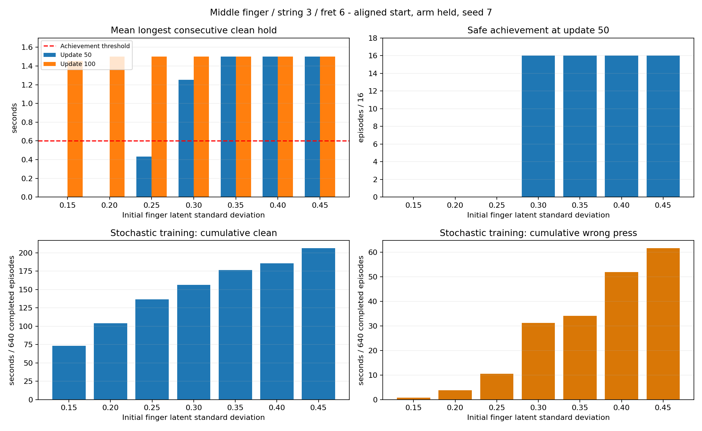

# 손가락 초기 탐색 0.35·0.4·0.45 비교 결과

세 조건 모두 학습 100회, 50·100회 평균 정책 평가, 마지막 모델 손 확대·전신 영상 저장을 완료했다. **현재 한 목표에서는 0.35를 다음 실험의 우선 후보로 권장한다.** 0.35·0.4·0.45는 50회부터 동일한 평가 상한에 도달했으며, 0.35의 학습 중 오압현이 더 적었다. 기본 학습 설정은 변경하지 않았다.

## 같은 조건에서 무엇을 바꿨나

중지·3번줄·6프렛 한 목표, 정렬된 도착 자세 출발, 팔을 유한 제어로 유지한 진단이다. large64 환경, H32, seed7, 조건당 100회·204800전이를 사용했다. 각 조건의 완료 에피소드는 640개다. 담당 손가락 4축만 탐색하며 초기 Gaussian latent 표준편차만 바꿨다. 이 수치는 관절 각도 단위나 std 하한이 아니다. std 하한 exp(-3), 보상9개, 직접 목표각 제어, 속도한계4rad/s, PD·물리·종료 조건은 동일하다. 비교한 7조건 모두 학습률은 3e-5로 유지됐다.

50·100회 체크포인트를 각각 16환경에서 평균 정책으로 평가했다. 모두 같은 준비 입력을 재현했으므로 다양한 초기 자세나 난수에 대한 독립 일반화 시험은 아니다. 현재 달성 기준은 올바른 압현의 연속 0.6초 유지이며, 목표 음 전체 길이 1.5초를 별도로 검사했다.

## 평균 정책 평가

아래 유지 시간은 누적 시간이 아닌 **최장 연속 유지 시간의 16환경 평균**이다. 안전 실패·무효도 전체16개 분모에 포함했다.

| 초기 std | 50회 달성 | 50회 연속 유지 | 50회 음 전체 유지 | 100회 달성 | 100회 연속 유지 | 100회 음 전체 유지 |
| --- | --- | --- | --- | --- | --- | --- |
| 0.15 | 0/16 | 0.000초 | 0/16 | 16/16 | 1.454초 | 0/16 |
| 0.20 | 0/16 | 0.000초 | 0/16 | 16/16 | 1.500초 | 16/16 |
| 0.25 | 0/16 | 0.433초 | 0/16 | 16/16 | 1.500초 | 16/16 |
| 0.30 | 16/16 | 1.254초 | 0/16 | 16/16 | 1.500초 | 16/16 |
| 0.35 | 16/16 | 1.500초 | 16/16 | 16/16 | 1.500초 | 16/16 |
| 0.40 | 16/16 | 1.500초 | 16/16 | 16/16 | 1.500초 | 16/16 |
| 0.45 | 16/16 | 1.500초 | 16/16 | 16/16 | 1.500초 | 16/16 |

100회에는 7조건 모두 달성16/16이다. 다만 0.15는 음 시작 직후 짧은 누락이 남아 전체1.5초 유지0/16이며, 0.2 이상은 전체1.5초 유지16/16이다. 모든 평가에서 오압현·물리 실패·손목 종료·무효는0이었다. 새 세 조건에서는 누락도0이다.

50회 관측 시 0.3은 달성16/16이지만 평균 연속 유지가 약1.254초였고, 0.35 이상은 전부1.5초였다. 따라서 **0.35가 이번 표본에서 50회에 음 전체 유지에 도달한 가장 작은 탐색값**이다. 50회 이전의 도달 시점과 정확한 수렴 시점은 측정하지 않아 학습 시간이 절반으로 단축됐다고 단정할 수 없다.

## 탐색 중에는 어떤 차이가 있었나

다음 표는 무작위 행동을 포함한 학습 중640개 완료 에피소드 집계다. 위 평균 정책 평가와 구분한다. 시간 단위는 초이며 여러 에피소드의 누적 합계다.

| 초기 std | clean 관측 에피소드 | 최초 접촉 완료 | 누적 clean | 누적 오압현 | 최장 연속 clean | 학습 중 달성 |
| --- | --- | --- | --- | --- | --- | --- |
| 0.15 | 546/640 | 220/640 | 73.433 | 0.829 | 0.212 | 0/640 |
| 0.20 | 575/640 | 326/640 | 104.233 | 3.837 | 0.346 | 0/640 |
| 0.25 | 598/640 | 408/640 | 136.500 | 10.594 | 0.346 | 0/640 |
| 0.30 | 602/640 | 456/640 | 156.446 | 31.279 | 0.421 | 0/640 |
| 0.35 | 608/640 | 493/640 | 176.292 | 34.146 | 0.488 | 0/640 |
| 0.40 | 606/640 | 514/640 | 185.875 | 51.915 | 0.758 | 1/640 |
| 0.45 | 603/640 | 530/640 | 206.475 | 61.765 | 0.779 | 2/640 |

탐색 증가에 따라 올바른 접촉 기회와 오압현이 함께 늘었다. 0.35→0.4→0.45에서 학습 중 오압현은 약34.1→51.9→61.8초다. 0.45의 학습 중 달성2개는 탐색 행동의 결과이며, 평가 성능이 더 우수하다는 근거는 아니다. 세 조건 모두 물리·손목 종료0이었다.

큰 탐색은 속도 제한에 걸리는 요청도 늘린다. 실제240Hz 전체 에피소드 기반 요청각과 적용각의 RMS 차이, 대표 환경0의 처음2에피소드 제한 비율은 관측 범위가 서로 다르므로 같은 통계로 해석하지 않았다. 상세는 [학습 로그 분석](분석/학습로그_7조건비교.md)을 참고한다. 요청각과 적용각 차이는 실제 관절 추종 오차와도 구분한다.

## 다음 실험에 적용할 판단

0.35를 우선 후보로 사용하되 전환·다른 줄과 프렛·다른 손가락·자유로운 팔 제어에서 같은 이득이 유지되는지는 별도 비교해야 한다. 0.4·0.45는 현재 평가 성능 이득이 없고 학습 중 오압현이 증가해 우선순위가 낮다. 손가락 움직임 비용을 새로 부과하거나 보상·제어를 함께 바꾸지 않았다.

현재 성공은 구현된 패드 기하·하중 대리지표에 따른 압현 판정이다. 실제 줄 압력이나 연주 음향 품질을 검증한 결과는 아니다.

## 영상과 검증 기록

각 조건의 마지막 모델에서 동일한5초 재생을 손 확대·전신 두 시점으로 저장했다. 별도의1환경 재생도 전부1.5초 유지에 성공했다. 동영상 디렉토리에는 영상6개만 둔다.

- [std035_fullbody](/home/ajou/yigyu/3/docs/2026-11-09/탐색값_035_040_045_비교_v1/동영상/std035_fullbody.mp4)
- [std035_hand](/home/ajou/yigyu/3/docs/2026-11-09/탐색값_035_040_045_비교_v1/동영상/std035_hand.mp4)
- [std040_fullbody](/home/ajou/yigyu/3/docs/2026-11-09/탐색값_035_040_045_비교_v1/동영상/std040_fullbody.mp4)
- [std040_hand](/home/ajou/yigyu/3/docs/2026-11-09/탐색값_035_040_045_비교_v1/동영상/std040_hand.mp4)
- [std045_fullbody](/home/ajou/yigyu/3/docs/2026-11-09/탐색값_035_040_045_비교_v1/동영상/std045_fullbody.mp4)
- [std045_hand](/home/ajou/yigyu/3/docs/2026-11-09/탐색값_035_040_045_비교_v1/동영상/std045_hand.mp4)

- [원시 수치와 원문 SHA](분석/7조건_최종수치.json)
- [학습 로그 상세 분석](분석/학습로그_7조건비교.md)
- [실행·봉인·영상 검사](검증/최종실행_봉인검사.json)
- [최종 독립 검수](검증/최종독립검수.md)
- [진행상황과 실행 경로](진행상황.json)

기존 실험의 원문·체크포인트·입력과 활성 학습 코드는 보존했다. 새 조건의 설정·초기 가중치 차이, 입력 SHA, 완료 보고서와 종료 정리 상태를 대조했다.
