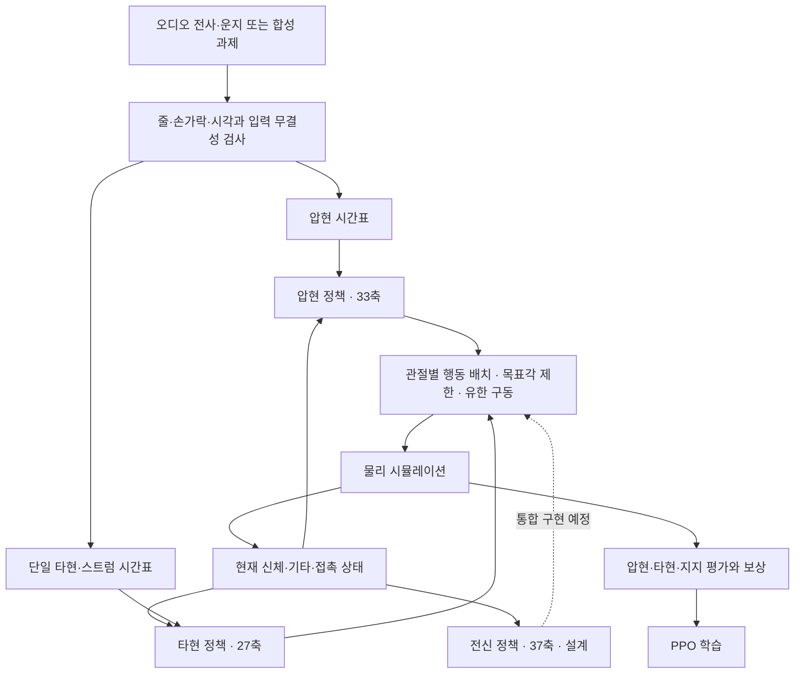

# Overview — 연주 목표와 전신·악기의 상호작용을 연결하는 프레임워크

논문: **From Audio to Full-Body Guitar Performance with a Freely Moving Instrument**

설계 기준: [정리.txt](정리.txt). 코드 확인 기준: 2026-11-04 작업 트리. 이 문서는 전체 프레임워크의 설계와 현재 구현 범위를 설명하며 새로운 실험 결과를 보고하지 않는다.

## 1. 해결하려는 문제

기타 연주는 손끝을 정해진 위치에 보내는 것만으로 완성되지 않는다. 왼손은 줄과 프렛에 맞춰 접근하고, 음이 시작하기 전에 압현을 준비한 뒤, 필요한 시간 동안 접촉을 유지해야 한다. 오른손은 해당 줄을 정해진 시점과 방향으로 통과해야 하며, 다음 타현을 위해 줄에서 충분히 분리되어야 한다. 그동안 몸통·팔·다리는 악기가 과도하게 움직이지 않도록 지지해야 한다.

이 연구에서는 기타를 공간에 고정하지 않는다. 기타가 움직이면 같은 프렛의 세계 좌표도 달라지므로, 미리 계산한 손 궤적을 세계 좌표에 고정하는 것만으로 목표를 유지하기 어렵다. 손의 연주 동작은 기타의 운동을 만들고, 기타의 운동은 다시 두 손의 목표 위치와 접촉 조건을 바꾼다. 따라서 연주 목표, 신체 상태, 기타 상태를 함께 관측하는 물리 피드백 제어가 필요하다.

목표는 주어진 연주 계획을 실제 시뮬레이션 안에서 수행하는 것이다. 현재 범위에서 목표 줄·프렛·담당 손가락은 정책에 주어진다. 운지 선택 자체를 강화학습 정책이 새로 결정하는 문제와는 구분한다. 또한 시뮬레이터의 접촉·줄 통과 판정은 연주 동작을 평가하는 대리 지표이며, 실제 현 진동이나 생성된 음의 품질까지 입증하지 않는다.

## 2. 전체 입력과 출력

전체 시스템의 입력은 연주 시간표와 초기 물리 상태다. 연주 시간표는 오디오에서 얻은 전사·운지 결과 또는 직접 설계한 합성 과제로 구성한다. 물리 상태에는 전신 관절, 각 몸체와 기타의 위치·방향·속도, 접촉 합력 및 과제 진행 상태가 포함된다. 현재 구현은 시뮬레이터 상태를 직접 관측하며, 영상만으로 같은 정보를 추정하는 인지 모듈은 이 정책의 일부가 아니다.

압현 목표 한 개는 줄, 프렛, 손가락, 누름 시작, 음 시작, 해제 시각으로 표현한다. 타현 목표는 하나의 줄 또는 순서가 있는 여러 줄, 타현 방향, 허용 시간과 통과 지점을 표현한다. 두 목표를 연결할 때에는 동일한 음악 시계를 사용하되, 압현 준비 시각과 실제 타현 시각을 별도 변수로 유지한다.

정책의 출력은 담당 관절에 대한 정규화 행동이다. 행동은 제한된 관절 목표각으로 변환되어 유한한 구동기를 통해 적용된다. 기타 위치나 실제 관절 상태를 원하는 값으로 매 순간 덮어쓰는 방식은 사용하지 않는다. 물리 시뮬레이터가 반환한 실제 움직임과 접촉이 다음 관측과 보상 계산의 입력이 된다.

학습 산출물은 정책 파라미터와 가치 추정기, 실행 설정, 입력·소스 식별 기록이다. 평가 산출물은 실제 상태 궤적, 목표별 수행 기록, 실패 원인과 영상이다. 목표 그림은 앞으로 수행할 동작을 설명하며, 정책의 실제 수행 영상과 구분한다.

## 3. 세 정책의 역할 분담

전체 설계는 압현·타현·전신 지지의 세 정책으로 이루어진다. 각 정책은 같은 시점의 물리 상태에서 자신에게 필요한 정보를 읽고, 서로 겹치지 않는 관절에 행동을 출력한다.

| 정책 | 해결하는 작업 | 제어 범위 | 연주 목표 입력 |
| --- | --- | --- | --- |
| 압현 정책 | 왼손 접근·정렬·압현·유지·해제와 목표 전환 | 왼팔 12축 + 왼손 21축 = 33축 | 현재·예정 압현 목표 |
| 타현 정책 | 준비·단일 타현·스트럼·분리·다음 목표 준비 | 오른팔 팔꿈치 3축 + 손목 3축 + 오른손 21축 = 27축 | 현재·다음 타현 제스처 |
| 전신 정책 | 자세, 발 지지, 몸통과 오른쪽 상완을 통한 기타 지지 | 나머지 가동 관절 37축 | 별도의 연주 목표 없이 현재 상태 |

전체 105개 관절 축 중 가동범위가 0인 8개 축을 제외하면 97개 축이다. 설계상의 분할은 \(33+27+37=97\)이다. 타현 27축에는 팔꿈치가 포함되므로, TXT의 간략 표기인 “R_wrist를 포함하는 하위 관절”만으로 제어 범위를 정의하지 않는다. 정확한 축 소유권은 [Model](02_model.md)의 표와 이름 집합을 따른다.

여기서 분리하는 것은 출력 관절의 소유권이다. 물리적 영향까지 독립적이라는 뜻은 아니다. 전신 정책의 몸통 움직임은 양손의 상대 위치를 바꾸고, 오른쪽 상완의 지지 변화는 기타를 움직일 수 있다. 각 정책이 전신 관절과 기타 상대 상태를 관측하는 이유도 이런 상호작용을 반영하기 위해서다.

전신 정책에 프렛·타현 시각을 직접 주지 않는 것은 사용자가 정리한 설계를 따른다. 전신 정책은 현재의 손·기타·발 상태를 바탕으로 지지를 조절하고, 연주 목표를 예상하는 역할은 두 손 정책이 맡는다. 이 선택은 입력을 단순하게 하지만, 실제 움직임이 나타나기 전 선제적으로 지지를 바꾸는 데에는 제약이 있다. 목표 없는 전신 정책으로 충분한지는 이후 비교 실험의 대상이다.

## 4. 상태와 목표를 분리한 정책 구조

신체와 기타의 상태는 “지금 어떤 상황인가”를 설명하고, 목표는 “어떤 작업을 언제 해야 하는가”를 설명한다. 두 정보는 의미와 시간 변화가 달라 별도의 인코더로 처리한다. 인코더는 여러 입력값을 정책이 사용하기 좋은 특징 벡터로 변환하는 신경망이다.

압현·타현 정책은 상태 특징과 목표 특징을 결합한다. 압현은 네 손가락 각각의 현재·다음 목표에 대응하는 8개 슬롯을 사용한다. 타현은 현재·다음 제스처 2개 슬롯을 사용하되, 한 제스처 안에 스트럼의 여러 줄과 진행 상태를 담는다. 따라서 목표 슬롯 수와 동시에 표현할 수 있는 줄 수는 같은 개념이 아니다.

전신 정책은 상태 특징만 사용한다. 현재 상태의 상호작용을 바탕으로 자세와 지지를 조절한다는 설계이며, 목표 인코더를 빈 값으로 남기는 구현을 제안하는 것은 아니다.

정책과 가치 추정기는 역할이 다르다. 정책은 행동을 선택하고, 가치 추정기는 현재 상태에서 앞으로 받을 보상과 비용을 추정해 학습을 돕는다. 현행 compact 손 정책은 행동용 특징 추출과 가치용 특징 추출의 파라미터를 분리한다. 전체 신경망 차원, 목표 마스크와 행동 분포는 [Model](02_model.md)에서 정의한다.

## 5. 전체 처리 흐름

**그림의 범위:** 완성하려는 세 정책 프레임워크의 정보 흐름이다. 현재 압현과 타현은 각각의 실행 경로를 가지며, 세 정책의 행동을 동시에 합쳐 학습하는 97축 통합 실행기가 완성됐다는 의미는 아니다. 현재 실행에서 정책이 담당하지 않는 관절은 기존 유지·지지 제어를 사용한다.

실행은 다음 순서로 진행한다.

1. 연주 목표의 줄·프렛·손가락·시각·중복 점유를 검사하고 실행 입력을 확정한다.
2. 초기 자세에서 에피소드를 시작하고 정책이 움직일 수 있는 준비 시간을 둔다.
3. 물리 상태와 현재·예정 목표를 정책 입력으로 변환한다.
4. 정책이 60Hz로 행동을 선택하고 목표각 제한을 적용한다.
5. 같은 제어 구간에서 물리를 240Hz로 네 번 진행하며 실제 접촉·통과·이탈을 측정한다.
6. 보상·비용·다음 상태를 저장하고 수집 구간마다 PPO로 갱신한다.
7. 정상 종료 또는 실패 시 해당 환경만 초기화한다. 경험 수집 구간이 끝났다는 이유로 진행 중인 동작을 초기화하지 않는다.

## 6. 현재 구현과 전체 설계의 경계

현재 코드는 단일한 버전의 완성된 세 정책 시스템이 아니다. 공통 물리 기반 위에 기본 압현 경로와 새로운 compact 압현·타현 경로가 존재한다. 문서의 기준을 혼동하지 않도록 다음과 같이 구분한다.

| 항목 | 현재 확인한 구현 | 문서에서의 의미 |
| --- | --- | --- |
| 공통 물리 | GPU PhysX, 인간 Root 고정, 자유 기타·중력 활성, 유한 관절 제어 | 실제 실행 기반 |
| 기본 왼손 실행 | `train.py`의 finger-skill, 상태 557, 활성 행동 33 | 기존 기본 경로. 아래 compact 차원과 혼합하지 않음 |
| 새 압현 구조 | compact press v5, 상태 464 또는 골반 포함 473, 목표 26×8, 출력 33 | 새 framework의 압현 구체화 기준 |
| 새 타현 구조 | compact strike, 상태 450, 목표 79×2, 출력 27 | 단일 타현·스트럼을 포함하는 별도 구현 |
| 전신 학습 정책 | TXT의 상태 480·출력 37 설계 | 독립 정책·보상·학습 실행 연결이 필요 |
| 세 정책 동시 제어 | 33/27/37 분할 설계 | 97축 소유권 배치와 공동 실행·평가가 필요 |
| 음향과 자유 균형 | 현 진동·음향 성공, 움직이는 인간 Root의 균형 제어 | 현재 기하·하중 및 Root 고정 조건으로 입증할 수 없음 |

TXT는 합의한 원안을 보존한다. 압현 443/16, 타현 440/16 등 원안의 차원을 현재 구현 숫자로 조용히 바꾸지 않는다. [Model](02_model.md)은 원안에서 추가된 정보와 최종 합계를 설명하고, [Method](03_method.md)는 실제 적용되는 보상과 학습 절차를 설명한다.

기존 `whole_body_control`이라는 코드 명칭은 전신 관절의 유한 PD·지지 제어를 가리킬 수 있다. 이것을 37차원 강화학습 정책이 이미 존재한다는 근거로 사용하지 않는다. 또한 기타가 자유 강체라는 조건과 인간이 자유롭게 균형을 유지한다는 조건은 별개다.

## 7. 목표 구성과 연구 단계

합성 목표는 실제 곡에서 여러 요인이 동시에 변하는 문제를 줄이고, 특정 동작을 반복해서 확인하기 위한 입력이다. 단일 압현, 두 손가락 동시 압현, 같은 손가락의 이동, 손가락 교대, 유지하면서 추가·해제·전환, 전체 목표 전환, 해제 후 재압현을 별도로 정의할 수 있다.

현재 C1~C6 자료는 이 아홉 유형을 43.75초의 목표 시간표로 연결한 여섯 손가락 조합이다. 정책 준비와 말미 평가를 포함한 전곡 실행 길이는 별도로 구성한다. 이 입력은 운지 규칙 검사를 통과했지만, 그 사실만으로 모든 공통 손목 자세와 물리 접촉이 가능하다고 결론 내리지 않는다.

현재 `press_sequence` 실행기는 한 번에 C1~C6 중 하나를 선택해 압현 v5에 연결한다. 여섯 목표를 매 초기화마다 섞는 기능이나 기존 C1 체크포인트를 C2로 바꾸어 재개하는 기능으로 설명하지 않는다. 여러 조합을 하나의 정책으로 학습하는 입력 선택·저장 계약은 후속 통합 항목이다.

연구는 목표 표현의 유효성, 물리 실행의 가능성, 정책의 학습 가능성, 저장 모델의 별도 평가, 새로운 목표로의 일반화를 차례로 구분한다. 단일 과제의 진단용 목표각 제어가 성공한 것은 강화학습 정책의 성공을 뜻하지 않으며, 유한한 후보 탐색에서 찾지 못한 것도 불가능성의 증명이 아니다.

## 8. 무엇을 평가할 것인가

평가는 입력된 목표와 실제 상태가 얼마나 일치했는지 측정한다. 압현은 담당 손가락의 유효 접촉과 오압현을 함께 보고, 여러 목표가 있는 구간에서는 동시에 clean인 시간과 최장 연속 구간을 측정한다. 음을 누른 뒤에는 필요한 해제가 실제로 관측됐는지도 별도로 확인한다.

타현은 목표 줄·방향·시간·통과 기하를 함께 확인한다. 스트럼에서는 목표 줄 집합뿐 아니라 지정된 순서와 각 줄의 통과 여부를 확인한다. 같은 줄을 반복해서 지나가며 성공을 중복 적립하는 동작을 막기 위해 재타현 가능 상태를 관리한다.

지지는 기타 이탈·회전, 발 접촉·미끄럼, 관절 추종과 제어 포화, 실패 종료를 측정한다. 향후 자유 Root 조건에서는 몸 전체의 질량중심과 실제 지지 영역을 포함한 별도 균형 평가가 필요하다. 현행 Root 고정 실행의 완주율을 자유 균형 성공률로 바꾸어 부르지 않는다.

새 framework의 효과는 각 손 정책의 성능, 두 손을 함께 실행할 때의 간섭, 학습된 전신 지지를 추가했을 때의 변화로 나누어 검증해야 한다. 이번 문서 작성에서는 학습이나 물리 실험을 새로 실행하지 않았다.

## 직접 근거

- [공통 장면](../../guitar_learning/gpu/scene.py), [유한 관절·지지 제어](../../guitar_learning/gpu/control.py), [물리와 정책 실행 연결](../../guitar_learning/training/rollout.py).
- [압현 v5 환경](../../guitar_learning/gpu/compact_press_v5.py), [정책](../../guitar_learning/training/compact_press_v5.py), [합성 목표 실행](../../guitar_learning/tool/experiments/press_sequence.py).
- [타현 환경](../../guitar_learning/gpu/compact_strike.py), [타현 정책](../../guitar_learning/training/compact_strike.py), [타현 실행](../../guitar_learning/tool/experiments/compact_strike.py).
- 세부 주장과 적용 범위는 [근거 색인](evidence_index.md)을 따른다.
