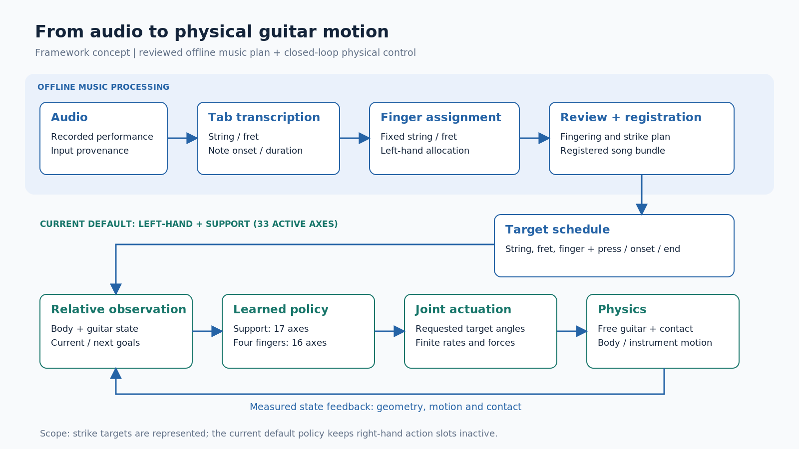

# Framework overview

> 작성 범위: 전체 연구의 입력·출력과 공통 구조. 현재 기본 학습의 제어 범위는 왼손 압현과 그에 필요한 신체 지지다. 근거: [E1–E6](evidence_index.md).

## 음악 정보에서 신체 동작으로

기타 연주를 이해하려면 어떤 음이 언제 나는지뿐 아니라, 연주자가 어느 줄의 어느 위치를 누르고 그 상태를 어떻게 유지하는지 살펴볼 수 있어야 한다. 녹음에 대응하는 악보나 동작 자료가 없는 경우에도 연주 과정을 시각화할 수 있도록, 본 프레임워크는 오디오에서 구성한 음악 정보를 물리 시뮬레이션 안의 기타 연주 목표로 연결한다. 출력은 시간에 따른 신체 관절과 기타의 3차원 상태이며, 이 상태를 렌더링하면 연주 과정을 여러 시점에서 관찰할 수 있다.

오디오에 포함된 음높이와 시간만으로 실제 운지가 하나로 정해지지는 않는다. 같은 음을 다른 줄과 프렛으로 낼 수 있고, 같은 위치도 서로 다른 손가락으로 누를 수 있기 때문이다. 따라서 음악을 해석하는 과정과 그 계획을 신체로 실행하는 과정을 나누어 다룬다. 앞 단계는 수행할 줄·프렛·손가락과 시간을 명시하고, 뒤 단계는 실제 신체와 악기의 상태에 대응하면서 그 목표를 실행한다. 생성한 동작은 입력 녹음의 실제 연주자가 사용한 자세를 복원한 정답 동작이 아니라, 주어진 연주 계획을 수행하기 위한 동작이다.

## 연주 계획의 구성

첫 단계에서는 오디오를 음의 시작·지속 시간과 줄·프렛 정보로 변환하고, 이 정보를 바탕으로 왼손 손가락을 배정한다. 프로젝트에는 이를 위한 오프라인 전사·운지 배정 경로가 있으며, 물리 학습은 검토 후 등록한 곡 자료를 입력으로 사용한다. 이 경계를 두면 같은 음악 계획을 고정한 상태에서 제어 방법을 비교할 수 있다. 전사에서 발생한 오류와 제어기가 계획을 수행하지 못한 오류도 구분할 수 있다.

연주 계획은 음높이를 나열하는 데서 끝나지 않는다. 압현을 준비할 시점, 누를 위치에 도달해야 할 시점, 소리를 유지할 구간을 함께 표현한다. 오른손에는 타현할 줄과 방향, 줄을 통과할 시점을 전달할 수 있다. 예를 들어 ‘3번 줄의 6프렛을 중지로 누른다’는 목표에는 손가락의 이동 시간과 음이 유지되는 시간도 필요하다. 이 예시는 목표 형식을 설명하기 위한 것으로 특정 학습 결과를 뜻하지 않는다.

현재 물리 학습은 등록된 목표 시간표를 읽는다. 원시 오디오를 매 제어 순간에 직접 입력하는 정책은 아니다. 또한 진단용으로 만든 단음·전환 과제는 합성 목표를 사용할 수 있으므로, 모든 평가 입력을 오디오 전사의 산출물이라고 부르지 않는다.

## 움직이는 기타와의 상호작용

기타가 공간에 고정되어 있지 않으면 손의 목표 위치도 악기의 움직임에 따라 달라진다. 손가락을 움직여 넥에 힘을 가하면 기타의 위치와 방향이 변할 수 있고, 그 변화는 다음 압현 위치와 악기 지지에 영향을 준다. 따라서 손을 미리 정한 세계 좌표의 위치로 보내는 것만으로는 충분하지 않다.

본 프레임워크는 목표 줄·프렛을 기타에 붙은 좌표계로 정의하고, 신체와 기타 사이의 상대 위치·움직임 및 접촉 정보를 제어에 사용한다. 제어기는 현재 관절 상태와 음악 목표를 보고 관절 목표각을 선택한다. 관절 구동과 중력·접촉을 적용한 물리 시뮬레이션은 다음 신체·기타 상태를 계산하고, 이 상태를 다시 제어기에 전달한다. 이 반복을 통해 연주 동작과 악기의 반응을 같은 시간축에서 다룬다.

## 지지와 정밀 동작을 함께 학습하기

왼손 압현에는 팔·손목이 손을 목표 부근으로 옮기는 움직임과, 개별 손가락이 작은 위치 차이를 조절하는 움직임이 함께 필요하다. 현재 기본 정책은 왼쪽 흉곽·팔·손목·엄지에 해당하는 지지 출력과 검지부터 소지까지의 개별 출력을 나누어 구성한다. 이 출력들은 하나의 물리 환경에서 동시에 실행되며, 지지 부분과 손가락 부분을 함께 학습한다.

학습 신호는 목표 패드의 접근, 적절한 접촉, 압현 유지와 달성을 구분한다. 잘못된 줄·프렛의 압현과 음 수행 부족도 함께 고려한다. 기타와 신체가 허용 범위를 벗어난 경우에는 별도의 실패 비용을 부여한다. 목표 지점에 한 번 닿은 것, 음을 유지한 것, 악기를 안정적으로 지지한 것을 서로 다른 정보로 남겨 이후 평가에 사용한다.

## 전체 구성과 현재 적용 범위

**그림 1.** 오프라인 음악 처리와 물리 제어의 관계를 나타내는 개념도. 검토된 연주 계획을 입력으로, 상대 상태 관측·정책·관절 구동·물리 시뮬레이션을 반복한다. 오른손 타현 목표는 공통 계획에 포함할 수 있지만, 현재 기본 정책의 활성 제어는 왼손과 지지에 해당하는 33축이다. 그림은 전체 양손 연주의 성공을 나타내지 않는다.

프레임워크의 설명은 다음 세 단계로 이어진다. Model에서는 신체·악기·좌표계와 연주 목표를 정의한다. Method에서는 목표를 관측으로 바꾸고, 정책의 행동을 제한된 관절 구동으로 실행하며, 과제 수행을 학습 신호로 만드는 방법을 설명한다. Experiment와 Result에서는 같은 정의를 사용해 단일 압현, 목표 전환, 동시 압현 및 양손 협응을 각각 확인한다. 이 초안에서는 앞의 두 부분을 먼저 작성하고, 개선 중인 구조의 채택과 성능 주장은 후속 평가에 연결한다.
