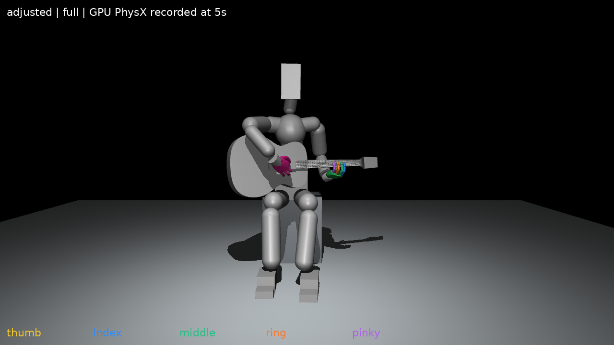

# Model and problem formulation

> 구현 확인일: 2026-11-02. 현재 GPU 왼손 경로를 기준으로 한다. 소스별 적용 범위는 [E2–E5](evidence_index.md)에 정리했다. 본문의 기호는 설명용 표기이며 코드의 배열 이름과 반드시 같지는 않다.

## 신체와 악기의 물리 모델

시뮬레이션 장면은 앉은 휴머노이드, 기타, 의자와 지면으로 구성된다. 휴머노이드의 Root, 즉 신체 전체의 기준 위치와 방향은 고정한다. 하체는 유한한 힘을 사용하는 자세 유지 제어를 받는다. 따라서 이 설정의 전신 동작은 관절이 있는 전신 모델에서 생성되는 움직임을 뜻하며, 자유롭게 이동하는 Root나 모든 관절의 정책 학습을 뜻하지 않는다.

휴머노이드 자산은 105개의 스칼라 관절 입력을 가진다. 이 중 원래 가동범위가 0이 아닌 축은 97개이고, 나머지 8개는 영범위 축이다. 모델 입력 수, 실제 움직일 수 있는 축 수, 정책이 선택하는 축 수를 구분한다. 현재 기본 왼손 정책은 33축을 활성화한다. 이 안에는 왼쪽 흉곽·어깨·팔꿈치·손목의 12축과 왼손의 21축이 포함된다. 왼손 중 엄지 5축은 지지 출력에 포함하고, 나머지 네 손가락은 각각 4축으로 제어한다.

| 구분 | 현재 기본 경로의 의미 |
| --- | --- |
| 자산의 관절 입력 | 105개 |
| 원래 비영 가동범위 | 97축 |
| 정책 활성 출력 | 왼쪽 관련 33축 |
| 정책 안의 지지 / 네 손가락 출력 | 17축 / 16축 |
| 공통 행동 배열 | 39칸. 비활성 오른손 6칸은 0 |
| 하체 | 별도 유한 자세 유지 제어. 정책 출력에 포함하지 않음 |
| Root | 고정 |

기타는 중력과 접촉에 반응하는 자유 강체다. 몸통·넥·프렛 사이의 상대 위치는 고정되지만, 기타 전체의 위치와 방향은 변할 수 있다. 현재 GPU 장면은 기타를 하나의 강체와 89개의 충돌 형상으로 구성한다. 원본 자산의 39개 논리 부위·마커는 연주 위치와 관측을 위한 기준으로 사용하며, 독립적으로 움직이는 39개 강체가 아니다. 기본 조건에서는 스트랩을 사용하지 않는다.

기타의 시각 메시, 충돌 형상, 연주 위치 마커는 역할이 다르다. 시각 메시는 외형을 보여주고, 충돌 형상은 신체와 악기 사이의 접촉 반응을 계산하며, 마커는 줄·프렛의 목표 위치를 정한다. 줄 표식이 존재한다는 사실은 진동하는 현의 동역학이나 음향 합성을 시뮬레이션한다는 뜻이 아니다. 물성·마찰·접촉 설정은 실제 평가에 사용한 장면 설정으로 고정하여 보고한다. 과거 자산 측정값을 최근 실행의 적용값으로 대체하지 않는다.

## 기타를 기준으로 표현하는 위치와 속도

손가락 목표를 세계 좌표에 고정하면 기타가 움직인 뒤에도 손이 이전 위치로 향하게 된다. 이를 피하기 위해 목표와 손의 관계를 기타 좌표계에서 표현한다. 세계 좌표계를 \(W\), 기타 좌표계를 \(G\)라 하고, 기타 원점의 세계 위치와 기타에서 세계로의 회전을 각각 \(t_G^W\), \(R_G^W\)로 둔다. 세계 위치 \(p^W\)에 있는 손의 점은 다음과 같이 표현한다.

\[
p^G=(R_G^W)^\top(p^W-t_G^W).
\]

이 좌표에서는 같은 줄·프렛의 목표가 기타와 함께 움직인다. 손가락 패드와 목표의 차이를 비교하면, 악기 전체가 이동한 경우와 손이 목표에 대해 이동한 경우를 구분할 수 있다.

속도도 같은 원리를 적용한다. \(v_p^W\)를 손의 점의 속도, \(v_{G,o}^W\)를 기타 원점의 속도, \(\omega_G^W\)를 기타의 각속도라 하면 상대 속도는 다음과 같다.

\[
v^G=(R_G^W)^\top\left[v_p^W-v_{G,o}^W
-\omega_G^W\times(p^W-t_G^W)\right].
\]

회전에 의한 속도를 빼므로 기타와 함께 움직이는 점을 불필요한 손의 상대 이동으로 해석하지 않는다. 시뮬레이터가 질량중심의 선속도를 반환하는 경우에는 먼저 원점의 속도로 바꾼다. 질량중심과 원점은 일반적으로 같지 않다.

## 연주 목표와 시간

압현 목표 \(g_i\)를 설명하기 위해 다음 표기를 사용한다.

\[
g_i=(s_i,f_i,d_i,t_i^{\mathrm{press}},t_i^{\mathrm{on}},t_i^{\mathrm{off}}).
\]

| 기호 | 의미 |
| --- | --- |
| \(s_i\) | 누를 줄. 실제 파일의 줄 번호는 등록 시 관례를 확인 |
| \(f_i\) | 프렛. 개방현은 별도로 처리 |
| \(d_i\) | 배정한 왼손 손가락 |
| \(t_i^{\mathrm{press}}\) | 입력 계획에서 압현 준비가 시작되는 시점 |
| \(t_i^{\mathrm{on}}\) | 소리가 시작되어야 하는 시점 |
| \(t_i^{\mathrm{off}}\) | 목표 지속 구간의 끝 |

준비 행동은 압현 기준 시점 이전부터 필요할 수 있다. 실제 입력에는 원 음표의 식별자, 타현 계획과 준비 구간 등 추가 정보가 있으며, 위 식은 왼손 제어를 설명하기 위한 요약이다. 개방현은 왼손 압현 목표가 없는 음으로 취급한다. 오른손 타현 목표는 줄의 집합, 진행 방향과 줄별 통과 시점을 별도로 갖는다. 따라서 한 타현 사건과 한 왼손 압현 목표를 같은 객체로 간주하지 않는다.

곡 전체의 목표 시간표가 알려져 있더라도 정책이 매 순간 전체 곡을 모두 관측하는 것은 아니다. 환경은 현재와 가까운 미래의 목표를 일반 토큰으로 제공하고, 네 손가락의 현재 추적 목표와 다음 목표를 우선 토큰으로 보존한다. 토큰은 여러 속성을 묶어 전달하는 목표 단위다. 실제 목표의 수와 관측 토큰의 최대 용량은 서로 다르다.

원곡 시각, 준비 시간을 포함한 시각, 선택 구간의 로컬 에피소드 시각도 구분한다. 구간 학습에서 로컬 시각 0은 원곡의 시작을 뜻하지 않는다. 현재 기본 곡 구성에는 정책 준비 시간과 말미 시간이 포함된다. 최종 평가에서는 원곡의 음 시점과 이 시간 변환을 함께 명시한다.

## 압현을 관측하는 기준

압현 여부는 손끝 중심과 목표 중심의 거리만으로 정하지 않는다. 지정된 끝마디 패드의 표면이 목표 줄·프렛 셀에 접근했는지, 표면 방향과 법선 간격이 적절한지, 접촉에 대응하는 몸체 하중이 존재하는지를 함께 사용한다. 목표에 해당하는 기하·하중 조건을 충족한 상태를 압현 후보로 부른다.

여기서 하중은 현재 GPU 경로의 몸체 순접촉합력을 이용한 지표다. 개별 줄과 손가락 사이의 접촉력을 직접 측정한 값이 아니며, 여러 접촉의 합이나 상쇄 영향을 받을 수 있다. 패드 표면도 관측·판정을 위한 형상 표현이므로 물리 엔진이 처리한 모든 접촉점의 재현으로 해석하지 않는다.

압현 후보 중 잘못된 줄·프렛의 간섭을 제외한 유효 상태를 이 초안에서는 **유효 압현(clean press)**이라고 부른다. 예를 들어 같은 줄의 낮은 프렛을 누르더라도 더 높은 프렛에서 원치 않는 접촉이 발생하면 의도한 음을 수행했다고 인정하지 않는다. 유효 압현의 연속 유지 시간과 음 전체의 충족 여부를 따로 누적하여, 한 번 닿은 것과 음을 끝까지 유지한 것을 구분한다.

이 판정은 시뮬레이션의 기하·하중 기반 수행 지표다. 실제 음향적 정확도나 사람 연주와의 동작 유사성을 직접 검증하는 지표는 아니다.

현재 구현의 지정 패드는 검지부터 소지까지 각 끝마디 원본 표면에서 표본화한 128점을 사용한다. 압현 목표는 줄의 위치를 넥 상면에 투영한 유한 선분이며, 프렛 셀의 양 끝에서 2mm씩 안쪽을 사용한다. 후보 판정에서는 같은 패드점이 목표 현의 횡방향 3mm 이내, 프렛 셀 내부, 기준면 높이 −1에서 +3mm, 법선 코사인 0.1 이상을 만족하는지 확인하고, 해당 끝마디의 순접촉합력 0.01N 이상을 함께 요구한다. 접근 거리의 최근접점과 접촉 후보 조건을 만족하는 점은 선택 목적이 다르므로 항상 같은 점이라고 가정하지 않는다. 이 값들은 현재 소스의 판정 조건이며, 최종 평가에서는 실행 계약과 일치하는지 다시 확인한다.

## 준비 상태와 장면 예시

현재 GPU 왼손 경로의 준비 기준은 v9다. 기준 관절값과 초기 복원 조건은 [준비 상태 소스](../../guitar_learning/runtime/prepared_reset_v1.py) 및 [v9 입력](../../guitar_learning/assets/prepared_reset_v1/left_standby_v9.json)으로 식별한다. 기준 자세는 시작 상태를 정할 뿐, 연주 중 신체·기타를 같은 상태에 고정하는 조건이 아니다.

**그림 3.** 준비 자세v9를 실제 GPU 물리 장면에서5초 유지한 뒤 기록한 화면. 신체와 기타·양손의 배치를 설명하는 초기 자세 자료이며, 학습 정책의 연주 성공을 나타내지 않는다. 원본 실행 조건과 복사 출처는 [그림 관리](images/README.md) 및 [E10](evidence_index.md)에 연결했다.

## 제어 문제

정책 관측을 \(o_k\), 정책 행동을 \(a_k\), 시뮬레이터의 물리 상태를 \(x_k\)라 둔다. 제어 시점 \(k\)에서 정책은 관절 상태, 기타와의 상대 상태, 목표 토큰과 수행 이력을 이용해 행동을 선택한다.

\[
a_k\sim\pi_\theta(\cdot\mid o_k),\qquad
x_{k+1}=F_{\mathrm{phys}}(x_k,\mathcal C(a_k,x_k)).
\]

\(\pi_\theta\)는 학습하는 정책, \(\mathcal C\)는 목표각 변환과 유한 관절 구동, \(F_{\mathrm{phys}}\)는 해당 제어 구간의 중력·접촉을 포함한 물리 진행을 나타낸다. 정책의 행동이 곧 토크이거나 실제 관절각인 것은 아니다. 학습 목표는 음악 시간표에 맞는 압현 수행을 높이면서 신체와 악기의 허용 상태를 유지하는 것이다. 현재 왼손 경로의 수행 확인과 최종 양손 연주의 달성은 별도 평가 대상으로 둔다.
