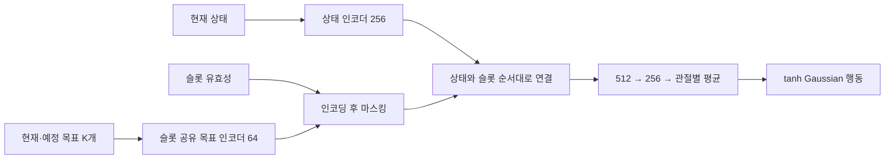

# Model: 정책별 관측, 목표 표현과 신경망

자료 기준일: **2026-11-04**. [정리.txt](정리.txt)의 세 정책 구상을 바탕으로 현행 코드를 대조한 모델 명세다. 원안과 구현의 차이를 표기하며, 코드가 존재한다는 사실을 학습 성능이나 세 정책의 동시 실행 성공으로 해석하지 않는다.

## 1. 세 정책이 관측하고 결정하는 것

압현과 타현 정책은 현재 몸과 기타의 상태에 더해 예정된 연주 목표를 받는다. 전신 정책은 자세와 악기 지지를 담당하므로, 원안에서는 별도의 음표 목표 없이 몸·기타·양손의 상태를 받는다. 여기서 정책은 관절을 직접 순간 이동시키는 함수가 아니라, 다음 제어 시점에 사용할 **정규화된 관절 목표 명령의 확률분포**를 출력하는 함수다.

| 구분 | 상태 입력 | 목표 한 슬롯 | 슬롯 수 | 학습 행동 | 확인된 위치·상태 |
|---|---:|---:|---:|---:|---|
| 원안 압현 / 초기 compact | 443, 골반 포함 452 | 16 | 8 | 33 | 원안에 대응하는 별도 코드 존재 |
| 현행 compact 압현 v5 | **464, 골반 포함 473** | **26** | **8** | **33** | 독립 실험 환경·정책 구현 |
| 원안 타현 | 440 | 16 | 2 | 27 | 단일 타현 중심의 설계 수치 |
| 현행 compact 타현 | **450** | **79** | **2** | **27** | 단일 타현·스트럼 환경·정책 구현 |
| 전신 정책 원안 | **480** | 없음 | 없음 | **37** | 별도 학습 정책으로는 미구현 |

압현 v5는 `compact_press_v5`, 타현은 `compact_strike` 실행 경로를 기준으로 한다. 기본 `guitar_learning/train.py`가 선택하는 557차원 J 압현 경로는 별도의 모델이며, 이 표의 compact 모델로 자동 교체되지 않는다. [압현 v5 정책](../../guitar_learning/training/compact_press_v5.py), [타현 정책](../../guitar_learning/training/compact_strike.py), [기본 실행 경로](../../guitar_learning/training/launch.py)

## 2. 관절 소유와 행동 차원

### 2.1 관측하는 105축과 명령하는 97축의 구분

관절 상태에는 Root를 제외한 전체 105축을 사용한다. 그중 양쪽 무릎·발가락의 y·z축 8개는 관절 범위가 0이다. 원안의 정책 출력은 이 8축을 제외한 97축을 다음과 같이 나눈다.

| 정책 | 소유하는 관절 이름 | 차원 |
|---|---|---:|
| 압현 | `L_Thorax`, `L_Shoulder`, `L_Elbow`, `L_Wrist`의 x·y·z | 12 |
| 압현 | `LH` 엄지 5축, 검지·중지·약지·소지 각각 4축 | 21 |
| 타현 | `R_Elbow`, `R_Wrist`의 x·y·z | 6 |
| 타현 | `RH` 엄지 5축, 검지·중지·약지·소지 각각 4축 | 21 |
| 전신 설계 | `Torso`, `Spine`, `Chest`의 x·y·z | 9 |
| 전신 설계 | `R_Thorax`, `R_Shoulder`의 x·y·z | 6 |
| 전신 설계 | `Neck`, `Head`의 x·y·z | 6 |
| 전신 설계 | 양쪽 `Hip` 3축, `Knee_x` 1축, `Ankle` 3축, `Toe_x` 1축 | 16 |
| 합계 | 압현 33 + 타현 27 + 전신 37 | **97** |

손가락 4축은 기저 관절의 `1_x`, `1_z`와 두 굽힘축 `2`, `3`이다. 엄지는 `thumb1_x/y/z`, `thumb2`, `thumb3`의 5축이다. 따라서 **타현 27축은 오른쪽 팔꿈치부터 포함**한다. `R_Wrist`와 그 아래 손만으로는 손목 3 + 손 21 = 24축이므로, 원안의 “R_wrist를 포함하는 하위 관절 27”은 위 표처럼 구체화해야 한다. [축 이름 정의](../../guitar_learning/core/control.py), [실제 오른손 27축 제어](../../guitar_learning/tool/experiments/right27/control.py)

### 2.2 실제 학습 행동과 전달용 39칸

현재 실행기는 공용 자료 수집 형식에 맞추기 위해 39칸 행동 배열을 사용한다. 두 정책에서 같은 배열 위치가 항상 같은 관절을 뜻하지 않으므로, 차원뿐 아니라 **관절 이름·활성 인덱스 계약**을 함께 확인해야 한다.

| 경로 | 39칸 전달 배열 | 확률·학습에 참여하는 부분 |
|---|---|---|
| compact 압현 | `[왼팔 12, 왼손 21, 비활성 6]` | 앞 33칸 |
| compact 타현 | `[비활성 12, 오른손 21, 오른팔 팔꿈치·손목 6]` | 뒤 27칸 |

비활성 칸은 실제 행동에서 0이며, 로그 확률·엔트로피·KL 계산에서 제외된다. 이 배열들을 인덱스 기준으로 단순히 더하는 것은 세 정책 결합 방법이 아니다. 통합 실행기를 만들 때는 각 정책의 이름 기준 소유 집합을 하나의 105축 목표 배열로 배치해야 한다. [압현 출력 및 마스크](../../guitar_learning/training/policy.py), [오른손 출력 및 마스크](../../guitar_learning/tool/experiments/right27/policy.py)

현재 몸통·하체의 지지는 학습된 37축 전신 정책 대신 기존 제어기가 수행한다. `WholeBodyTargetContract`라는 이름의 클래스도 105축 목표·PD 제어를 제공하지만, 정책 오프셋은 39축이고 나머지 66축은 기준 목표를 유지하는 별도 CPU 계약이다. 이를 전신 37축 학습 정책의 구현으로 세지 않는다. GPU에서는 추가로 발 역기구학과 유한 지지 제어를 사용한다. [CPU 전신 목표 계약](../../guitar_learning/core/whole_body_control.py), [GPU 제어기](../../guitar_learning/gpu/control.py)

### 2.3 신체·기타·지지면의 물리 모델

물리 상태는 관절각·각속도뿐 아니라 각 몸체의 위치·방향·선속도·각속도와 접촉 합력을 포함한다. 기타는 공간에서 움직일 수 있는 강체이며, 줄·프렛·피크의 측정 기준은 그 움직임에 맞춰 갱신한다.

| 구성 | 현재 GPU 모델의 조건 |
|---|---|
| 인간 | 관절 105축, Root 고정. 가동 관절 97축을 실제 구동·접촉으로 움직임 |
| 기타 | Root 비고정·중력 활성. native 강체 1개와 충돌 형상 89개로 구성 |
| 기타 측정 기준 | 기존 논리 몸체·마커를 강체 변환으로 복원. 별도의 자유도를 가진 물리 몸체로 세지 않음 |
| 지지면 | 지면과 고정된 의자 강체. 가슴·상완·허벅지·발 상태를 별도로 측정 |
| 물리 | GPU PhysX, 240Hz, 중력 \((0,0,-9.81)\,m/s^2\) |
| 관절 구동 | 위치 구동 48축·힘 구동 57축. 가동범위/정책 출력의 분류와 다름 |
| 초기 상태 | 왼손 실행은 v9, 오른손 실행은 035/v14 준비 스냅샷을 사용 |

형상·질량·질량중심·관성·마찰·충돌 필터는 자산과 준비 상태의 계약에서 읽고 native 읽기 값과 대조한다. 기타는 스트랩이나 직접 외력으로 원하는 위치에 붙잡아 두는 대상이 아니다. 사람 Root를 고정했기 때문에 현재 조건은 인간의 자유 균형을 포함하지 않는다.

기타의 논리 마커에 접촉력을 임의로 나누어 배분하지 않는다. 인간·의자의 native 몸체 합력을 기록하고 기타 전체 합력은 기타 Root에만 대응시킨다. 압현은 패드 표면과 몸체 하중, 타현은 피크점과 유한 현 선분의 통과로 판정한다. 이 목표 기하는 변형·진동하는 현 모델이나 음향 합성기의 구현을 뜻하지 않는다. [장면과 native 읽기 검증](../../guitar_learning/gpu/scene.py), [기타 강체 자산 기록](../../guitar_learning/assets/gpu_rigid_guitar_v1/manifest.json), [준비 상태 계약](../../guitar_learning/runtime/prepared_reset_v1.py)

## 3. 좌표계, 시간과 입력 척도

### 3.1 움직이는 기타를 기준으로 본 손

공간 입력은 관절 상태와 상대 몸체 상태로 나뉜다. 기타는 골반 좌표계, 손목과 피크는 **현재 기타 좌표계**에서 표현한다. 이렇게 하면 기타 자체가 움직여도 정책이 “기타에 대해 손이 어디에 있는가”를 읽을 수 있다.

기준 몸체를 \(B\), 관측점을 \(X\), 세계 좌표의 위치와 회전을 \(p,R\)라 하면,

\[
p_{X/B}=R_B^\top(p_X-p_B),\qquad R_{X/B}=R_B^\top R_X.
\]

선속도는 단순한 두 속도의 차이에서 끝나지 않는다. 기준 몸체의 회전 때문에 생기는 속도도 제거한다.

\[
v_{X/B}=R_B^\top\{v_X-v_B-\omega_B\times(p_X-p_B)\},\qquad
\omega_{X/B}=R_B^\top(\omega_X-\omega_B).
\]

여기서 \(v_X,v_B\)는 몸체 원점의 속도다. 시뮬레이터의 질량중심 속도에서 원점 속도로 옮기는 보정이 코드에 포함된다. 상대 회전의 6차원 표현은 회전행렬의 첫 두 열이다. 따라서 상대 몸체 상태 하나는 위치 3 + 회전 6 + 선속도 3 + 각속도 3 = **15차원**이다. [좌표·속도 변환](../../guitar_learning/gpu/control.py), [타현 상대 상태 조립](../../guitar_learning/gpu/compact_strike.py)

전체 관절의 “각도” 입력은 실제로 \(q-q^{ref}\), 즉 준비 기준 자세에 대한 각도 차이다. 목표 추종 오차는 \(q^{target}-q\)다. 초기 상태 대비 기타 변화 6차원은 위치 차 3 + **회전 벡터 3**이며, 상대 자세의 회전 6차원 표현과 구분한다.

### 3.2 정책 시간과 목표 시간

현재 GPU 경로는 60 Hz로 정책 행동을 한 번 선택한 뒤 같은 목표각으로 240 Hz 물리를 네 번 진행한다. 각 물리 간격에서 수행을 측정하고 제어 구간이 끝나면 다음 정책 관측을 구성한다. 네 시점의 상태를 신경망 입력에 단순히 쌓는 구조는 아니다. 목표에는 절대 시각 대신 `목표 시각 − 현재 악보 시각`을 넣는다. 양수는 남은 시간, 음수는 이미 지난 시간을 뜻한다.

압현의 부분 구간 학습에서는 `score_time = local_time + score_offset`으로 원 악보 시각을 복원한다. 타현은 원본 이벤트 시각에 준비 시간 `pre_roll`을 더한 동일한 시계에서 이벤트 중심 시각과 줄별 통과 시각을 유지한다. 60 Hz 결정 주기와 240 Hz 접촉·통과 측정 주기를 같은 것으로 쓰지 않는다. [압현 악보 시계](../../guitar_learning/gpu/finger_skill_environment.py), [타현 시간 계약](../../guitar_learning/song/strike_task.py), [GPU 장면 주기](../../guitar_learning/gpu/scene.py)

각 입력은 기록된 고정 척도 \(s_i>0\)로 나눈 뒤 제한한다.

\[
\widehat{x}_i=\operatorname{clip}(x_i/s_i,-10,10).
\]

실행 중 평균·분산을 계속 추정하는 정규화는 이 compact 입력에 적용하지 않는다. 압현 목표의 줄·프렛·손가락은 각각 6·14·4로 나눈 스칼라이며 one-hot 표현이 아니다. 타현 `next_string`은 실행계의 0~5 인덱스를 5로 나눈 값이다. **운지 원본은 0=low-E, 실행계는 0=high-e**이므로 입력 변환 계약을 통해 뒤집고, 압현 슬롯의 표시용 줄 번호는 실행 인덱스에 1을 더한 1~6을 쓴다. [압현 목표 척도](../../guitar_learning/gpu/compact_press_v5.py), [타현 목표 척도](../../guitar_learning/gpu/compact_strike.py), [줄 번호 변환 계약](../../guitar_learning/song/strike_task.py)

## 4. 압현 모델의 입력

### 4.1 상태: 원안 443차원에서 v5 464차원으로

| 기본 상태 블록 | 차원 | 의미 |
|---|---:|---|
| 전신 관절 상태 | 315 | 105축의 기준각 차·속도·목표 추종 오차 |
| 이전 행동 | 33 | 직전 왼손 정책 행동 |
| 기타의 골반 상대 상태 | 15 | 위치·회전·상대 선속도·상대 각속도 |
| 왼손목의 기타 상대 상태 | 15 | 동일한 15차원 상대 몸체 표현 |
| 접촉 플래그 | 10 | 가슴·오른쪽 상완·오른쪽 허벅지 3, 왼손 다섯 손가락 5, 양발 2 |
| 초기 상태 대비 변화 | 12 | 기타 위치 3·회전 벡터 3, 양발 위치 6 |
| 손가락별 수행 상태 | 8 | 네 손가락 각각 현재 유효 clean 여부·연속 clean 시간 |
| 손목 안내 | 7 | 안내 유효성 1·영역 중심 3·반폭 3 |
| 엄지와 넥 관계 | 8 | 영역 차이 3·표면 간격·방향 일치·영역 초과 거리·유효성·접촉 후보 |
| 실제 손가락 굽힘 | 16 | 네 손가락의 MCP/PIP/DIP 기하 각도 12·유효성 4 |
| 손목 이탈 감시 | 4 | 활성 감시·누적 이탈·남은 유예·심한 이탈 연속 시간 |
| 기본 합계 | **443** | 원안과 대응 |

굽힘각은 각 손가락의 실제 마디 회전에서 얻은 기하 각도이며 \(\pi/2\)로 나눈다. 기저 관절의 네이티브 `x/z` 좌표를 그대로 MCP 각도로 읽은 값이 아니다. 손가락 수행 상태의 clean 시간은 음이 실제로 유지되어야 하는 구간에서 측정한다. [기본 compact 상태 조립](../../guitar_learning/gpu/compact_press_v5.py)

| 추가 상태 블록 | 차원 | 보완하는 정보 |
|---|---:|---|
| 지지 접촉 상실 시간 | 3 | 상체 지지 전체·왼발·오른발의 이탈 시간 |
| 에피소드 잔여 시간·미정산 음 페널티 예산 | 2 | 남은 수행 범위와 종료 시 비용 맥락 |
| 동시 압현 상태 | 4 | 현재 대상 수·모두 clean 여부·동시 clean 연속 시간·구간 잔여 시간 |
| 손가락별 준비·대기 맥락 | 12 | 실제 대기 gate 4·다음 press까지 시간 4·다음 press 유효성 4 |
| v5 기본 합계 | **443 + 9 + 12 = 464** | 골반 블록 제외 |
| 선택적 골반 상태 | 9 | 골반 좌표계의 중력 방향·원점 선속도·각속도 |
| 골반 포함 v5 | **473** | 별도 입력 계약 |

동시 압현 상태의 네 값은 두 개 이상 목표가 함께 유지되어야 하는 구간에서만 의미가 있으며, 무목표·단일 목표 구간에서는 0이다. v5의 다음 press 시간은 현재 슬롯에 선택되지 않은 회복 범위 경계 목표도 포함해 계산한다. 남은 음 비용 예산의 척도는 선택된 일부 목표 수가 아니라 전체 악보 목표 수 \(M\)에 따른 \(0.25M\)이다. [v3 추가 상태](../../guitar_learning/gpu/compact_press_v5.py), [v5 준비 맥락·척도](../../guitar_learning/gpu/compact_press_v5.py)

### 4.2 목표: 한 슬롯 26차원

압현 목표는 “어느 줄·프렛을 언제 누르는가”뿐 아니라, 담당 손가락이 현재 그 목표에 얼마나 접근했고 얼마나 유지했는지를 함께 담는다.

| 목표 필드 | 차원 | 의미 |
|---|---:|---|
| 줄·프렛·담당 손가락 | 3 | 목표의 공간·역할 식별 |
| press·음 시작·해제까지 시간 | 3 | 준비·유지·해제의 시점 |
| 목표와 패드의 위치 차 | 3 | 목표 영역과 선택된 실제 손가락 표면의 차이 |
| 패드 상대속도의 음수 | 3 | 기타 좌표계에서 측정한 패드점 상대속도에 음수를 붙인 값 |
| 패드 법선 일치·표면 높이 | 2 | 방향과 누름 면의 기하 관계 |
| 접촉 후보·오압현 | 2 | 현재 측정에 따른 목표 접촉과 충돌 상태 |
| 기본 목표 합계 | **16** | 원안에 대응 |
| 현재 접촉 연속 시간·접촉 진행률·달성 원장 | 3 | 현행 목표의 획득 진행 |
| 최장 clean 연속 시간·누락 시간 | 2 | 지금까지의 유지 이력 |
| 수행 비용 지급량·정산 여부 | 2 | 목표별 보상 정산 이력 |
| 요구 clean 시간·음 길이·선택 목표 가중치 | 3 | 유지 기준과 목표별 비중 |
| v5 목표 합계 | **26** | 슬롯 하나의 차원 |

여기서 속도는 **최근접점 오차 벡터를 시간 미분한 값이 아니다**. 선택된 물리 패드점의 상대속도에 음수를 붙인 관측이다. 가장 가까운 표면점이 바뀌면 최근접점 오차의 미분과 다를 수 있다. 또한 달성 원장은 선택한 보상 프로필의 요구 유지 기준을 따르므로, 그 값 하나로 “음 전체를 유지했다”라고 판단하지 않는다. [목표 필드 16개](../../guitar_learning/gpu/compact_press_v5.py), [진행 필드 10개](../../guitar_learning/gpu/compact_press_v5.py), [v5 속도 의미와 유지 기준](../../guitar_learning/gpu/compact_press_v5.py)

### 4.3 8개 슬롯은 네 손가락의 tracking/next 쌍

슬롯 순서는 아래처럼 고정되어 있고, 역할을 담당할 손가락은 목표 데이터에서 정해진다.

| 슬롯 | 손가락 | 역할 |
|---|---|---|
| 0, 1 | 검지 | tracking, next |
| 2, 3 | 중지 | tracking, next |
| 4, 5 | 약지 | tracking, next |
| 6, 7 | 소지 | tracking, next |

`tracking`은 먼저 현재 음 구간에 들어온 목표 중 종료가 가장 빠른 것을 고른다. 현재 음이 없으면 준비 범위에 들어온 목표 중 시작이 가장 빠른 것을 고른다. `next`는 tracking과 다른 미래 목표를 고른다. 따라서 tracking을 항상 “이미 누르고 있는 음”, next를 “시간에 관계없이 반드시 다음 음”이라고 해석하면 틀린다.

기본 준비 노출 범위는 `press − 2초`부터이며, compact E4 경로는 선택 범위의 첫 press 묶음을 초기 시점부터 보여주는 예외를 둔다. 종료된 목표는 다시 활성화하지 않는다. 손가락당 두 슬롯은 동시에 여덟 음을 누른다는 뜻이 아니며, 먼 미래의 모든 목표를 담는 것도 아니다. 이 범위의 충분성은 빠른 연속 전환에서 별도로 평가해야 한다. [공용 손가락 목표 선택](../../guitar_learning/gpu/finger_reward.py), [compact가 상속하는 초기 준비 노출](../../guitar_learning/gpu/finger_skill_environment.py)

## 5. 타현 모델의 입력

### 5.1 상태 450차원

| 상태 블록 | 차원 | 의미 |
|---|---:|---|
| 전신 관절 상태 | 315 | 105축의 기준각 차·속도·목표 추종 오차 |
| 이전 행동 | 27 | 오른손 21축 + 팔꿈치·손목 6축 |
| 기타·오른손목·피크의 상대 상태 | 45 | 15차원 표현 세 개 |
| 접촉 플래그 | 10 | 압현과 같은 신체 부위 플래그 |
| 초기 상태 대비 변화 | 12 | 기타 위치·회전 및 양발 위치 |
| 줄별 검출 상태 | 18 | 여섯 줄 각각 armed·부호 있는 거리·cooldown |
| 준비·회복 상태 | 4 | ready·준비 연속 시간·recovered·회복 연속 시간 |
| 골반 상태 | 9 | 중력 방향·선속도·각속도 |
| 지지 접촉 상실 시간 | 3 | 상체 지지와 양발의 이탈 시간 |
| 이벤트 진행 요약 | 7 | 남은 시간·이벤트 진행 비율·완료·clean·누락·잘못된 타현·미준비 횟수 |
| 합계 | **450** | 원안 440 + 이탈 시간 3 + 진행 요약 7 |

`armed`는 줄 검출기가 재타현을 받을 수 있는 상태이고, `cooldown`은 최소 간격이 풀릴 때까지 남은 시간이다. 현재 구현은 물리 두 tick을 기준으로 남은 시간을 계산한다. 두 값은 같지 않다. 또한 `recovered`는 단순히 피크가 잠시 떨어졌다는 플래그가 아니라, 현재 이벤트의 회복 조건에 따른 원장 상태다. [상태 선언·조립](../../guitar_learning/gpu/compact_strike.py), [이벤트 검출·회복 원장](../../guitar_learning/gpu/strike_events.py)

### 5.2 목표 79차원과 스트럼의 표현

타현은 두 슬롯을 사용하지만, 슬롯 하나는 줄 하나가 아니라 **타현 이벤트 하나**를 나타낸다. 한 이벤트는 단일 줄 타현 또는 여러 줄을 정해진 순서·시차로 통과하는 스트럼일 수 있다. 첫 슬롯은 회복 단계까지 포함한 현재 이벤트이고, 둘째는 다음 이벤트다.

| 목표 블록 | 차원 | 구성 |
|---|---:|---|
| 기본 단일 타현 정보 | 16 | 다음 줄·방향·중심 시각/마감까지 시간 4, 목표 위치 차 3, 피크 상대속도 3, 부호 거리·깊이 오차·방향 통과 속도·armed·clean 완료·기하 유효성 6 |
| 제스처 정보 | 2 | 스트럼 여부·전체 통과 길이(시간) |
| 줄별 계획·진행 | 36 | 통과 대상·발음 대상·순서·시차·승인 여부·타이밍 오차, 각 6줄 |
| 이벤트 수행·회복 | 19 | 아래 표의 수행 상태 |
| 회복 경로 | 6 | 줄별 회복 경로 마스크 |
| 합계 | **79** | 한 이벤트의 입력 |

| 수행·회복 19차원의 세부 묶음 | 차원 |
|---|---:|
| 다음 통과 순번 | 1 |
| 준비 완료·준비 연속 시간 | 2 |
| 잘못된 타현·처리 완료·통과 완료 | 3 |
| 회복 연속 시간·최고 회복 진척·회복 완료·요구 회복 시간·연결 상태 | 5 |
| 통과 진행률 | 1 |
| 미준비·누락·현재 단계 | 3 |
| 이격 필요·재활성화 필요·새 회복 여부·최고 종료 진척 | 4 |

통과 대상(`traversal`)과 발음 대상(`audible`)은 별도 배열이다. 스트럼에서 무엇을 지나가야 하는지와 무엇이 발음 대상인지 구분하고, 실제 승인된 줄과 목표 통과 시각의 오차도 보존한다. 방향은 down=+1, up=−1이다. `next_string`은 현재 이벤트에서 아직 승인되지 않은 줄 중 다음 순번을 가리키며, 이벤트가 진행되면서 바뀐다. 위치 차의 목표점도 준비·통과·회복 단계에 맞추어 계산된다. [79개 목표 필드·현재/다음 슬롯](../../guitar_learning/gpu/compact_strike.py), [단음·스트럼 입력 계약](../../guitar_learning/song/strike_task.py)

이 구조에서 “현재와 다음 2슬롯”은 미래 두 개의 줄만 보는 제약이 아니다. 현재 스트럼 하나에 최대 여섯 줄의 계획이 들어간다. 반대로 세 번째 이후 이벤트의 세부 정보는 이 입력에 없으므로, 장기적인 타현 준비에 충분한지는 후속 검증 대상이다.

## 6. 상태와 목표를 통합하는 신경망

### 6.1 인코더와 빈 슬롯 처리

두 compact 정책은 다층 퍼셉트론(MLP), 즉 선형 변환과 비선형 활성화를 순서대로 적용하는 신경망을 사용한다. 각 은닉층의 활성화는 `Tanh`다. 목표 인코더는 한 정책 내부의 슬롯들 사이에서 가중치를 공유한다.

상태를 \(s\), 목표를 \(g_k\), 슬롯 유효성을 \(m_k\in\{0,1\}\)라 하면,

\[
h_s=f_s(s),\quad
h_{g,k}=m_k f_g(\operatorname{where}(m_k,g_k,0)),\quad
h=[h_s;h_{g,1};\cdots;h_{g,K}].
\]

목표를 0으로 채우는 것만으로는 충분하지 않다. 신경망 선형층에는 bias가 있으므로 0 입력에서도 값이 생길 수 있다. 구현은 **인코딩 후에도 마스크를 곱해 빈 슬롯의 64차원 출력을 정확히 0으로 만든다**. 슬롯 마스크는 별도 입력 인자로 전달되며 26·79차원 목표 필드에 포함되지 않는다. [공유 인코딩과 마스킹](../../guitar_learning/training/policy.py)

| 구성 | 압현 v5 | 타현 compact |
|---|---|---|
| 상태 인코더 | 464 또는 473 → 256 → 256 | 450 → 256 → 256 |
| 슬롯별 목표 인코더 | 26 → 64 → 64 | 79 → 64 → 64 |
| 목표 슬롯 결합 | 8 × 64 = 512 | 2 × 64 = 128 |
| 통합 특징 \(h\) | **256 + 512 = 768** | **256 + 128 = 384** |
| 행동 경로 | 768 → 512 → 256 → 33 | 384 → 512 → 256 → 27 |
| 가치 경로 | 768 → 256 → 256 → 두 개의 1차원 출력 | 384 → 256 → 256 → 두 개의 1차원 출력 |

그림은 행동 경로를 나타낸다. 가치를 예측하는 경로에는 별도의 상태·목표 인코더가 있다. **Actor와 Critic은 인코더를 공유하지 않으며**, 보상 가치 \(V_r\)와 비용 가치 \(V_c\) 두 출력만 같은 가치 인코더를 공유한다. 압현과 타현 정책 사이에도 가중치 공유가 구현되어 있지 않다. 목표 슬롯끼리의 공유를 Actor–Critic 간 공유로 혼동하지 않는다.

압현의 768, 타현의 384는 원시 입력의 총 길이가 아니라 **인코딩한 특징을 연결한 길이**다. compact 정책에는 attention·순환신경망·일반 목표 목록이 없다. 상태에 포함한 시간·원장·이전 행동이 수행 이력을 전달하며, 일반 이벤트 배열은 길이 0이다. `size=small/medium/large`는 기록되지만 compact 모델의 층 폭을 바꾸지 않는다. [압현 v5 구조](../../guitar_learning/training/compact_press_v5.py), [26차원 인코더](../../guitar_learning/training/policy.py), [타현 구조](../../guitar_learning/training/compact_strike.py)

### 6.2 확률정책과 행동 범위

학습 중에는 관절별 독립 정규분포에서 잠재 행동 \(z_j\)를 뽑고 `tanh`로 행동을 제한한다.

\[
z_j=\mu_j(s,g)+\sigma_j\epsilon_j,\quad \epsilon_j\sim\mathcal N(0,1),
\qquad a_j=\tanh z_j\in(-1,1).
\]

\(\mu\)는 행동 신경망의 출력이고 \(\log\sigma\)는 관절별로 학습하는 전역 매개변수다. 관측에 따라 표준편차를 새로 예측하는 출력부는 없다. 결정론적 평가에서는 표본 추출 대신 \(a=\tanh\mu\)를 사용한다.

| 초기화 | 압현 v5 | 타현 compact |
|---|---|---|
| 행동 평균 출력층 | 가중치·bias 0 | 가중치·bias 0 |
| 초기 잠재 표준편차 | 팔 12 + 엄지 5: **0.15**, 나머지 손가락 16: **0.35** | 27축 모두 \(e^{-3}\approx0.0498\) |
| 사용 시 log 표준편차 범위 | −5~2 | −5~2 |

이 표준편차는 rad 단위의 관절각 표준편차가 아니라 **tanh 이전 정규화 잠재 행동**의 표준편차다. 실제 관절각의 변화는 아래 목표각 변환과 변화율 제한을 거친다. 압현 v5의 실행기는 역할별 초기 표준편차가 공용 초기화에 의해 다시 이동하지 않도록 검사한다. [압현 초기 탐색](../../guitar_learning/training/compact_press_v5.py), [실행기의 초기화 검증](../../guitar_learning/tool/experiments/compact_press_v5.py), [타현 초기 탐색](../../guitar_learning/training/compact_strike.py)

행동의 로그 확률에는 `tanh` 변환의 야코비안 보정이 들어간다.

\[
\log\pi(a\mid s,g)=\sum_{j\in\mathcal A}
\left[\log\mathcal N(z_j;\mu_j,\sigma_j^2)-\log(1-\tanh^2z_j)\right].
\]

\(\mathcal A\)는 실제 학습 축 집합으로 압현 33축, 타현 27축이다. 구현은 수치적으로 안정적인 `softplus` 식으로 보정항을 계산한다. PPO에서 사용하는 엔트로피는 **변환 전 정규분포의 엔트로피**이며, tanh로 제한된 행동 분포의 정확한 엔트로피와 같다고 쓰지 않는다. KL은 활성 축의 정규분포 매개변수로 계산한다. [압현 확률·엔트로피·KL](../../guitar_learning/training/policy.py), [타현 활성 축 확률 계산](../../guitar_learning/tool/experiments/right27/policy.py)

### 6.3 신경망 출력에서 실제 제어 목표로

정책은 토크를 직접 출력하지 않는다. 행동 \(a_j\)를 준비 기준각 \(q_j^{ref}\)와 허용 하한·상한 \(l_j,u_j\) 사이의 요청각으로 바꾼다.

\[
q_j^{req}=q_j^{ref}+
\begin{cases}
a_j(u_j-q_j^{ref}),&a_j\ge0,\\
a_j(q_j^{ref}-l_j),&a_j<0.
\end{cases}
\]

손가락 21축은 실제 네이티브 관절 범위를 사용하고, 직전 목표에서 한 제어 tick당 최대 \(4/60\) rad씩 움직이도록 제한한다. 행동 0은 “직전 목표 유지”가 아니라 준비 기준각을 요청한다. 팔 축은 별도의 허용 오프셋·평활화·변화율 제한을 적용한다. 실제 자세는 유한 제어력과 접촉을 통해 물리적으로 변하며, 요청각과 도달각은 같다고 가정하지 않는다. [왼손 목표각 변환](../../guitar_learning/gpu/control.py), [오른손 목표각 변환](../../guitar_learning/tool/experiments/right27/control.py)

## 7. 전신 정책: 다음 구현을 위한 명세

전신 정책은 음악 목표 인코더를 생략한다. 몸통·오른쪽 어깨·머리·하체의 현재 상태와 기타 지지 상태를 보고 37축을 조절하는 구상이다. 현재 손의 위치·속도는 관측하되, 압현·타현 목표 슬롯을 직접 받는 구조는 원안에 포함하지 않는다.

| 제안 상태 블록 | 차원 |
|---|---:|
| 105축 관절 상태 3종 | 315 |
| 이전 전신 행동 | 37 |
| 기타의 골반 상대 상태 | 15 |
| 양손목의 기타 상대 상태 | 30 |
| 접촉 플래그 | 10 |
| 초기 상태 대비 기타·양발 변화 | 12 |
| 골반 중력·선속도·각속도·지면 기준 높이 | 10 |
| 양발의 골반 상대 상태 | 30 |
| 신체와 기타를 합친 질량중심의 상대 위치·속도 | 6 |
| 가슴·오른쪽 상완·지지 허벅지·양발의 접촉 합력 | 15 |
| 합계 | **480** |

제안 행동 경로는 `480 → 256 → 256` 상태 인코더 뒤에 `256 → 512 → 256 → 37`을 두는 구조다. Actor/Critic 분리, 확률분포와 가치 출력은 압현·타현과 같은 원칙을 적용할 수 있으나, **전신 모델로 구현·검증된 사실은 아니다**. 접촉 합력은 해당 몸체에 작용하는 모든 접촉의 합이며 특정 기타 접촉력으로 단정하지 않는다. [원안](정리.txt)

현재 장면은 사람 Root 고정·기타 Root 비고정 조건을 요구한다. 따라서 현행 코드에서 105축 관절 상태를 읽거나 전신 PD 제어를 수행한다는 사실이 자유 Root의 균형 학습을 뜻하지 않는다. 37축 정책을 추가할 때는 기존 발 보정·상체 지지 제어와 어느 목표를 누가 결정하는지, Root와 의자 접촉을 어떻게 다룰지 별도 제어 계약으로 정해야 한다. [현행 장면의 Root 조건](../../guitar_learning/gpu/scene.py), [기존 제어기 소유 범위](../../guitar_learning/gpu/control.py)

## 8. 기본 J 모델과 혼동하지 않기

기본 학습 진입점은 557차원 상태·24차원 목표·손가락별 8개 우선 슬롯의 `FingerSkillPolicy`를 사용한다. 이 모델에는 일반 이벤트 attention 문맥이 있고, 지지 17축 경로와 네 손가락 출력부가 분리되어 있다. 각 손가락 출력부는 공통 문맥에 자기 tracking/next 두 토큰과 자기 상태 20열을 추가해 4축을 출력한다.

| 항목 | 기본 J 경로 | compact 압현 v5 |
|---|---|---|
| 상태 / 목표 | 557 / 24 | 464 또는 473 / 26 |
| 목표 특징 너비 | 128 | 64 |
| 일반 이벤트 목록 | attention 문맥 사용 | 사용하지 않음 |
| Actor 구조 | 지지 경로 + 손가락 경로·개별 출력부 | 통합 특징 → 하나의 33축 출력부 |
| large | 실제 fusion 폭 1024 → 1024 → 512 | 이름을 기록하며 실제 폭은 512 → 256으로 고정 |

이 때문에 “large를 사용한다”, “상태와 목표를 합친다”라는 설명만으로 모델을 특정할 수 없다. 문서와 실험에는 실행 경로, 관측 schema, 상태·목표 차원, 활성 관절 이름, 실제 층 크기를 함께 적어야 한다. [기본 J 모델](../../guitar_learning/training/policy.py), [기본 진입 설정](../../guitar_learning/training/launch.py), [compact v5 모델 계약](../../guitar_learning/training/compact_press_v5.py)

이 문서는 입력·출력·네트워크의 명세다. 접촉 후보는 표면 기하와 몸체 접촉 합력에 근거하고, 타현 승인은 줄 통과 기하와 시간·방향·순서에 근거한다. 실제 현 압력·진동·음향 성공, 손가락 조합의 물리적 수행 가능성, 세 정책 통합 성능은 각 조건을 직접 실행해 검증해야 한다.
