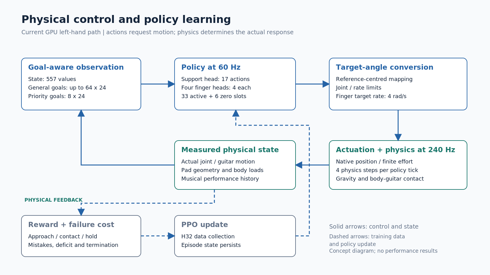

# Method

> 본문 1–7절은 현재 기본 GPU 왼손 학습 경로를 설명한다. 8절의 손가락별 진행 상태는 별도 실험 확장이다. 각 절의 직접 근거는 [근거 색인](evidence_index.md)에서 확인할 수 있다.

## 1. 오디오를 검토 가능한 연주 계획으로 변환

오디오만으로 신체 동작을 하나로 결정할 수 없으므로, 물리 제어에 앞서 어떤 음을 어떤 운지로 수행할지 명시한다. 현재 오프라인 파이프라인은 Conformer 기반 전사기로 오디오에서 줄별 음과 시작·종료 시점을 추정하여 탭 자료를 만든다. 이어 운지 배정기가 주어진 줄·프렛에 사용할 왼손 손가락을 정한다. 이 배정기는 입력 탭의 줄·프렛을 고정한 채 손가락을 배정한다. 따라서 음높이 추정 뒤 줄과 프렛까지 모두 새로 최적화하는 방법으로 설명하지 않는다. 코드 추정·융합 경로도 있으나, 이번 압현 제어 설명의 핵심 입력은 음별 탭과 운지 정보다.

전처리 결과는 검토 후 곡 번들로 등록한다. 번들에는 오디오, 운지, 압현·타현 계획과 출처 정보가 함께 들어 있다. 목표 컴파일러는 원 음표와 계획 사건의 대응을 확인하고, 시각·줄 번호·지원 범위를 검증하여 표준 시간표를 구성한다. 여러 줄을 차례로 지나는 타현은 줄별 통과 시점으로 전개하므로, 하나의 스트로크 안에서도 각 줄의 음 시작이 다를 수 있다.

물리 학습 중에는 이 시간표를 고정하여 사용한다. 손의 접촉 결과에 맞춰 원곡의 음 시작을 옮기거나, 원시 오디오를 매 제어 순간 다시 전사하지 않는다. 이 설계는 같은 목표에서 제어 성능을 비교하기 위한 것이다. 전처리의 정확도, 등록 과정에서의 수정, 물리 제어의 수행 정확도는 각각 평가해야 한다. 합성 단음·전환 입력은 별도 출처로 식별한다. 현재 작업 지침의 압현 범위는 1–14프렛이며 개방현은 별도 허용하지만, 이 지침만으로 모든 입력에 자동 제한이 적용되거나 모든 조합의 실행 가능성이 보장되지는 않는다.

## 2. 신체 상태와 음악 목표를 함께 관측

제어기는 현재 관절의 위치·속도와 직전 목표, 기타의 위치·방향과 신체에 대한 상대 상태, 손목·엄지·손가락의 기하 및 접촉 정보, 수행 이력과 남은 시간을 관측한다. 원시 값은 필드별 고정 척도로 나누고 범위를 제한한다. 현재 기본 상태 벡터의 길이는 557이다. 이 숫자는 아래 목표 토큰을 포함한 전체 입력 크기가 아니라 신체·과제 상태 부분의 길이다.

| 입력 | 현재 기본 형태 | 역할 |
| --- | --- | --- |
| 상태 벡터 | 557개 값 | 신체·악기·이력·종료 상태 |
| 일반 목표 토큰 | 최대 64개, 각 24개 값 | 현재와 가까운 미래의 음 |
| 손가락별 우선 토큰 | 8개, 각 24개 값 | 네 손가락의 추적 목표와 다음 목표 |
| 유효 마스크 | 일반·우선 토큰별 참/거짓 | 빈 칸이 목표로 사용되지 않도록 구분 |

목표 토큰은 음 시작·종료·압현 준비까지의 시간, 줄·프렛·손가락·타현 방향, 현재 수행 구간 여부와 압현 이력, 목표에 대한 상대 위치·속도 등을 포함한다. 전곡 경로의 일반 관측 창은 가까운 미래 4초를 대상으로 한다. 곡의 음 수가 토큰 용량과 같을 필요는 없다. 별도의 전체 목표 원장이 시간표와 음별 평가 이력을 보존한다.

여러 음을 하나의 일반 문맥으로 합치더라도 특정 손가락의 목표가 빠지지 않도록 손가락별 우선 토큰을 별도로 둔다. 각 손가락은 현재 발음 구간의 자기 음을 우선 추적한다. 그런 음이 없으면 준비 가능한 가장 빠른 자기 음을 선택하고, 다음 목표를 별도로 제공한다. 기본 경로의 준비 노출은 압현 준비 시작보다 2초 앞선 시점부터 허용된다. 한 손가락이 음을 유지하는 동안 다른 손가락은 다음 목표를 준비할 수 있다. 다만 이러한 목표 표현 자체가 동시 압현의 성공을 보장하지는 않는다.

## 3. 지지 출력과 손가락 출력을 결합

팔·손목을 움직여 손을 가까이 보내는 일과 손가락으로 마지막 위치 차이를 조절하는 일은 공간적 규모가 다르다. 현재 기본 정책은 이 역할을 반영하여 지지 부분과 개별 손가락의 출력부를 구분한다. 지지 17축에는 왼쪽 흉곽·팔·손목·엄지가 포함되고, 검지·중지·약지·소지는 각각 4축씩 총 16축을 출력한다.

지지 인코더는 지정된 관절·기타·손목·지지 접촉 정보와 목표 토큰의 계획 부분을 사용한다. 손가락 인코더는 전체 상태와 음악 문맥을 사용하며, 각 손가락의 출력부는 자기 관절 상태와 자기 추적·다음 목표를 추가로 받는다. 일반 음 토큰은 상태에서 만든 질의에 따라 가중합하여 문맥으로 만들고, 우선 토큰은 손가락별 순서를 보존한다. 지지·손가락·가치 인코더는 서로 다른 가중치를 사용한다.

학습 중 정책은 정규분포에서 행동을 표본 추출한 뒤 \(\tanh\)를 적용해 각 성분을 −1과 1 사이로 제한한다. 활성 33축은 같은 시점에 선택하고 함께 학습한다. 공통 행동 배열의 오른손 6칸은 현재 경로에서 0으로 유지한다. 지지 부분과 손가락을 순차적으로 학습하거나 지지 정책을 고정하는 단계를 현재 기본 방법으로 두지 않는다. 이 구조의 효과는 최종 평가에서 단일 출력 구조 등과 비교할 항목으로 남긴다.

**그림 2.** 현재 기본 왼손 제어의 개념도. 정책은 60Hz로 목표각 요청을 만들고, 유한 관절 구동과 물리 시뮬레이션은 240Hz로 반응을 계산한다. 음악 목표와 실제 상태는 다음 관측으로 돌아간다. 점선 학습 경로는 수집된 보상·실패 비용으로 정책을 갱신하는 과정을 뜻한다.

## 4. 행동을 유한 관절 구동으로 실행

정책 출력은 실제 관절각이나 토크 자체가 아니다. 먼저 각 행동을 관절 범위 안의 목표각 요청으로 바꾸고, 목표 변화율과 관절 구동의 힘을 제한한 뒤 물리적으로 실행한다. 왼손 손가락 21축의 기준각 \(q_i^{\mathrm{ref}}\)는 현재 GPU 준비 자세 v9의 값이다. 관절의 하한·상한을 \(q_i^{\min},q_i^{\max}\), 행동을 \(a_{i,k}\)라 하면 요청각은 다음과 같다.

\[
q_{i,k}^{\mathrm{req}}=q_i^{\mathrm{ref}}+
\begin{cases}
a_{i,k}(q_i^{\max}-q_i^{\mathrm{ref}}),&a_{i,k}\geq0,\\
a_{i,k}(q_i^{\mathrm{ref}}-q_i^{\min}),&a_{i,k}<0.
\end{cases}
\]

행동 0은 기준각, −1과 1은 각각 허용 하한과 상한을 요청한다. 같은 행동을 반복해도 요청각이 계속 누적되지 않는다. 이후 직전 목표각 \(q_{i,k}^{\mathrm{tar}}\)에서 다음 목표각으로의 변화를 제한한다.

\[
q_{i,k+1}^{\mathrm{tar}}=q_{i,k}^{\mathrm{tar}}+
\operatorname{clip}\!\left(q_{i,k}^{\mathrm{req}}-q_{i,k}^{\mathrm{tar}},
-\dot q_i^{\lim}\Delta t_c,\dot q_i^{\lim}\Delta t_c\right).
\]

\(\Delta t_c=1/60\)초이며 손가락의 목표 변화율 한계는 \(\dot q_i^{\lim}=4\)rad/s다. 이는 명령 목표의 변화율이며 실제 관절속도의 상한을 뜻하지 않는다. 다른 활성축에는 별도의 범위·변화율과 평활화를 사용한다.

손가락 등 위치 구동축은 시뮬레이터의 유한 강성·감쇠와 힘 상한으로 목표를 추종한다. 외부 힘 제어축은 중력 보상, 자세 피드백과 지지 항을 결합하고 관절별 힘 상한을 적용한다. 하체에는 별도의 질량행렬 기반 자세 유지 제어를 사용한다. 손목·발의 기하 보정은 이 구동에 전달할 목표를 계산하는 과정이며, 정상 실행 중 실제 신체 상태를 목표 자세로 덮어쓰는 과정이 아니다.

정책과 목표각 갱신은 60Hz로 수행한다. 한 제어 구간마다 240Hz 물리 계산을 네 번 진행하며, 각 물리 끝점에서 상태·접촉과 구동력을 다시 계산한다. 기타에는 정책이 직접 보조력을 가하지 않으며, 신체와의 접촉 및 중력에 따라 움직인다.

## 5. 접근·접촉·유지를 구분하는 학습 신호

목표에 가까이 가는 것만 보상하면 손이 근처에서 멈출 수 있고, 순간 접촉만 보상하면 음이 유지되지 않을 수 있다. 반대로 최종 달성만 보상하면 접촉에 이르는 과정의 학습 신호가 희박해진다. 현재 기본 경로는 최종 합산에 사용하는 아홉 항을 다음과 같이 구분한다.

| 항 | 역할 |
| --- | --- |
| 목표 패드 접근 | 실제 패드 표면과 선택 목표의 관계가 개선되는 방향을 안내 |
| 최초 접촉 | 음별 연속 접촉 진행에 따라 제한된 예산을 지급 |
| 유효 압현 유지 | 잘못된 압현을 제외한 발음 구간의 유지 |
| 압현 달성 | 요구된 연속 유지 시간 충족 |
| 오압현 | 실제 후보 접촉에 근거한 잘못된 줄·프렛 간섭을 감점 |
| 음 수행 부족 | 음의 누락과 연속 유지 부족을 정산 |
| 대기 자세 | 목표와 충돌하지 않는 시간에 약한 준비 자세 선호 제공 |
| 엄지 안내 | 넥 후면의 위치·방향·하중에 따른 약한 지지 선호 제공 |
| 행동 변화 | 손가락 LH21을 제외한 행동 변화에 비용 부여 |

접근 항은 위치가 가까운 상태 자체를 매번 가산하는 방식과 다르다. 선택 목표에 대한 잠재값 \(\Phi_k\)를 정의하고 \(r_k^{\mathrm{approach}}=\gamma\Phi_{k+1}-\Phi_k\) 형태의 변화량을 사용한다. 이 항은 실제 패드의 목표 접근을 안내하며, 관절 목표나 물리 상태를 직접 수정하지 않는다.

유효 압현의 시간은 연속한 두 물리 끝점의 후보 판정과 음의 발음 구간을 함께 사용해 누적한다. 음의 길이를 \(D_i=t_i^{\mathrm{off}}-t_i^{\mathrm{on}}\)라 할 때 현재 기본 달성에 필요한 연속 시간은 다음과 같다.

\[
h_i^{\mathrm{req}}=\min\left(D_i,\max(0.05\ \mathrm{s},0.4D_i)\right).
\]

이는 짧은 접촉을 여러 번 더한 누적 시간과 다르며, 이 문턱을 넘었다고 음 전체가 유지된 것도 아니다. 따라서 달성 여부와 발음 구간의 유지 비율을 따로 기록한다. 수행 부족 항은 누락 시간에 대한 감점을 누적하고 음 끝에서 연속 유지 부족까지 정산하여, 이미 지급한 감점이 중복되지 않도록 한다.

대기 자세와 엄지 안내는 약한 선호다. 손가락을 특정 자세로 자동 복귀시키거나 엄지를 넥에 붙이는 강제 조건으로 사용하지 않는다. 기본 환경의 상위 클래스에 남아 있는 별도 보상 계산을 모두 현재 아홉 항에 추가하지도 않는다. 최종 계수와 실제 합산 항은 실행 계약 및 최종 환경의 정의로 식별한다.

## 6. 실패 처리와 에피소드 경계

정상적인 곡·구간의 끝과 물리·손목 실패에 의한 조기 종료를 구분하여 기록한다. 손목이 목표 수행에 필요한 허용 영역에서 벗어나는 상태에는 유예·누적 시간을 적용하고, 심각한 이탈은 별도 조건으로 처리한다. 기타와 신체의 물리 상태에 대한 실패 조건도 함께 검사한다. 구체적인 임계값과 적용 시간은 평가에 사용한 계약으로 보고한다.

실패 비용은 음악 보상과 별도로 기록하되 정책 최적화에 반영한다. 현재 경로는 종료 비용에 남은 시간과 미관측 음의 부정 보상 예산도 반영하여, 일찍 종료하는 것이 남은 어려운 음을 회피하는 이득이 되지 않도록 설계했다. 이 설명은 설계 의도이며 효과는 비교 실험으로 확인해야 한다.

초기화에서는 검토된 준비 자세와 기타 상태를 복원한다. 실제 상태 복원은 에피소드 경계에서 수행하며, 진행 중인 손 움직임을 정답 각도로 교체하지 않는다. 팔의 진단 제어로 도달 가능한 자세를 찾거나 알려진 각도를 재생한 실험은 학습 정책의 독립 수행과 구분한다.

## 7. 정책 학습과 별도 평가

정책은 PPO(Proximal Policy Optimization)를 사용해 갱신한다. 이 구현은 수집한 행동의 이전 확률과 갱신 중 정책의 확률을 비교하고, 큰 변화에 제한을 둔다. 보상과 실패 비용에 대해 각각 미래값을 추정한다. 현재 기본 경로는 보상 우위에서 비용 우위를 고정 가중치 1로 차감한 뒤 정규화하여 정책에 반영한다. 비용 승수를 자동 조절하는 방법으로 기술하지 않는다. 탐색 분산은 학습하지만 별도 엔트로피 보너스는 사용하지 않는다.

매 정책 시점에 새 행동을 선택한다. 기본 수집 길이는 환경당 32개 제어 시점(H32)이며, 이 경계는 에피소드 초기화 경계가 아니다. 곡이 진행 중이면 신체·기타·목표 이력과 종료 타이머를 유지한 채 다음 수집을 이어간다. 정상 종료나 실패가 발생한 환경만 초기화한다.

학습 초기에는 겹치는 음의 관계를 보존한 곡 구간을 사용하고, 최초 계획 전이 예산의 25%에 도달하면 다음 초기화부터 전곡을 선택한다. 진행 중인 구간을 중간에 전곡으로 교체하지 않으므로 실제 학습 자료의 구간·전곡 비율이 정확히 25:75인 것은 아니다. 초기부터 지지와 네 손가락의 활성 33축을 공동 학습한다.

저장 모델은 동일한 코드·입력·관측·행동 계약으로 식별한다. 학습 중 결과와 저장 모델의 별도 평가를 나누고, 별도 평가에서는 평균 행동과 확률적 행동, 초기 조건, 음·에피소드 분모를 명시한다. 단일 압현·전환·동시 압현·양손 협응은 서로 다른 성공 조건으로 평가한다. 시간표 끝까지 물리적으로 진행한 것과 음악 목표를 충족한 것도 구분한다.

## 8. 별도 확장: 손가락별 진행 상태

현재 기본 관측에는 목표와 수행 이력이 있지만, 손가락마다 준비·정렬·압현·유지의 진행이 다를 때 이를 더 명시적으로 전달할 필요가 있다. 별도 실험 경로는 각 손가락에 idle, prepare, aligned, press, hold, release의 여섯 상태와 선택 목표·남은 시간·정렬 및 유효 압현 연속 시간 등을 제공한다. 손가락당 14개, 총 56개 값을 추가하여 상태 벡터가 613개가 된다.

이 여섯 상태는 행동을 잠그는 고정 순서가 아니다. hold 중 접촉이 끊기면 press로 돌아갈 수 있고, 다음 준비가 필요하면 이전 음의 release보다 우선할 수 있다. 한 손가락의 목표 교체가 다른 손가락의 진행 시계를 초기화하지 않는다. 자기 발음 음의 유지는 자기 다음 음의 준비보다 우선한다.

이 경로는 조기 목표 노출과 준비 보상 관련 변경도 함께 사용한다. 따라서 기본 557상태 정책과의 차이를 단순히 상태 56개 추가로만 설명하지 않는다. 문서화된 CPU 검사까지의 확인과 GPU 학습 효과는 별개다. 또한 네 손가락이 독립된 목표를 갖는다고 팔·손목이 네 개 생기는 것은 아니다. 현재의 공유 손목 허용 영역과, 여러 동시 음 및 다음 준비를 함께 만족하는 전곡 공유 자세·이동 경로 계획은 구분한다. 최종 채택 여부는 [미확정 항목](04_open_questions.md)의 평가에 따라 정한다.
