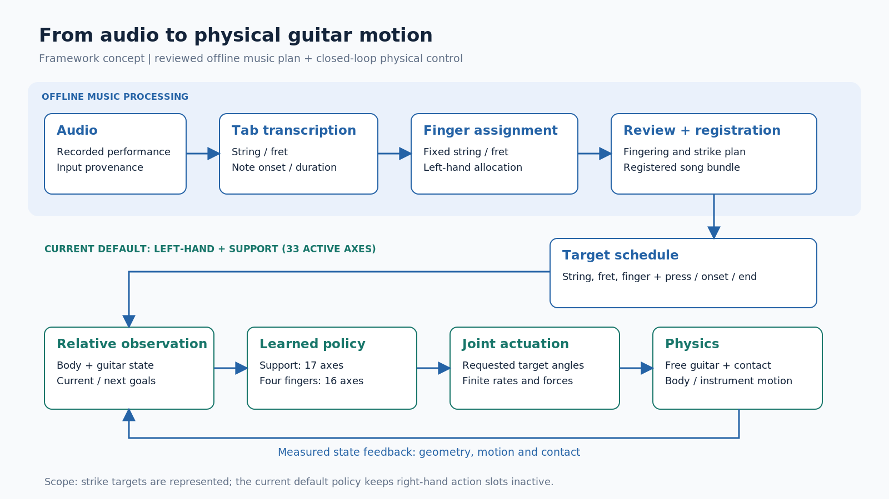

# 프레임워크 상세 초안

논문: **From Audio to Full-Body Guitar Performance with a Freely Moving Instrument**  
작성·구현 확인일: **2026-11-02**. 한국어 작업 초안.

교수님께 설명할 Overview·Model·Method의 내용을 먼저 모으는 공간이다. 각 절은 나중에 Methodology의 하위 절로 옮길 수 있도록 작성했다. 기존 [방법 원고](../03_methodology.md)의 2026-10-19 설정이나 이미 합의한 초록·서론을 덮어쓰지 않는다. 이 디렉토리의 작성일은 기존 실험 결과의 기준일을 바꾸지 않는다.

## 읽는 순서

| 문서 | 설명 |
| --- | --- |
| [01 Overview](01_overview.md) | 문제, 입력·출력, 음악 계획과 물리 제어를 연결하는 전체 흐름 |
| [02 Model](02_model.md) | 신체·기타·접촉·좌표계·시간·행동의 정의 |
| [03 Method](03_method.md) | 목표 구성, 관측, 정책, 관절 제어, 보상과 학습 |
| [확정할 항목](04_open_questions.md) | 목표 전환·동시 압현·오른손 통합을 확정할 때 필요한 판단 |
| [근거 색인](evidence_index.md) | 각 설명에 사용한 코드와 문서, 적용 범위 |
| [그림 관리](images/README.md) | 개념도, 실제 시뮬레이터 화면과 추후 그림의 저장 규칙 |

## 이 초안의 범위

전체 연구는 오디오에 대응하는 양손 연주를 목표로 한다. 현재 상세 기술의 중심은 **움직이는 기타를 기준으로 목표를 표현하고, 신체의 지지와 왼손 압현을 함께 제어하는 공통 구조 및 기본 GPU 학습 경로**다. 오른손 목표 표현이 존재하는 것과 최신 왼손 정책이 오른손까지 학습한다는 것은 다르다.

| 구분 | 이번 초안에서의 위치 |
| --- | --- |
| 공통 물리 모델·상대 좌표·등록된 연주 목표·직접 목표각 제어 | Model과 Method 본문으로 설명 |
| 현재 기본 왼손 학습 | 557상태, 활성 33축, 지지·손가락 공동 학습을 기준으로 설명 |
| 손가락별 진행 상태 확장 | 613상태의 별도 실험 경로로 설명. 기본 정책으로 확정하지 않음 |
| 단일 압현·목표 전환·동시 압현의 개별 연구 | 최종 방법을 선택하기 위한 근거. 서로 다른 실행 결과를 합산하지 않음 |
| 양손 통합·전곡 공유 손목 계획·교육적 효과 | 검증·확정할 사항으로 관리 |

본문에 결과 수치나 달성하지 않은 성공 주장을 넣지 않았다. 코드에 있는 구조는 설명하되, 그 구조의 효과는 이후 동일 조건의 별도 평가로 채운다. 실행별 설정값은 학습 계약과 결과 파일을 확인한 뒤 Experiment에 정리한다.

그림은 처리 단계와 범위를 설명하는 **개념도**다. 실제 수행 장면이나 검증된 전체 연주 결과를 나타내지 않는다. 각 그림의 재사용 캡션은 [그림 관리](images/README.md)에 있다.

## 작성 체크리스트

- [x] 기존 원고와 분리된 Overview·Model·Method 본문 작성
- [x] 공통 구조·현재 기본 정책·별도 실험 경로 구분
- [x] 그림 디렉토리와 편집 가능한 개념도 마련
- [x] 주장별 소스 및 남은 결정 사항 연결
- [x] 링크·수식·그림·구현 대응 확인
- [x] 별도 검수 및 지적 사항 반영

이번 산출물은 로컬 상세 초안이다. Overleaf 반영과 교수님 전달은 이후 작업으로 남긴다.

확인 기록: 로컬 링크71개 유효, 근거36파일의 기록 시점 대비 해시 일치, JSON·SVG 형식 및 PNG3개 확인, 실제 화면 복사본의 원본 해시 일치. 개념도2종은 렌더링 후 시각 확인했으며, 별도 검수에서 수정이 필요한 지적은 없었다. 이 확인은 문서·구현 설명의 검수이며 새로운 물리 실행이나 성능 평가가 아니다.
