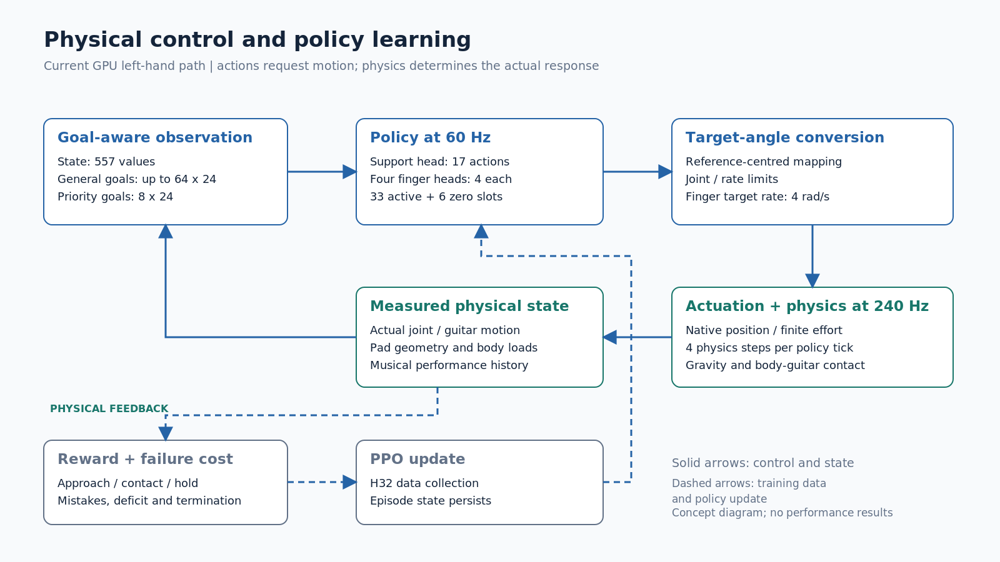
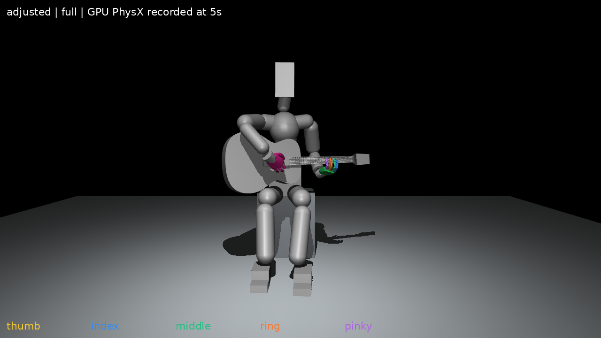

# 프레임워크 그림과 캡션

개념도와 실제 장면을 함께 보관하되 종류와 조건을 캡션에서 구분한다. `*.svg`는 편집 원본, `*.png`는 문서 미리보기, `*.pdf`는 LaTeX 삽입용 벡터 파일이다. 같은 이름의 세 형식은 같은 그림이다. 개념도는 이 초안을 위해 작성했으며 성능 측정값을 포함하지 않는다. 그림 안의 짧은 표기는 영문으로 두고 설명은 한국어 캡션으로 제공한다.

## 그림 1 — Framework overview

[SVG 원본](framework_overview.svg) · [PNG](framework_overview.png) · [PDF](framework_overview.pdf)

**캡션:** 오디오 전처리와 물리 제어를 연결하는 프레임워크 개념도. 오프라인 탭 전사와 운지 배정 결과를 검토·등록한 뒤 연주 목표 시간표로 변환한다. 상대 상태 관측, 정책, 유한 관절 구동과 물리 시뮬레이션을 반복하여 신체·기타 상태를 생성한다. 타현 목표는 공통 계획에 포함할 수 있지만 현재 기본 정책의 활성 제어는 왼손 및 지지33축이다. 실제 수행 영상이나 전체 양손 연주 성공을 나타내지 않는다.

근거: [E1–E6](../evidence_index.md).

## 그림 2 — Physical control and learning

[SVG 원본](control_loop.svg) · [PNG](control_loop.png) · [PDF](control_loop.pdf)

**캡션:** 현재 기본 왼손 정책의 관측·행동·물리 피드백 흐름. 정책은60Hz로 지지17축과 네 손가락16축의 행동을 선택한다. 목표각 변환·제한을 거쳐 유한 관절 구동과240Hz 물리 시뮬레이션을 적용하며, 제어 구간당 네 물리 계산을 수행한다. 실제 상태는 다음 관측으로 돌아가고 보상·실패 비용은 수집 후 PPO 학습에 사용한다. 그림은 제어 경로의 개념도이며 학습 성능을 나타내지 않는다.

근거: [E3·E5–E8](../evidence_index.md).

## 그림 3 — 준비 자세 v9 실제 화면

**캡션:** 준비 자세v9를 실제 Isaac Gym GPU 물리 장면에서5초 유지한 뒤 기록한 전신 화면. 기타와 양손·신체의 배치를 설명하기 위한 자료다. 초기 자세 확인 화면이며 학습 정책의 압현·양손 연주 성공을 나타내지 않는다.

원본: [adjusted_full.png](../../../docs/2026-11-02/압현성공/initial_pose/초기자세_v9/native_images/adjusted_full.png). 원본을 수정하지 않고 복사했다. 검증 조건은 [v9 README](../../../docs/2026-11-02/압현성공/initial_pose/초기자세_v9/README.md)와 [E10](../evidence_index.md)에서 확인한다. [출처 기록](provenance.json)에 원본·복사본 해시를 남겼다. 이 캡션은 원 실행의 조건을 가리키며 이후 학습 설정 전체의 증거로 확대하지 않는다.

## 새 그림을 넣을 때

- 원본 화면은 실행 위치·모델·시각과 함께 보존하고, 자른 그림이나 주석 추가본은 다른 파일명으로 저장한다.
- 개념도는 설명하는 범위를 캡션에 적고, 최종 정책이 바뀌면 관련 도식을 함께 수정한다.
- 결과 그래프는 직접 로그와 성공 판정 정의를 연결하고, 단위·시간 구간·분모를 표시한다.
- 아직 없는 압현 기하·시간축·양손 장면은 [그림 작성 순서](../04_open_questions.md)에 남겼다. 빈 그림을 실제 결과처럼 채우지 않는다.
