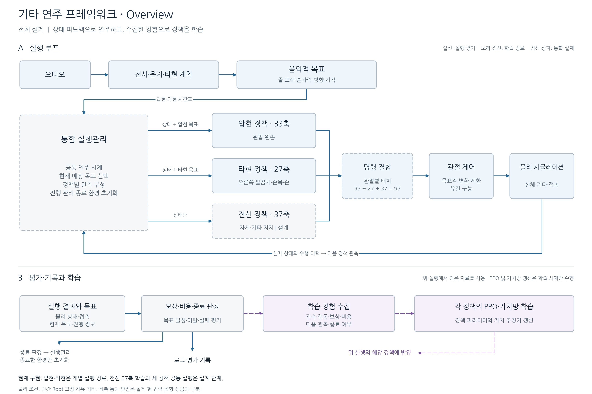

# 프레임워크 그림

## 세 정책 전체 설계 — 압현 v5 기준

[PNG](framework_overview_v5.png) · [SVG](framework_overview_v5.svg) · [PDF](framework_overview_v5.pdf)

이 그림은 완성하려는 전체 프레임워크의 설계이며, 세 정책의 공동 실행이나 연주 성공을 보고하는 실험 결과가 아니다. 기존 그림을 보존하고 별도 이름으로 작성했다.

1. 오디오의 전사·운지·타현 계획에서 압현과 타현의 시간표를 만든다. 합성 목표를 사용할 때에는 오디오 처리 없이 같은 종류의 목표를 직접 제공할 수 있다.
2. 통합 실행관리는 공통 연주 시계와 실제 상태·수행 이력을 바탕으로 정책별 관측을 구성한다. 압현과 타현은 상태와 목표를 받고, 전신 정책은 상태만 받는다. 이 관리 기능 자체를 또 하나의 학습 정책으로 정의하는 것은 아니다.
3. 세 정책의 출력은 담당 관절에 배치한다. 압현 33축, 타현 27축, 전신 37축의 소유권은 서로 겹치지 않는다. 목표각 변환·범위 제한·유한 구동을 거쳐 물리가 진행되며, 실제로 움직인 상태가 다음 관측으로 돌아온다.
4. 물리 결과를 목표와 비교하여 보상·비용·종료를 판정한다. 로그는 기록·평가에 사용하고, 정상 종료 또는 실패한 환경만 초기화한다. 학습 경험 수집 구간이 끝났다는 이유로 환경을 초기화하지 않는다.
5. 학습 시에는 관측·행동·보상·비용·다음 관측·종료 여부를 수집해 각 정책의 PPO와 가치망을 갱신한다. 그림의 학습 블록은 역할을 묶어 표현한 것으로, 세 정책이 하나의 가치망을 공유하거나 공동 PPO가 구현됐음을 뜻하지 않는다. 평가 실행에서는 정책 파라미터를 갱신하지 않는다.

실선은 실행·평가, 보라색 점선은 학습 경로다. 점선 상자는 아직 통합 설계에 해당한다. 압현과 타현의 개별 학습 경로는 구현되어 있지만 전신 37축 학습과 세 정책 공동 실행은 후속 구현이다. 현재 물리는 인간 Root 고정·자유 기타 조건이며 접촉·통과 성공과 실제 현 압력·음향 성공을 구분한다.

구현 근거는 [Overview](../01_overview.md), [Model](../02_model.md), [Method](../03_method.md)를 따른다. 그림 재생성 원본은 [render_overview.py](../tools/render_overview.py)이며 프로젝트 루트에서 `python paper/framework/tools/render_overview.py`로 PNG·SVG·PDF를 생성한다.

## 보존한 과거 그림의 용도

이 디렉토리의 PNG·SVG·PDF와 [provenance.json](provenance.json)은 이전 framework 작성 자료로 그대로 보존한다. 이번 2026-11-04 문서 재작성에서는 TXT와 함께 기존 매체의 내용을 변경하지 않았다.

| 자료 | 원래 범위 | 새 문서에서의 사용 조건 |
| --- | --- | --- |
| [framework_overview.png](framework_overview.png), [SVG](framework_overview.svg), [PDF](framework_overview.pdf) | 2026-11-02 기준 오디오·운지·기본 왼손 제어 흐름 | 과거 개념도. 현재 v5·스트럼·37축 전신 설계의 완성된 도식으로 사용하지 않음 |
| [control_loop.png](control_loop.png), [SVG](control_loop.svg), [PDF](control_loop.pdf) | 기존 왼손 및 지지 제어 흐름 | 60Hz 정책·240Hz 물리의 설명 자료. 현재 네트워크·관절 분할의 정본은 새 Model을 따름 |
| [scene_v9_recorded_5s.png](scene_v9_recorded_5s.png) | 준비 자세 v9의 실제 물리 화면 | 초기 배치 설명 자료. 학습 정책의 연주 성공·자유 균형 결과가 아님 |

준비 자세 화면의 원본은 [adjusted_full.png](../../../docs/2026-11-02/압현성공/initial_pose/초기자세_v9/native_images/adjusted_full.png)이며, 조건은 [원래 README](../../../docs/2026-11-02/압현성공/initial_pose/초기자세_v9/README.md)를 따른다. 출처 기록의 기존 SHA를 유지한다.

새 전체 프레임워크의 개념도는 [Overview](../01_overview.md)에 편집 가능한 Mermaid로 작성했다. 그림 캡션에서 전체 설계와 현재 구현을 구분한다. 새 성능 그래프나 연주 영상은 실제 실행 입력·모델·평가 로그를 확보한 뒤 추가한다.
