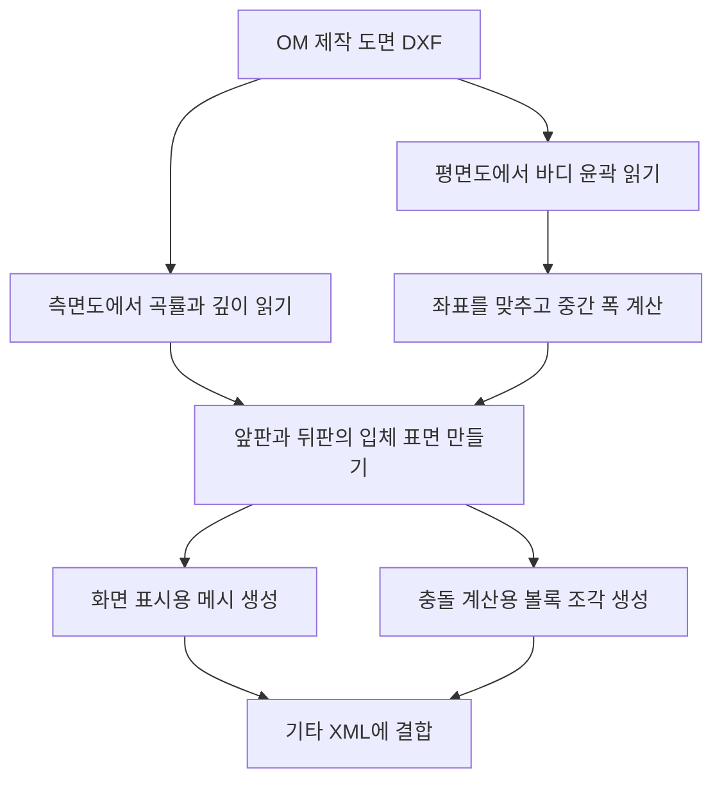

# 기타의 설계와 사양

## 모델 구성

이 연구에서는 캐릭터가 기타를 몸으로 받치고, 손으로 줄과 프렛에 접근하는 과정을 시뮬레이션한다. 이를 위해 기타의 **겉모양**, **몸이나 손과 부딪히는 형상**, **연주 위치를 판단하는 기준점**을 각각 정의한다.

현재 사용하는 모델 파일은 `om_body_geometry_v3/guitar_asset.xml`이다. 기타는 바디, 넥, 헤드, 너트, 22개의 프렛과 6현의 위치를 나타내는 마커로 구성된다. 마커는 줄의 위치를 계산할 때 사용하는 기준점이다.

바디의 겉모양은 Christophe Grellier의 *Acoustic guitar — Orchestra Model* 제작 도면을 바탕으로 만들었다. 위에서 본 도면에서는 바디의 윤곽을, 옆에서 본 도면에서는 깊이와 앞판·뒤판의 휘어진 정도를 읽었다. 넥·헤드·프렛·마커는 별도의 형상과 위치 정보로 정의되어 있다. 따라서 기타 전체를 하나의 실물에서 스캔한 모델은 아니다.

기타는 힘을 받아 움직이고 회전할 수 있지만, 바디 자체가 휘어지지는 않는 강체로 다룬다. 바디 표면은 빈틈없이 닫힌 형상으로 만든다. 실제 기타 내부의 보강대인 브레이싱, 목재 판의 두께, 속이 빈 구조, 탄성 변형과 소리 발생은 모델에 포함하지 않는다.


위 그림은 바디의 표면을 작은 삼각형으로 표현한 **메시(mesh)**를 보여준다. 정면·측면·사선에서 외형을 확인할 수 있으며, 캐릭터와 실제로 어디에서 접촉하는지는 시뮬레이션 실행 결과에서 확인한다.

## 제작 도면을 3차원 바디로 만드는 과정

전체 과정은 **평면 윤곽을 읽고 → 앞뒤 깊이를 붙여 입체 표면을 만들고 → 화면 표시용과 충돌 계산용 모델을 만드는 것**이다.

입력은 선과 곡선의 좌표가 저장된 DXF 도면이다. 평면도에서 바디의 폭과 길이를 구하고, 측면도에서 앞판·뒤판의 곡률과 깊이를 구한다. 이후 두 정보를 하나의 좌표계에 맞춘다. 도면에 없는 중간 부분은 보간으로 채우고, 좌우 대칭이나 곡면 모양에 관한 가정을 적용한다. 각 단계에서 도면으로부터 읽은 정보와 추가한 가정을 함께 설명한다.



### 1. 평면도에서 바디의 테두리 읽기

먼저 위에서 본 기타 바디의 테두리를 가져온다. [원본 DXF](../../docs/2026-10-12/stability_adapter_2/results/om_body_outline_v1/OM_acoustic_guitar.dxf)는 밀리미터 단위의 제작 도면이다. `ezdxf`라는 도구로 파일을 읽고, 브레이싱 배치가 그려진 평면도에서 바디의 바깥 테두리에 해당하는 16개의 `SPLINE` 요소를 선택한다. `SPLINE`은 부드러운 곡선을 표현하는 도면 요소다.

각 요소는 handle이라는 고유 번호로 구분한다. 여기서는 도면을 해석한 뒤 바디 테두리에 해당하는 번호를 미리 지정했다. 따라서 새로운 도면을 넣으면 바디를 자동으로 찾아내는 방식은 아니다. 선택한 곡선은 다음 순서로 연결한다.

```text
AE → AF → B0 → 7BC → B1 → B2 → B3 → B4
   → 2F6 → 2F5 → 2F4 → 2F3 → 2F2 → 2F1 → 2F0 → 2EF
```

컴퓨터에서 테두리를 계산할 수 있도록 각 곡선을 여러 점으로 바꾼다. 이때 사용하는 호출은 `make_path(...).flattening(0.02)`이며, `0.02 mm`는 곡선을 선분으로 근사할 때 사용하는 허용값이다. `2F`로 시작하는 요소들은 점의 순서를 뒤집어, 모든 곡선이 테두리를 같은 방향으로 따라가도록 맞춘다.

곡선과 곡선 사이의 최대 연결 간격은 약 `1.42 × 10⁻¹⁴ mm`로, 수치 계산의 정밀도 수준이다. 마지막 점과 첫 점 사이에는 약 `0.016934 mm`의 작은 간격이 남는다. 첫 점을 배열 끝에 한 번 더 추가해 윤곽을 닫으며, 이 닫힘 점까지 포함한 좌표 수는 449개다.

결과에는 윤곽 좌표와 함께 선택한 요소 번호, 좌표의 범위, 연결 간격을 저장한다. 구현은 [윤곽 추출 스크립트](/home/ajou/yigyu/3/archive/legacy_guitar_20261019/stability_adapter_2/extract_om_body_outline_v1.py), 결과는 [윤곽 추출 자료](./evidence/guitar_outline.json)에서 확인할 수 있다.

### 2. 좌표를 맞추고 위치별 바디 폭 계산하기

도면의 좌표 방향을 시뮬레이션에서 사용하는 기타의 방향에 맞춘다. 도면에서는 넥 방향이 +X이지만, 기타 모델에서는 넥 방향을 로컬 +Y로 사용한다. 여기서 **로컬 좌표**란 기타에 붙어 함께 움직이는 좌표를 뜻한다.

축을 교환한 뒤, 평면 윤곽을 감싸는 직사각형의 중심을 원점으로 옮긴다. 이 직사각형을 bounding box라고 한다. 길이 단위도 밀리미터에서 미터로 바꾼다. 도면 좌표를 `(X_D, Y_D)`, 바디 평면 좌표를 `(x_B, y_B)`라고 하면 변환식은 다음과 같다.

\[
x_B = \frac{Y_D-c_Y}{1000}, \qquad
 y_B = \frac{X_D-c_X}{1000}.
\]

즉, 도면의 중심 좌표를 빼고 축을 바꾼 다음 1000으로 나누는 과정이다. 중심 좌표는 `(c_X, c_Y) ≈ (785.762100, −263.689033) mm`다. 변환 후 바디의 길이는 `491.957431 mm`, 최대 폭은 `380.632046 mm`다. 단위와 기준 위치만 바꾸며, 도면의 실제 크기를 확대하거나 축소하지 않는다.

다음으로 바디의 각 길이 위치에서 폭이 얼마나 되는지 계산한다. 길이 방향 위치를 `y`, 그 위치에서 바디 폭의 절반을 `w(y)`라고 둔다. 추출한 윤곽에서 같은 `y`를 갖는 점들의 `|x|` 최댓값을 반폭으로 사용한다. 점과 점 사이의 반폭은 PCHIP라는 곡선 보간 방법으로 이어 계산한다. PCHIP의 정식 이름은 piecewise cubic Hermite interpolation이다.

각 단면의 왼쪽 끝은 `−w(y)`, 오른쪽 끝은 `+w(y)`로 정한다. 따라서 최종 바디는 **추출한 윤곽을 바탕으로 중간 폭을 보간하고 좌우 대칭을 적용한 형상**이다. 원래 도면의 모든 미세한 비대칭까지 그대로 유지하는 방식은 아니다.

### 3. 측면도에서 바디의 깊이와 휘어진 정도 읽기

평면 윤곽만으로는 바디의 깊이를 알 수 없다. 이 정보는 옆에서 본 도면에서 가져온다. 앞판과 뒤판을 나타내는 원호에서는 곡률 반지름을 읽고, 넥 쪽과 꼬리 쪽 끝단의 선분에서는 앞뒤 깊이를 읽는다. 곡률 반지름이 클수록 표면은 완만하게 휘어진다.

| 도면 요소 | Handle | 읽어낸 정보 |
|---|---|---|
| 앞판의 길이 방향 원호 | `2FCE` | 반지름 7,620 mm |
| 뒤판의 길이 방향 원호 | `2EF2` | 반지름 4,572 mm |
| 꼬리 쪽 끝단 선분 | `64` | 깊이 104.000 mm |
| 넥 쪽 끝단 선분 | `63` | 깊이 약 85.001714 mm |

측면도에서 바디의 길이 구간은 `30~521 mm`로, 길이는 491 mm다. 평면도에서 읽은 길이와 약 `0.957431 mm` 차이가 난다. 두 도면의 넥 쪽 끝과 꼬리 쪽 끝이 각각 대응하도록 길이 위치를 비례 변환한다.

평면 바디의 양 끝을 `y_min`, `y_max`, 이에 대응하는 측면도의 길이 좌표를 `s(y)`라고 하면 다음과 같다. 아래 식은 미터 단위다.

\[
s(y)=0.030+0.491\frac{y-y_{\min}}{y_{\max}-y_{\min}}.
\]

이 식은 평면도의 한쪽 끝을 측면도의 30 mm 위치에, 반대쪽 끝을 521 mm 위치에 맞춘다. 중간 위치도 같은 비율로 대응시킨다. 바디의 평면 길이와 폭은 유지하면서, 깊이를 어느 위치에서 읽을지만 맞추는 것이다.

앞판 원호는 지판 아래의 넥 연결부까지 같은 반지름으로 연장하여 계산한다. 원호에서 계산한 넥 끝의 깊이는 약 85.000 mm로, 끝단 선분에서 직접 읽은 85.001714 mm와 조금 다르다.

구현은 [깊이 추출 스크립트](/home/ajou/yigyu/3/archive/legacy_guitar_20261019/stability_adapter_2/extract_om_depth_v1.py), 원호의 중심·반지름과 끝단 정보는 [측면 깊이 자료](./evidence/guitar_depth.json)에 있다.

### 4. 앞판과 뒤판을 입체 표면으로 만들기

측면도는 길이 방향으로 표면이 어떻게 휘어지는지 알려준다. 하지만 바디의 가운데에서 옆 가장자리로 갈 때 표면이 어떻게 휘어지는지는 이 정보만으로 정해지지 않는다. 이를 채우기 위해 앞판과 뒤판을 각각 **큰 구의 표면 일부처럼 완만하게 휜 면**으로 근사한다. 폭 방향에도 길이 방향과 같은 곡률 반지름을 적용하는 것이다. 이 구면 근사는 2차원 도면을 3차원 표면으로 만들기 위해 추가한 가정이다.

측면도 원호의 중심을 앞판 `(s_f, z_f^c)`, 뒤판 `(s_b, z_b^c)`로 쓰고, 반지름을 각각 `R_f = 7.620 m`, `R_b = 4.572 m`로 둔다. 바디의 평면 위치 `(x, y)`에서 앞판과 뒤판의 높이는 다음 식으로 계산한다. 모든 길이는 미터 단위다.

\[
z_{\mathrm{front}}(x,y)
=a+z_f^c+\sqrt{R_f^2-(s(y)-s_f)^2-x^2},
\]

\[
z_{\mathrm{back}}(x,y)
=a+z_b^c-\sqrt{R_b^2-(s(y)-s_b)^2-x^2}.
\]

두 식은 같은 평면 위치에 대해 앞판의 높이와 뒤판의 높이를 각각 구한다. `s(y)`는 앞 단계에서 맞춘 측면도 위치이며, `a`는 표면 전체를 Z 방향으로 옮기는 값이다. `a = 0.020 − (z_f^c + R_f)`로 설정하여 앞판 구면의 정점을 바디 로컬 Z의 20 mm 위치에 둔다. 계산하는 범위는 `y_min ≤ y ≤ y_max`, `−w(y) ≤ x ≤ w(y)`다.

같은 위치에서 앞판 높이에서 뒤판 높이를 빼면 그 지점의 바디 깊이가 된다. 이를 국소 깊이라고 하며, 식으로는 `z_front(x,y) − z_back(x,y)`다. 중심선 `x=0`에서 깊이는 꼬리 쪽 약 104 mm, 넥 쪽 약 85 mm이고, 양 끝 사이의 내부 구간에서 최대 약 107.198 mm가 된다. 앞판과 뒤판의 휘어진 정도와 중심이 달라 바디의 깊이도 위치마다 달라진다.

### 5. 화면에 보이는 바디 메시 만들기

계산한 앞판·뒤판 표면에 점을 배치하고, 점들을 삼각형으로 연결해 화면 표시용 메시를 만든다. 메시를 이루는 점을 정점이라고 한다.

먼저 길이 방향을 균일하게 나눈 247개 표본 위치와, 윤곽에서 얻은 서로 다른 `y` 위치를 합친다. 각 위치에서는 반폭 `w(y)`를 계산하고, 폭 방향에 `−1~1` 범위의 21개 비율을 사용해 점을 놓는다. 각 점의 가로 위치는 `x = w(y) × 비율`이며, 앞판과 뒤판의 높이는 앞 단계의 곡면식으로 구한다.

이웃한 정점들을 삼각형으로 연결해 앞판과 뒤판을 만든다. 여기에 좌우 측벽과 양 끝단을 이어 빈틈없는 외곽을 완성한다. 이후 면적이 없는 면, 중복 면, 사용되지 않는 정점을 제거하고, 각 면이 바깥을 향하도록 방향을 정리한다. 마지막으로 메시가 빈틈없이 닫혀 있는지(`is_watertight`), 유효한 부피를 갖는지(`is_volume`), 계산된 부피가 양수인지 확인한다.

완성된 `body_visual.obj`는 **정점 19,364개와 삼각형 면 38,724개**로 구성된다. XML에서는 이 메시를 화면 표시용으로 등록한다. `contype=0`, `conaffinity=0`, `density=0`을 지정해 이 메시가 접촉이나 질량 계산에 참여하지 않도록 한다.

### 6. 충돌을 계산할 바디 형상 만들기

캐릭터의 손이나 몸이 기타에 닿는지는 별도의 충돌 형상으로 계산한다. 기타 바디는 허리 부분이 안쪽으로 들어가 있으므로, 여러 개의 볼록한 조각으로 나누어 표현한다. 각 조각은 점들을 바깥에서 팽팽하게 감싼 모양인 **볼록 껍질(convex hull)**로 만든다.

하나의 볼록 껍질로 기타 전체를 감싸면 오목한 허리 부분까지 메워질 수 있다. 이를 줄이기 위해 길이 방향으로 나누고, 윤곽과 차이가 큰 구간은 더 잘게 나눈다.

1. 바디의 길이 방향을 처음에는 24개 구간으로 나눈다.
2. 각 구간에서 길이 방향 9개 위치와 폭 방향 9개 비율을 사용해 앞판·뒤판의 점들을 만든다.
3. 이 점들을 XY 평면에서 감싸는 볼록 껍질을 구한다. 구간 안의 101개 길이 위치에서 이 껍질의 반폭과 목표 반폭 `w(y)`를 비교한다.
4. 껍질이 목표보다 바깥으로 튀어나온 오차와 안쪽으로 줄어든 오차를 구한다. 둘 중 큰 값이 0.5 mm를 넘고 구간 길이가 1 mm보다 크면, 그 구간을 절반으로 나누어 다시 계산한다.
5. 최종 구간마다 3차원 점들을 감싸는 볼록 껍질을 만든다. 각 조각이 닫혀 있고, 유효한 부피를 가지며, 볼록한지 검사한다. 면 방향도 정리한다.

최종 충돌 조각은 **63개**다. 파일 이름은 `body_collision_00.obj`부터 `body_collision_62.obj`까지다. 조각별 정점 수는 146~162개로, 생성 코드에서 정한 조각당 256개 이하 조건을 만족한다. 모든 최종 구간은 반폭 오차가 0.5 mm 이하인지 다시 확인한다.

검사 결과, 최대 외측 오차는 약 **0.494161 mm**, 최대 내측 오차는 약 **0.457272 mm**다. 이 값은 검사한 평면 위치에서 충돌 형상의 반폭이 목표 반폭과 얼마나 다른지를 뜻한다. 원본 도면 전체에 대한 3차원 오차나, 시뮬레이터가 읽어 변환한 뒤의 실제 접촉 간격을 측정한 값은 아니다.

화면 표시용·충돌용 메시의 생성과 XML 결합은 [바디 생성 스크립트](/home/ajou/yigyu/3/archive/legacy_guitar_20261019/stability_adapter_2/build_om_body_geometry_v3.py)에서 수행한다. 입력 파일을 식별하는 해시, 메시별 정점 수, 구간별 오차와 검사 결과는 [형상 manifest](./evidence/guitar_geometry_manifest.json)에 저장한다.

## 치수

다음 표는 바디와 기타 전체의 크기를 정리한 것이다. 바디의 앞뒤 깊이, 모델 전체를 감싸는 높이, 현 마커 사이의 길이는 측정 기준이 다르므로 각각 구분한다.

| 항목 | 값 | 측정 기준 |
|---|---:|---|
| 바디 길이 | 491.957 mm | 평면 윤곽의 넥 연결부부터 꼬리까지 |
| 최대 바디 폭 | 380.632 mm | 평면 윤곽에서 가장 넓은 가로 폭 |
| 바디 중심선의 깊이 | 약 85.000~107.198 mm | `x=0`인 같은 위치에서 앞판과 뒤판 사이의 깊이 |
| 전체 바디 메시의 Z 범위 | 108.476 mm | 메시 전체에서 가장 높은 Z와 가장 낮은 Z의 차이 |
| 기타 전체 길이 | 1,004.328 mm | 헤드부터 바디 꼬리까지의 외형 길이 |
| 6현 시작–끝 마커 길이 | 약 620.0~625.6 mm | 각 현의 두 기준점 사이 거리 |
| 앞판 곡률 반지름 | 7.620 m | 앞판을 만들 때 사용한 도면 원호의 반지름 |
| 뒤판 곡률 반지름 | 4.572 m | 뒤판을 만들 때 사용한 도면 원호의 반지름 |

예를 들어 중심선의 깊이는 같은 위치에서 앞판과 뒤판 사이를 잰 값이다. 반면 메시 전체의 Z 범위는 서로 다른 위치에 있는 최고점과 최저점을 사용할 수 있다. 따라서 두 값이 같을 필요는 없다. 현 마커 사이 거리는 연주 판정에 쓰는 기준점 사이의 길이이며, 실물 기타에서 진동하는 현의 길이를 실측한 값은 아니다.

## 기타의 움직임과 연주 위치 판정

XML에는 `body` 선언이 39개 있고, 내부 관절은 0개다. 여기서 `body`는 XML에서 부위와 기준 좌표를 정의하는 항목이며, 기타의 울림통을 뜻하는 일상적인 ‘바디’와 구분한다. 바디·넥·프렛·마커 사이의 상대 위치와 방향은 고정되어 있어 기타의 일부가 관절처럼 따로 움직이지 않는다.

기타 전체는 공간에서 자유롭게 움직일 수 있다. 실행 시 `fix_base_link=False`로 기타 객체(actor)를 생성하기 때문이다. 이 설정으로 기타는 세계 좌표의 세 방향으로 이동하고 세 축으로 회전하는 6자유도를 갖는다. **부품 사이의 관계는 고정되어 있지만, 기타 전체의 위치와 회전은 고정되어 있지 않다.**

연주 위치는 `G:string1`부터 `G:string6`, 각각의 `*_end` 마커, 프렛 및 타현 판정 영역으로 정의한다. 이 좌표들은 기타에 붙어 있으므로 기타가 움직이면 함께 이동한다. 손과 이 기준점들 사이의 상대 위치를 계산하면, 움직이는 기타에서도 손이 목표 줄이나 프렛에 제대로 접근했는지 평가할 수 있다. 기준 실행에서는 `G:thumb_support_proxy`와 `G:pluck_range`를 충돌 필터로 제외해 물리 접촉 대상으로 사용하지 않는다.

영상에는 각 현의 양 끝 마커를 연결한 두께 2 px의 선을 6개 그린다. 시뮬레이터의 깊이 영상을 사용해 손이나 다른 물체 뒤에 가려지는 부분을 처리한다. 이 선은 화면 표시만 추가하며 새로운 물리 형상을 만들지 않는다. XML에 있는 6개의 시각 캡슐도 현을 보여주기 위한 형상이며, 현의 탄성·진동·변형을 계산하지 않는다.

## 좌표계와 바디 중심

위치를 해석하려면 **기타 전체의 기준점**, **바디 메시의 기준점**, **외형의 중심**, **질량중심**을 구분해야 한다. 이 기준점들은 같은 위치에 있지 않다.

기타 전체 actor의 로컬 좌표계를 G, 바디 메시의 로컬 좌표계를 B라고 부른다. 두 좌표계의 축 방향은 같다. +Y는 넥·너트 쪽, −Y는 바디 꼬리 쪽, X는 폭 방향, +Z는 현이 있는 앞판 쪽을 향한다. 이 축들은 기타에 붙어 함께 회전하므로, 세계 좌표에서 어느 방향을 향하는지는 현재 기타의 회전에 따라 달라진다.

B의 원점, 즉 `G:body`의 위치는 G 좌표에서 `[0, −0.4, −0.0217] m`다. 바디 메시를 감싸는 상자(bounding box)의 중심은 G 좌표에서 약 `[0, −0.4, −0.055938] m`다. 이 상자의 중심은 외형을 기준으로 계산한 중심으로, `G:body` 원점이나 질량 분포로 결정되는 질량중심과 다르다. 앞판의 최대 높이는 G의 Z 좌표에서 약 −1.7 mm다.

바디 중심이 세계 공간에서 어디에 있는지 구하려면, 먼저 기타 원점에서 바디 중심까지의 상대 위치를 기타의 회전만큼 돌린다. 그다음 기타 원점의 세계 위치를 더한다. 따라서 기타가 회전하면 actor 원점의 위치가 같더라도 바디 중심의 세계 위치는 달라질 수 있다. 바디 중심의 움직임을 평가할 때 두 기준점의 차이를 반영하는 이유다.

## 질량·질량중심·관성

질량은 기타의 전체 운동에, 질량중심은 질량이 분포한 중심 위치에, 관성은 회전 운동에 관련된 값이다. 특히 관성은 같은 질량이라도 질량이 어느 위치에 분포하는지에 따라 달라진다.

아래 값은 기준 실행 `left_neck_near_initial_v1/native_hold_v4`에서 시뮬레이터에 실제 적용된 값을 읽어 저장한 결과다. 각 body의 질량에는 지정한 값을 적용한다. 질량중심은 모델을 불러오는 과정에서 형상을 바탕으로 계산한 값을 사용한다.

관성도 모델을 불러올 때 계산한 값을 바탕으로 하되, 질량을 지정값으로 바꾼 비율만큼 조정한다. 이를 식으로 쓰면 다음과 같다.

\[
I_{\mathrm{applied}}
=\frac{m_{\mathrm{specified}}}{m_{\mathrm{imported}}}
I_{\mathrm{imported}}.
\]

여기서 `imported`는 모델을 불러왔을 때의 값, `specified`는 지정한 질량, `applied`는 실행에 적용한 관성을 뜻한다. 즉, 질량을 바꿀 때 관성도 같은 비율로 바꾼다.

| 항목 | 저장된 적용값 |
|---|---|
| 기타 body 전체 질량 합계 | 4.648715728 kg |
| `G:body` 질량 | 4.080000401 kg |
| `G:body` 질량중심 | body 원점 기준 약 `[−0.06077, −19.40407, −32.31619] mm` |
| 질량중심 기준 관성 대각 성분 | 약 `[0.0751244, 0.0372464, 0.1054055] kg·m²` |

관성은 여러 방향의 회전 특성을 표현하는 행렬인 관성 텐서로 저장한다. 표에는 그 대각 성분만 적었으며, 비대각 성분도 존재한다. 전체 행렬과 body별 속성은 [실행에서 읽은 기타 물성](./evidence/guitar_native_properties.json)에 있다.

XML의 충돌 형상에는 밀도 1,000 kg/m³가 지정되어 있지만, 이는 모델을 불러올 때 사용하는 설정이다. 최종 질량은 위의 지정 질량 규칙을 따른다. 이 물성은 시뮬레이션에 적용한 값이며, 실제 속이 빈 목재 기타의 질량 분포를 측정한 값은 아니다.

스트랩은 기타 메시와 별도로 힘을 계산해 적용하는 모델이다. 위 표의 기준 실행에서는 스트랩이 꺼져 있다. 스트랩을 사용하는 실험을 설명할 때는 길이·장력 설정과 접촉 마찰 등 해당 실행의 조건도 함께 제시해야 한다.

## 파일과 출처

| 자료 | 경로 |
|---|---|
| 원저자 공식 도면 배포 페이지 | [Christophe Grellier — Downloads](https://www.grellier.fr/en/downloads) — **OM size acoustic guitar** 항목에서 PDF와 DXF 제공 |
| 현재 기타 XML 사본 | [문서용 기타 자산](./models/stability_adapter_2/assets/om_body_geometry_v3/guitar_asset.xml) |
| 실행에 사용하는 기타 XML | [OM 기타 자산](/home/ajou/yigyu/3/guitar_learning/assets/stability_adapter_2/assets/om_body_geometry_v3/guitar_asset.xml) |
| 원본 제작 도면 | [OM DXF](../../docs/2026-10-12/stability_adapter_2/results/om_body_outline_v1/OM_acoustic_guitar.dxf) |
| 평면 윤곽 추출 결과 | [윤곽 좌표와 연결 검사](./evidence/guitar_outline.json) |
| 측면 깊이 추출 결과 | [원호와 깊이 자료](./evidence/guitar_depth.json) |
| 형상 생성 및 검사 기록 | [형상 manifest](./evidence/guitar_geometry_manifest.json) |
| 실행에서 읽은 물성 | [질량·질량중심·관성](./evidence/guitar_native_properties.json) |
| 도면·파생 메시 출처 및 이용 조건 | [Attribution](./evidence/guitar_ATTRIBUTION.md) |

도면의 저자는 Christophe Grellier이며, 사용한 자료는 *Acoustic guitar — Orchestra Model*, version 1.1, 2007/2008 표기의 제작 도면이다. 도면과 파생 바디 메시의 출처 및 이용 조건은 위 Attribution 파일에 기록되어 있다.
